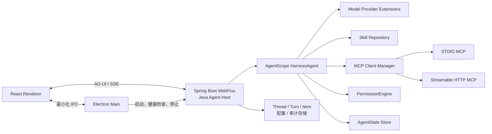

# Java 版 Codex Desktop：一期最终架构方案

#AI #Agent #Codex #MCP #Skills #Java

## 1. 决策结论

一期构建一个本地优先的 Agent 桌面应用，产品工作名为 **iWork**，首发平台固定为 Windows x64。采用 **AgentScope Java `HarnessAgent` 作为 Java 版 Codex App Server 内核**，以结构化 Tool Calling 实现 ReAct，并由 Electron/React 提供桌面交互。首个实现固定使用官方当前可用的 `1.1.0-RC2`，待稳定版发布并完成回归测试后升级；macOS/Linux 仍是后续目标，不属于一期验收。

核心原则：

- Java 负责 Agent Runtime、ReAct、MCP、Skills、权限、会话和持久化。
- React/TypeScript 负责聊天、流式展示、工具卡片、MCP/Skill 管理和审批交互。
- Agent 与 UI 通过 AG-UI/SSE 交互；Electron 只提供受限的桌面能力和 Java Host 生命周期管理。
- MCP、Skill、文件访问、命令执行均属于不可信能力，按最小权限和显式审批执行。
- 一期不自研传统文本 ReAct 解析器，不暴露原始思维链，不引入多 Agent 编排、RAG、插件市场或 Computer Use。

## 2. 最终技术选型

| 层次 | 技术 | 职责 |
| --- | --- | --- |
| 桌面壳 | Electron | 应用窗口、升级、受限 IPC、启动和监控 Java Host |
| 前端 | React + TypeScript + Vite | Chat、Tool Card、Approval Card、设置和资源管理页面 |
| 本地服务 | Spring Boot WebFlux（Java 21） | AG-UI SSE、REST 配置 API、取消与状态管理 |
| Agent 内核 | AgentScope Java `HarnessAgent`（首版 `1.1.0-RC2`） | ReAct、状态、会话、上下文压缩、Skill、权限和事件流 |
| 模型调用 | AgentScope Provider Extensions | OpenAI、DeepSeek、DashScope、Anthropic、Gemini、Ollama 等模型适配 |
| Agent ↔ UI | AG-UI | 流式文本、工具调用、状态变更、暂停审批、取消 |
| Agent ↔ Tools | MCP Java SDK（由 AgentScope 接入） | STDIO、Streamable HTTP MCP Server 和 Tool 生命周期 |
| Skills | Agent Skills `SKILL.md` 开放规范 | 发现、渐进加载、资源读取和绑定 Tool Group |
| 本地数据 | H2 或 SQLite + JSONL 审计日志 | 对话索引、配置、MCP、Skill、运行事件和审计 |
| 密钥 | Electron `safeStorage` + Java 内存注入 | 不以明文写入配置、数据库或日志 |
| 安装包 | electron-builder + 精简 JRE | Windows/macOS/Linux 平台安装包 |

## 3. 总体架构



### 3.1 运行时职责

- **Electron Main**：生成本次启动的能力令牌，启动 Java Host，监听健康状态，向 Renderer 暴露白名单 IPC。
- **Java Agent Host**：暴露 AG-UI 流、管理 Thread/Turn/Item、转换前端审批结果、持久化运行事件。
- **HarnessAgent**：执行 ReAct 循环；管理上下文、工具、Skill、权限、暂停与恢复。
- **MCP Client Manager**：读取配置、启动或连接 MCP、同步 Tool、保留 stderr/连接状态、超时重连。
- **React Renderer**：渲染消息、Agent 状态、工具执行和审批；不直接拥有操作系统能力。

## 4. ReAct 实现规范

ReAct 使用模型原生的结构化 Tool Calling，不解析 `Thought/Action/Observation` 文本。

```text
用户消息
  → 读取当前 Thread 上下文、Skill 元数据和可用 Tool
  → 模型流式响应
  → 无 ToolCall：保存最终 AgentMessage，完成 Turn
  → 有 ToolCall：进入权限判断
      → ALLOW：执行 Tool，追加 ToolResult，进入下一轮
      → ASK：保存 Approval，暂停 Turn，等待用户决策后恢复
      → DENY：生成拒绝结果并返回模型观察，进入下一轮
```

约束：

- 默认最大迭代次数：10；达到上限时生成可解释的终止结果。
- 每个 Tool 都有超时、重试策略和结果大小上限。
- Tool Result 超出上下文预算时保存为工件，只将摘要和引用送回模型。
- 用户可取消在运行中的 Turn；取消后持久化已产生事件。
- UI 只展示状态、计划摘要、工具调用和结果，不展示原始 Chain of Thought。

## 5. 一期功能范围

### 5.1 Chat

- 新建、恢复、重命名、归档/恢复和历史会话搜索；会话列表可折叠，摘要取最近一条可见用户消息的有界文本，不调用模型额外生成。
- 同一 Thread 的后续 Turn 必须携带有界的完整用户/助手可见上下文，支持“上面内容”一类连续指代；不把未完成助手消息、原始 reasoning 或系统审计项送回模型。
- Markdown、GFM、代码块和流式文本；最终输出位于本轮执行调用链之后，调用链整体及每一步 Tool Card 均可折叠。
- 停止、重试、运行中 steering。
- Tool Card：参数、状态、耗时、结果摘要和错误。
- Approval Card：允许一次、当前会话允许、拒绝。
- 输入区提供“请求批准”和“帮我批准”两种单轮授权体验；后者只自动提交 `ALLOW_ONCE`，不能绕过硬拒绝、根目录、Schema、哈希、解释器和安全策略。
- 模型/Provider 选择。
- 应用重启后的会话恢复。
- Tool 成功生成的 Word、Excel、HTML 和 Markdown 作为结构化输出物显示在结果末尾，支持默认应用打开、打开文件夹、另存为和右侧安全预览；预览栏可收起，也可在不遮挡左侧导航的范围内覆盖对话区展开。

### 5.2 Skills

- 用户级与工作区级 Skill 路径。
- `SKILL.md` 发现、启停、刷新和查看。
- 显式选择与依据 `description` 的隐式激活。
- 渐进披露：初始上下文只注入名称与描述；按需加载 `SKILL.md` 与资源。
- 使用标准 kebab-case Skill 名称，并加入兼容性校验。
- 用户显式确认后，可从本地目录或公开 GitHub 仓库导入标准 Skill；安装来源、固定 commit 与内容 hash 可追溯。
- `SKILL.md` 声明的执行前参考资料必须在调用业务 Tool 前按需读取，例如 `references/default-information.md`；Tool 动态选项不可用时不得跳过 Skill 已声明的默认值。
- Skill 内固定 PowerShell、Python 3 和 JavaScript 脚本可在受控执行器中运行；脚本必须来自已激活 Skill 或已批准工作区、固定 SHA-256、使用应用选择的可信解释器、清空并重建最小环境、限制参数/时间/输出/工作目录，并经过统一审批。Skill 文本和 `allowed-tools` 本身不授予执行权。

### 5.3 MCP

- 支持 STDIO 与 Streamable HTTP。
- 支持 Bearer Token；OAuth 置于 1.1。
- Server 启停、健康检查、断线重连和 stderr 日志。
- Tool 白名单/黑名单、启停、超时与审批。
- 显式配置工作目录、允许转发的环境变量和文件根目录。

## 6. 数据与事件模型

```text
Thread
  └── Turn
       └── Item
            ├── UserMessage
            ├── AgentMessage
            ├── ToolCall
            ├── ToolResult
            ├── Approval
            ├── Status
            └── Error
```

- `Thread` 是用户可见的会话。
- `Turn` 是一次用户请求及其 Agent 工作过程。
- `Item` 是可重放、可审计的最小事件单元。
- UI 状态由 Item 流重建；不能只保存最终文本。
- AgentScope `AgentState` 管理模型上下文；应用存储管理会话元数据和事件时间线，二者职责分离。

## 7. 安全边界（强制）

### 7.1 桌面与密钥

- Electron Renderer 禁用 Node Integration，开启 `contextIsolation` 与 sandbox。
- Renderer 通过 preload 使用严格白名单 IPC，不直接执行命令或读写文件。
- Java Host 仅绑定 `127.0.0.1` 随机端口。
- Electron 每次启动生成高熵能力令牌；Java Host 仅接受携带该令牌的请求。
- API Key 使用操作系统安全存储加密保管，仅在运行时注入 Java 内存。
- 禁止将密钥放入命令行、普通配置、数据库、Skill Metadata、Tool 参数和日志。

### 7.2 Tool、MCP 与文件系统

- Tool 权限统一分为读取、写入、执行、网络四类。
- 写文件、删除/移动文件、执行命令、发送外部消息和对外写操作默认 `ASK`。
- MCP STDIO 只允许显式 `executable + args`，禁止拼接 shell 字符串。
- 工作目录与文件根目录必须预先声明；所有文件路径需规范化并验证仍在允许根目录中。
- MCP 和 Skill 都视为不可信来源；只能使用显式允许的环境变量。
- 审计日志记录权限决策和工具摘要，但必须脱敏 Token、Cookie、Authorization 和私有数据。
- Renderer 只能持有 `{rootId, relativePath}` 形式的输出物引用，不能提交或获得任意绝对路径；Main 在每次预览、打开、定位和另存前重新规范化、验证文件仍位于已批准根目录，并限制类型与大小。
- DOCX/XLSX 预览只读取有界 ZIP/XML 条目；HTML 使用无脚本 sandbox 与收紧 CSP；预览失败不得退化为在 Renderer 中直接读取文件。

## 8. 产品交互与本地设置

- 左侧导航以 `iWork` 品牌呈现，提供搜索、侧边栏收起/展开、带图标且左对齐的“技能广场”“MCP服务”“模型配置”，会话列表支持折叠、重命名、归档/恢复。
- 右下角“设置”承载“常规”“归档会话”“关于版本”；“常规”至少包含默认工作区和最大迭代限制。默认工作区变更经原生目录选择器、规范化和读写能力检查后持久化，重启应用时同步默认文件根并使旧授权失效。
- 最大迭代限制默认 10，可配置范围 1～50，只影响下一次新 Turn 或重试，不能修改正在运行的 Turn；Host 仍执行同样的边界校验。
- UI 只显示安全摘要、稳定错误码和结构化工件元数据。会话摘要、Tool 参数摘要和输出物卡片不得泄漏绝对路径、密钥、完整 Tool 结果或 reasoning。

## 9. 仓库结构

```text
agent-desktop/
├── desktop-shell/          # Electron main / preload
├── desktop-ui/             # React + TypeScript
├── agent-host/             # Spring Boot WebFlux、AG-UI
├── agent-runtime/          # HarnessAgent 配置、权限、模型
├── agent-mcp/              # MCP 生命周期与配置
├── agent-persistence/      # Thread、Turn、Item、设置
├── skills/                 # 内置 Skills
└── integration-tests/      # ReAct/MCP/Skill/恢复测试
```

模块间仅通过明确的接口依赖。`agent-runtime` 不依赖 Electron 或 React；`desktop-ui` 不直接依赖数据库和模型 Provider。

## 10. 迭代路线与验收

| 阶段 | 交付内容 | 验收 |
| --- | --- | --- |
| 第 1 周 | Electron 启动 Host，AG-UI 流式聊天 | 可稳定完成一次流式会话并展示运行状态 |
| 第 2 周 | Thread/Turn/Item、停止、恢复 | 重启后可恢复会话与工具时间线 |
| 第 3 周 | STDIO/HTTP MCP、Tool Card | 可连接两类 MCP 并展示调用结果 |
| 第 4 周 | Skill 发现与渐进加载 | Skill 可显式、隐式触发，资源按需读取 |
| 第 5 周 | Skill 导入与安装 | 本地目录与公开 GitHub Skill 可预检、确认安装、追溯和回滚 |
| 第 6 周 | 权限审批与根目录控制 | 高风险操作均可暂停、批准或拒绝 |
| 第 7 周 | 打包、升级、崩溃恢复 | 可安装、升级，异常退出不丢失已持久化事件 |
| 第 8 周 | 核心兼容性、稳定性基线与受控内测 | 双 Provider 与双 MCP Transport 核心合同、Harness 单一 ReAct、取消/恢复/安全回归、2 小时稳定性基线和小范围内测通过 |
| 第 9 周 | 兼容扩面、长稳、反馈收敛与一期总验收 | Windows x64 设备/网络矩阵、真实 MCP/Skill 样本、8 小时以上长稳、P0/P1 清零并形成一期发布建议 |

一期完成条件：

1. 会话可创建、恢复、取消和重试。
2. Skill 可正确渐进加载。
3. STDIO 与 Streamable HTTP MCP 都可配置和调用。
4. 危险 Tool 会触发可恢复的人工审批。
5. 工具、错误、取消和权限决策均在 UI 和审计日志中可观察。
6. 不存在 Renderer 直接执行系统操作、密钥明文持久化或越界文件访问路径。

## 11. 明确不纳入一期

- 多 Agent Supervisor、A2A 和复杂 Graph 编排。
- RAG/向量库与知识库问答。
- MCP OAuth、Skill 市场、后台同步、无人值守自动安装和自动升级；用户确认的本地/公开 GitHub Skill 手动导入除外。
- 浏览器自动化、Computer Use、Shell 无审批执行。
- 云端多租户、分布式 Agent 状态与远程沙箱。

上述能力在一期验证完核心会话、Skill、MCP、ReAct 与安全模型后，再分阶段引入。

---
来源：2026-08-08 技术选型讨论；本文件为最终架构决策。
日期：2026-08-08
修订：2026-08-18，插入第 5 周 Skill 导入与安装，原第 5～8 周整体顺延一周。  
修订：2026-08-28，补充 iWork 交互、会话上下文与摘要、统一审批体验、受控 Python/JavaScript Skill 执行、结构化输出物与安全预览，并将第 8～9 周拆分为核心基线和一期收口两个明确阶段。
