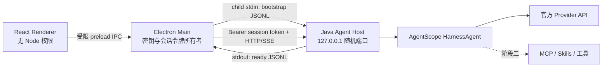
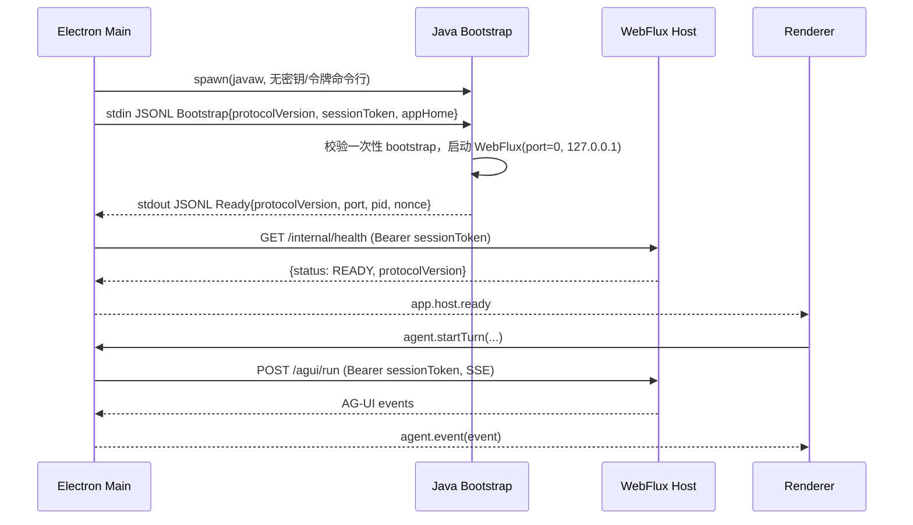
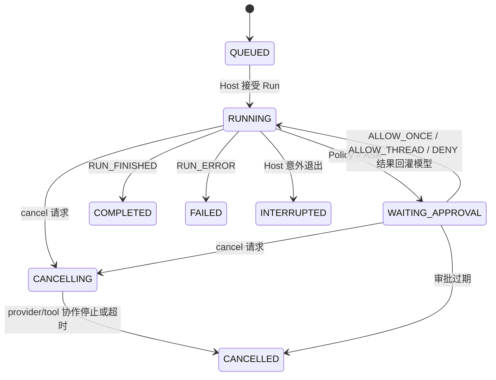

# 阶段一详细设计：本地 Runtime、AG-UI 与 Windows Desktop 通信

> 状态：已定稿，可作为阶段一开发基线  
> 关联方案：[一期最终架构方案](../FINAL_ARCHITECTURE.md)  
> 第 2 周执行设计：[Thread/Turn/Item、停止与恢复](WEEK_2_DETAILED_DESIGN.md)  
> 范围：启动 Host、流式 Chat、模型接入骨架、Thread/Turn/Item 持久化、取消与审批协议；不在本阶段交付完整 MCP/Skill 管理 UI。

## 0. 开工评估（2026-08-10）

阶段一开发输入已经充分：Java 21、Maven 3.9+、一期边界、Host 协议、事件模型、数据模型和验收标准均已确定，可以开始 P1-A～P1-C，并为 P1-D/P1-E 保留稳定接口。Provider 密钥只允许通过 Electron `safeStorage` 和一次性 IPC 注入 Host 内存，不得进入本文档、源码、Maven/Node 配置、环境变量、命令行、数据库或日志。

当前实现采用以下版本校正：

- AgentScope 官方当前可用的 Harness 版本固定为 `1.1.0-RC2`，不再使用并不存在的“AgentScope Java 2.0”制品版本；升级到稳定版必须通过回归测试。
- Qwen 产品档案显示名调整为“Qwen 3.7”。项目方提供的候选 `modelId` 为 `qwen3.7-flash`，但它必须通过目标账号与区域的 `/models` 或最小 Chat 请求校验后才可启用；不得静默替换为其他模型。
- Maven 中央仓库的网络/DNS 可达性属于构建环境前置条件，不改变代码设计；企业网络应通过 Maven `settings.xml` 配置受信镜像或代理。

## 1. 阶段目标与边界

阶段一要交付一个可安装、可运行的 Windows 桌面应用：用户可在本地创建会话，选择已配置的 DeepSeek 4 或 Qwen 3.7 官方 API 档案，得到可取消的流式回复；应用重启后会话仍可恢复。Runtime 与 UI 使用稳定的 AG-UI/SSE 事件契约，后续 MCP、Skills 和权限执行器只需沿用该契约扩展。

本阶段的“ReAct 就绪”表示 HarnessAgent、结构化 Tool Calling、审批和 Tool 事件的通路均已建模并以模拟工具验收；真实 MCP Server、Skill 发现及真实文件/命令工具放到下一阶段。不能通过解析 `Thought/Action/Observation` 文本来实现工具调用，也不向 UI 或持久化存储输出原始推理内容。

### 1.1 首发约束（固定）

| 项目 | 决策 |
| --- | --- |
| 平台 | 仅 Windows x64；按“当前用户安装”，不要求管理员权限。 |
| Agent 内核 | Java 21 + Spring Boot WebFlux + AgentScope Java `HarnessAgent`（首个实现固定 `1.1.0-RC2`）。 |
| 桌面端 | Electron Main + React/TypeScript Renderer；Renderer 无 Node/文件系统权限。 |
| 模型 | 仅官方在线 API；首批档案为 DeepSeek 4 与 Qwen 3.7；不下载、发现或运行本地模型。 |
| 网络 | 允许访问公网。模型调用属于受信任的 Provider 流量；MCP/工具发起的通用公网访问仍经过权限策略。 |
| 身份 | 本地单用户 Profile，无注册、登录、云同步或多用户切换。 |
| 默认工作区 | `%USERPROFILE%\\.agent-desktop\\workspace`，即 `C:\\Users\\<当前用户>\\.agent-desktop\\workspace`。 |

`%USERPROFILE%\\.agent-desktop` 是应用的独立用户目录；用户可在设置中另选 workspace，但不能把数据目录与 workspace 混为一处。

```text
%USERPROFILE%\.agent-desktop\
├─ workspace\                 # 默认 Agent 可见的项目根目录
├─ data\agent.db              # H2/SQLite 数据库（阶段一选 SQLite）
├─ secrets\                   # 仅 Electron safeStorage 密文；不由 Java 直接读文件
├─ logs\                      # 轮转日志，自动脱敏
├─ cache\
└─ skills\                    # 预留，阶段二启用
```

### 1.2 非目标

- 不做 macOS/Linux、本地推理、账号服务、团队共享、云端同步和自动更新。
- 不做真实文件写入、Shell、浏览器自动化、MCP 管理页面或 Skills 执行；仅保留协议和模拟工具验证。
- 不承诺跨会话保留供应商的原始 reasoning 内容；会话上下文只使用用户可见消息、工具调用及工具结果摘要。

## 2. 关键技术决定

### 2.1 Provider 档案而非硬编码模型名

DeepSeek 官方当前模型列表包含 `deepseek-v4-pro` 和 `deepseek-v4-flash`，其中阶段一默认档案设为 `deepseek-v4-pro`，请求地址为 `https://api.deepseek.com`。DeepSeek Chat Completions 支持流式 Tool Calling。([模型与价格](https://api-docs.deepseek.com/quick_start/pricing)、[Chat Completion](https://api-docs.deepseek.com/api/create-chat-completion))

Qwen 产品显示名固定为“Qwen 3.7”，实际 `modelId` 放进可版本化的官方 Provider Catalog。项目方提供的初始候选为 `qwen3.7-flash`；公开模型文档中可以确认 `qwen3.7-plus`，但不同账号、区域和产品入口的可用模型可能不同。因此连接校验必须先检查目标入口实际暴露的模型，再发起最小 Chat 请求；候选不可用时只报告明确错误和可用模型，不静默改名、替换或降级。([阿里云百炼文本模型](https://help.aliyun.com/zh/model-studio/text-generation-model)、[模型定价与可用范围](https://help.aliyun.com/en/model-studio/model-pricing))

```java
interface ModelProvider {
  ProviderId id();
  ProviderCapabilities capabilities(ModelProfile profile);
  Flux<ProviderEvent> stream(ChatRequest request, SecretString apiKey);
  ConnectionCheckResult check(ModelProfile profile, SecretString apiKey);
}

record ModelProfile(
    String id, String displayName, String providerId,
    URI officialBaseUrl, String modelId, ApiStyle apiStyle,
    ProviderCapabilities expectedCapabilities) {}
```

- API Key 只存在 Electron `safeStorage` 的密文中；每次请求由 Main 通过一次性 IPC 注入 Host 内存，Host 绝不写入数据库、日志、命令行或环境变量。
- `ProviderCatalog` 随安装包发布，包含官方 base URL、模型 ID、能力、状态和最小客户端版本。设置页的“验证连接”只发起一次最小、不可持久化的官方 API 请求。
- 对支持 reasoning 的 API：Host 可以在单次流内处理供应商必要字段，但只向 UI 发送可见回答与工具事件；不会保存或重放原始 reasoning。若某供应商要求跨轮携带该字段，改用其官方 continuation 机制，或关闭该保留选项。

### 2.2 进程与信任边界



Electron Main 是唯一能取得 Host 会话令牌和 Provider Key 的进程边界。Renderer 不知道本地端口、不会保存 Bearer Token，也不能任意调用 IPC。Host 仅绑定 `127.0.0.1`，拒绝无令牌请求；端口使用操作系统分配的随机端口，绝不固定为常用端口。

## 3. Java Host 启动、握手与停止

### 3.1 启动时序



**Bootstrap JSONL（仅进程 stdin，一行且只接受一次）**：

```json
{"type":"bootstrap","protocolVersion":1,"sessionToken":"base64url-256bit","appHome":"C:\\Users\\alice\\.agent-desktop"}
```

**Ready JSONL（仅 Host stdout 的第一条结构化行）**：

```json
{"type":"ready","protocolVersion":1,"port":51432,"pid":18340,"nonce":"base64url-128bit"}
```

规则：

1. Main 生成 256-bit `sessionToken`，通过受管 stdin 写入后立即关闭 bootstrap 写端；任何非 `ready` 的 stdout 都视为诊断日志而非协议。
2. Java Bootstrap 若 10 秒内未获得合法 bootstrap、版本不兼容或端口未绑定，进程以非零码退出；Main 最多重启一次，再展示可复制的诊断编号。
3. Main 以 `Authorization: Bearer <sessionToken>` 调健康检查，同时比对协议版本；任一不符即杀掉其子进程并提示重启。
4. 应用退出时 Main 先调用 `POST /internal/shutdown`，等待 5 秒；仍未退出才终止自己启动的子进程。不得按进程名杀 Java。
5. Host 崩溃后，当前 Turn 标为 `INTERRUPTED`，保留已落库 Item；重启 Host 后不自动续跑，用户显式“重试”。

### 3.2 Renderer 可调用的 IPC 白名单

```ts
type AgentDesktopApi = {
  getBootstrapState(): Promise<BootstrapState>;
  startTurn(input: StartTurnInput): Promise<{ turnId: string }>;
  cancelTurn(turnId: string): Promise<void>;
  resolveApproval(input: ResolveApprovalInput): Promise<void>;
  onAgentEvent(listener: (event: AgUiEvent) => void): Unsubscribe;
  saveProviderKey(input: SaveProviderKeyInput): Promise<void>;
  checkProvider(profileId: string): Promise<ConnectionCheckResult>;
};
```

`contextIsolation: true`、`sandbox: true`、`nodeIntegration: false` 为强制配置。IPC 使用严格 schema 校验和发送方窗口校验；没有“通用 invoke”、文件路径透传或任意 URL 请求接口。

## 4. Host API 与 AG-UI 事件契约

所有 Host HTTP 接口仅供 Electron Main 使用，均要求会话 Bearer Token，并校验 `X-App-Protocol: 1`。

| 方法 | 路径 | 用途 |
| --- | --- | --- |
| `GET` | `/internal/health` | 启动健康检查。 |
| `POST` | `/agui/run` | 启动或恢复一次 Agent Run；响应 `text/event-stream`。 |
| `POST` | `/api/v1/turns/{turnId}:cancel` | 幂等请求取消。 |
| `POST` | `/api/v1/approvals/{approvalId}:resolve` | 允许或拒绝已暂停的审批。 |
| `POST` | `/internal/shutdown` | 受控停止 Host。 |

`POST /agui/run` 的阶段一输入遵循 AG-UI 的 `RunAgentInput` 语义，并增加本地必填字段：

```json
{
  "threadId": "thr_01J...",
  "runId": "run_01J...",
  "messages": [{"id":"msg_01J...","role":"user","content":"解释这个项目"}],
  "context": {
    "turnId": "trn_01J...",
    "workspaceId": "ws_default",
    "modelProfileId": "deepseek-v4-pro"
  }
}
```

### 4.1 标准事件映射

| AG-UI 事件 | 产生条件 | 持久化 Item | UI 行为 |
| --- | --- | --- | --- |
| `RUN_STARTED` | Turn 转为 `RUNNING` | `STATUS` | 显示生成中。 |
| `STEP_STARTED/FINISHED` | ReAct 一次模型/工具步骤 | `STATUS` | 仅显示“正在分析/调用工具”的摘要。 |
| `TEXT_MESSAGE_START` | 创建助手可见消息 | `ASSISTANT_MESSAGE` | 创建流式气泡。 |
| `TEXT_MESSAGE_CONTENT` | 文本增量 | 追加到该 Item | 增量渲染。 |
| `TEXT_MESSAGE_END` | 助手消息完成 | 更新 Item | 固化 Markdown。 |
| `TOOL_CALL_START/ARGS/END` | 结构化 Tool Calling | `TOOL_CALL` | Tool Card 状态更新。 |
| `TOOL_CALL_RESULT` | 工具返回或拒绝 | `TOOL_RESULT` | 显示摘要与状态。 |
| `CUSTOM: approval.required` | 权限引擎返回 `ASK` | `APPROVAL` | 显示审批卡。 |
| `RUN_FINISHED` | 正常完成、拒绝后完成或取消 | `STATUS` | 结束生成状态。 |
| `RUN_ERROR` | Provider/运行时不可恢复错误 | `ERROR` | 显示可重试错误。 |

自定义事件一律使用可版本化名称与 JSON schema。示例：

```json
{
  "type": "CUSTOM",
  "name": "approval.required",
  "timestamp": "2026-08-08T10:00:00Z",
  "value": {
    "approvalId": "apr_01J...",
    "turnId": "trn_01J...",
    "capability": "network.http",
    "risk": "medium",
    "summary": "模拟工具将访问 https://example.com",
    "choices": ["ALLOW_ONCE", "ALLOW_THREAD", "DENY"],
    "expiresAt": "2026-08-08T10:05:00Z"
  }
}
```

事件须包含 `runId`、`threadId`、`turnId`、单调 `sequence` 与 UTC `timestamp`（公共 envelope，示例中省略）。Main 按 sequence 转发；Renderer 对重复事件幂等处理，并在断流后向 Main 请求该 Turn 已持久化的 Item 快照。任何 provider 的原始 chunk、API Key、HTTP header 与 reasoning 字段不得成为 AG-UI event 或 Item。

## 5. Thread / Turn / Item 数据设计

SQLite 采用 WAL 模式。主表只存可查询字段；大 payload 放在 `payload_json`，但要经 secret/redaction filter。ID 使用 ULID，时间统一 UTC ISO-8601。

```sql
CREATE TABLE local_user (
  id TEXT PRIMARY KEY, display_name TEXT NOT NULL,
  created_at TEXT NOT NULL, updated_at TEXT NOT NULL
);
CREATE TABLE workspace (
  id TEXT PRIMARY KEY, local_user_id TEXT NOT NULL,
  name TEXT NOT NULL, root_path TEXT NOT NULL UNIQUE, is_default INTEGER NOT NULL,
  created_at TEXT NOT NULL
);
CREATE TABLE thread (
  id TEXT PRIMARY KEY, local_user_id TEXT NOT NULL, workspace_id TEXT NOT NULL,
  title TEXT NOT NULL, model_profile_id TEXT NOT NULL, status TEXT NOT NULL,
  created_at TEXT NOT NULL, updated_at TEXT NOT NULL, archived_at TEXT
);
CREATE TABLE turn (
  id TEXT PRIMARY KEY, thread_id TEXT NOT NULL, run_id TEXT NOT NULL UNIQUE,
  status TEXT NOT NULL, model_profile_id TEXT NOT NULL, iteration_count INTEGER NOT NULL,
  cancel_requested_at TEXT, started_at TEXT NOT NULL, finished_at TEXT, error_code TEXT
);
CREATE TABLE item (
  id TEXT PRIMARY KEY, thread_id TEXT NOT NULL, turn_id TEXT,
  sequence INTEGER NOT NULL, type TEXT NOT NULL, visibility TEXT NOT NULL,
  payload_json TEXT NOT NULL, created_at TEXT NOT NULL,
  UNIQUE(turn_id, sequence)
);
CREATE TABLE approval (
  id TEXT PRIMARY KEY, turn_id TEXT NOT NULL, capability TEXT NOT NULL,
  request_json TEXT NOT NULL, decision TEXT NOT NULL, expires_at TEXT NOT NULL,
  resolved_at TEXT, resolved_by_user_id TEXT
);
```

`local_user` 在首次启动时创建一个 UUID 和默认显示名（Windows 当前用户名），这就是“简版用户体系”的唯一身份来源。它不读取 Windows 密码、不发往任何服务器，也不支持登录和用户切换。

`Item.type` 取值：`USER_MESSAGE`、`ASSISTANT_MESSAGE`、`TOOL_CALL`、`TOOL_RESULT`、`APPROVAL`、`STATUS`、`ERROR`。`visibility` 取值：`USER`、`SYSTEM_AUDIT`；一期 UI 只渲染 `USER` 与经过脱敏的 Tool 摘要。每个用户输入先作为 `USER_MESSAGE` 提交，再创建对应 Turn；禁止一条输入对应多个活动 Turn。

## 6. Turn 取消与审批状态机



**取消语义**：`cancel` 是幂等的；请求到达即落库 `cancel_requested_at` 并发出 `turn.cancelling` 状态。Host 取消 Reactor subscription、关闭当前 Provider stream，并向未来工具执行传播 cancellation token。取消后不得产生新的 `TEXT_MESSAGE_CONTENT`；已经写入的文本保留，最终生成 `RUN_FINISHED { outcome: "cancelled" }`。10 秒未协作退出即标记 `CANCELLED` 并记录可诊断的超时错误，不无限等待。

**审批语义**：

- 初始策略：`model.invoke`（仅已保存的官方 Provider 档案）为 `ALLOW`；`network.http`、文件写入/删除、进程执行和任何 MCP Tool 为 `ASK`。用户允许访问公网，不等于允许模型经任意工具无提示访问公网。
- `ALLOW_ONCE` 只作用于当前请求；`ALLOW_THREAD` 写入内存中的 thread-scoped grant，应用重启即失效；`DENY` 生成结构化拒绝 Tool Result，让模型改用安全路径或作答。
- 审批 5 分钟过期。过期、窗口关闭、Host 重启均视为 `DENY`/`CANCELLED`，绝不默认允许。
- 阶段一提供 `demo.http_get` 模拟工具来验收这条通路；它不实际联网，真实网络工具在阶段二接入。

## 7. ReAct 运行算法

```text
1. 锁定 Thread（阶段一：同一 Thread 同时最多一个活动 Turn）。
2. 读取可见历史、当前 workspace 元数据、已授权的工具描述；创建 RUN_STARTED。
3. 调 HarnessAgent 流式调用当前 Provider，并把可见文本映射为 TEXT_MESSAGE_* 事件。
4. 若模型给出结构化 Tool Call：迭代数 +1，先执行 Policy 决策。
   - ALLOW：执行工具，将摘要化 ToolResult 放入后续上下文；回到步骤 3。
   - ASK：持久化 Approval，暂停为 WAITING_APPROVAL；解析决定后继续。
   - DENY：写入拒绝 ToolResult；回到步骤 3。
5. 无 Tool Call 时完成 Turn；超过 10 次迭代则以明确的限制结果完成。
6. 无论成功、失败、取消，原子写入最终 Turn 状态并释放 Thread 锁。
```

`HarnessAgent` 是运行时唯一的 ReAct 编排者。Host 负责持久化、事件适配和取消令牌，不在 Controller 中自行拼接循环。模型调用参数按档案能力启用结构化工具；阶段一不把“思考文本”作为协议、日志或数据库字段。

## 8. 模块、接口与实现顺序

```text
desktop-shell/       Electron Main、preload、Host supervisor、safeStorage
desktop-ui/          React Chat、事件 reducer、Provider Settings、Approval Card
agent-host/          Bootstrap、WebFlux API、AG-UI adapter、SSE、鉴权
agent-runtime/       HarnessAgent、Provider adapter、Policy、Turn coordinator
agent-persistence/   SQLite migration、repository、redaction、snapshot query
integration-tests/   Host protocol、SSE、取消、审批、Provider mock
```

建议按以下工作包实施，每个工作包均有可演示产物：

1. **P1-A Host 基座**：Electron 启停 Java Host、bootstrap/ready/health、版本协商和崩溃诊断。
2. **P1-B 数据与本地身份**：初始化用户目录、默认 workspace、SQLite migration、Thread/Turn/Item 读写与会话列表。
3. **P1-C 流式 Chat**：AG-UI SSE、Renderer reducer、模拟 Provider 的首字节流式渲染、断流快照恢复。
4. **P1-D 官方 Provider**：DeepSeek 4 与 Qwen 3.7 Profile 设置、safeStorage 密钥保存、连接校验、真实 API 的手工验收。
5. **P1-E ReAct 控制面**：HarnessAgent 接入、模拟 Tool、取消、审批、最大迭代保护及审计脱敏。
6. **P1-F 打包验收**：Windows 当前用户安装包、首次启动、升级/卸载不误删 workspace 的验证。

## 9. 验收标准

| 编号 | 可验证结果 |
| --- | --- |
| A01 | 在无管理员权限的 Windows 用户下安装并首次启动，自动建立默认目录与本地 Profile。 |
| A02 | Main 能启动 Host；错误 token、错误协议版本、非 loopback 请求均不能访问 Host。 |
| A03 | 新建会话可用模拟 Provider 得到逐 token 渲染；重启后会话与已完成消息存在。 |
| A04 | 配置有效的 DeepSeek API Key 后，`deepseek-v4-pro` 可完成一次流式对话；失败时展示 Provider 错误码但不泄露 key。 |
| A05 | 配置有效的 Qwen 官方 API Key 后，按该入口的已验证 Qwen 3.7 modelId 完成一次流式对话。 |
| A06 | 生成中点击停止后，10 秒内 Turn 终态为 `CANCELLED`，之后无新增文本事件。 |
| A07 | `demo.http_get` 触发审批；允许、拒绝、过期、取消四条路径均可恢复或终止且数据库状态一致。 |
| A08 | 日志、SQLite、AG-UI 事件和错误弹窗中均检索不到 API Key、Authorization header 或原始 reasoning 内容。 |

## 10. 开发前仍需落实的输入

以下不是架构阻塞项，但在 P1-D 前应由项目负责人准备：

- DeepSeek 与 Qwen 的正式 API Key、所属地域/计费账户，以及非生产的限额预算；密钥只由开发者在本机设置页录入。
- 产品名称、Windows 安装包签名证书、应用图标与隐私说明。未确定产品名时，代码内部暂用 `agent-desktop`，避免把“Codex”用于产品命名。
- Qwen 账号对应的官方 API 入口与可调用 modelId；将连接校验成功的值写入发布 Catalog，再作为默认值。
- 允许出站的企业网络/代理规则。若存在企业代理，使用系统代理或显式的 Provider 代理配置，且不将代理凭据写入日志。

## 11. 阶段一完成后的设计门槛

阶段一结束不直接堆叠 MCP 功能。先用一页“阶段二设计”确认：MCP Server 生命周期、STDIO/HTTP 凭据、Tool schema 截断与审核策略、workspace 文件范围及权限卡片文案。该页通过后，才按既定总方案实现真实 MCP 与 Skills。
