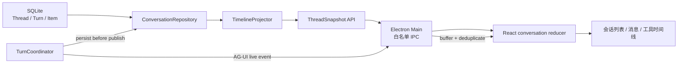
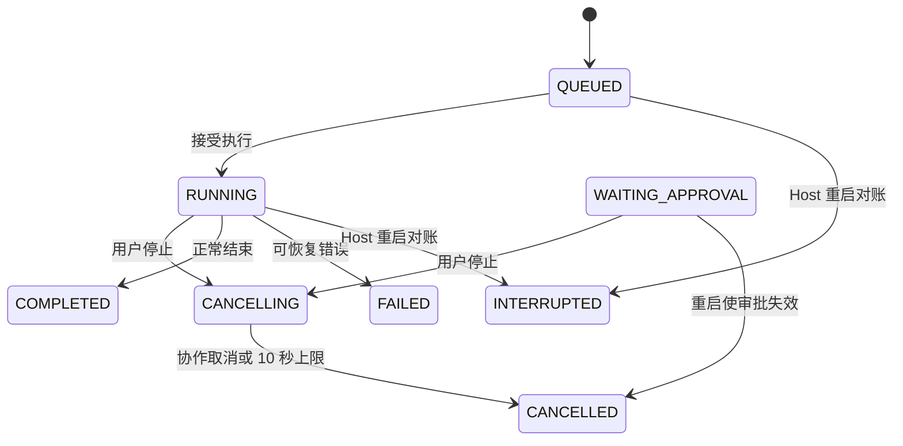
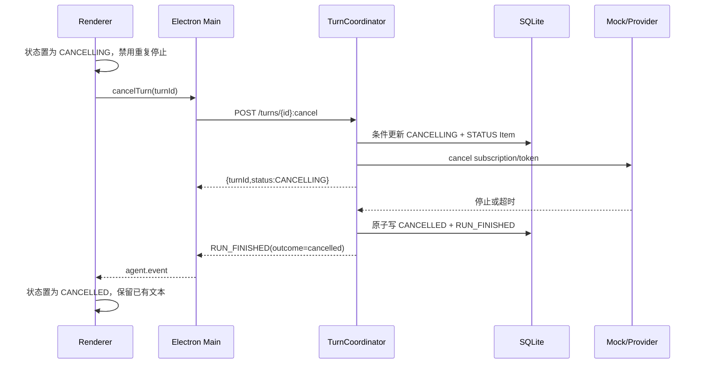
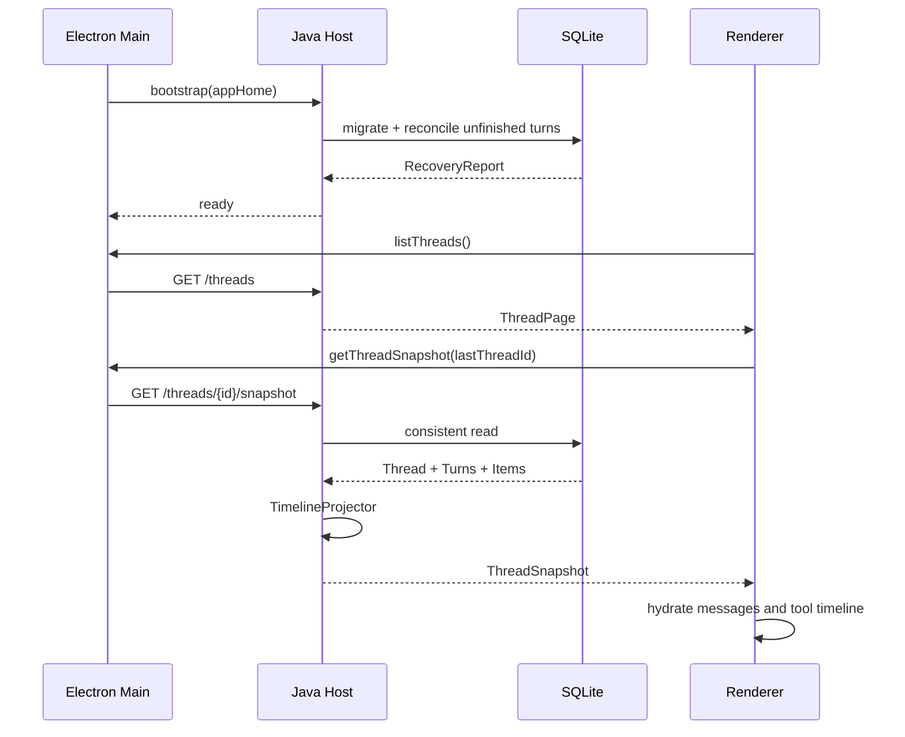

# 第 2 周详细设计：Thread/Turn/Item、停止与恢复

> 状态：已定稿，可作为第 2 周开发基线  
> 日期：2026-08-11  
> 上位方案：[一期最终架构方案](../FINAL_ARCHITECTURE.md)  
> 阶段基线：[阶段一详细设计](PHASE_1_DETAILED_DESIGN.md)  
> 前置状态：[第 1 周实施状态](IMPLEMENTATION_STATUS.md)

## 0. 设计结论与开工评估

第 2 周开发输入充分，可以开始实施。本周严格对应总方案中的一项交付：

| 总方案阶段 | 交付内容 | 验收 |
| --- | --- | --- |
| 第 2 周 | Thread/Turn/Item、停止、恢复 | 重启后可恢复会话与工具时间线 |

当前代码已经具备 SQLite/Flyway、Thread/Turn/Item 基础表、流式 Item 写入、取消入口和按 Thread 查询原始 Item 的能力；但它们还不是用户可验收的“恢复闭环”。本周必须补齐会话列表、结构化快照、启动对账、取消终态、Renderer 水合和重启端到端测试。

本周不需要新的外部输入，也不使用 DeepSeek/Qwen API Key。所有验收继续使用 Mock Provider；真实 Provider 属于 P1-D，不得成为第 2 周完成的前置条件。

## 1. 范围与边界

### 1.1 本周必须交付

1. Thread 列表、打开、重命名和归档；新会话仍允许在首次发送消息时惰性创建。
2. Turn 的完整状态持久化：`RUNNING`、`CANCELLING`、`CANCELLED`、`COMPLETED`、`FAILED`、`INTERRUPTED`。
3. Item 作为可重放时间线的唯一事实来源，覆盖用户消息、助手消息、工具调用、工具结果、状态和错误。
4. 停止操作的幂等状态机，停止后不再产生文本增量，10 秒内进入 `CANCELLED`。
5. Host 启动时对未终结 Turn 进行一致性对账，不自动续跑。
6. Renderer 启动后从数据库快照恢复会话列表、消息、Turn 状态及通用工具时间线。
7. 应用完整退出并重新启动后的端到端恢复验收。

### 1.2 明确不在本周

- 不接入 STDIO/Streamable HTTP MCP；它们属于第 3 周。
- 不实现真实 Tool 执行、完整 Tool Card 交互或工具结果详情页；第 2 周只定义并恢复通用工具时间线投影。
- 不实现 Skill 发现、加载或执行；它们属于第 4 周。
- 不实现权限审批和根目录控制；插入 Skill 导入交付后，它们顺延至第 6 周。`WAITING_APPROVAL` 只保留兼容状态语义。
- 不做安装包、自动升级或操作系统级崩溃恢复；插入 Skill 导入交付后，它们顺延至第 7 周。
- 不自动恢复或续跑崩溃前的模型请求。恢复的是可见会话与事件时间线；未完成 Turn 标为 `INTERRUPTED`，由用户显式重新发送。

### 1.3 “工具时间线恢复”的本周定义

第 2 周必须能从持久化 Item 恢复 `TOOL_CALL` 和 `TOOL_RESULT` 的名称、参数摘要、状态、结果摘要和错误信息。验收数据由 integration test 的确定性夹具写入，不连接真实 MCP，也不执行文件、网络或命令能力。第 3 周在同一投影契约上接入真实 MCP 并升级为完整 Tool Card。

## 2. 当前基线与差距

| 能力 | 当前状态 | 第 2 周处理 |
| --- | --- | --- |
| SQLite/Flyway/WAL | 已有 | 保留，增加恢复查询索引和事务方法 |
| Thread 创建 | 首次发送时 `ensureThread` | 改为原子 startTurn，并增加列表、重命名、归档 |
| Turn 写入 | 可创建和写终态 | 补齐状态约束、幂等取消、启动对账和终态原子提交 |
| Item 写入 | 每个 AG-UI 事件追加一条 Item | 保留 append-only 语义，增加幂等 sequence 和结构化投影 |
| Item 查询 | 返回数据库行及 JSON 字符串 | 改为服务端 `ThreadSnapshot`，Renderer 不解析数据库 JSON |
| 取消 | 可触发 Reactor signal | 补齐 `CANCELLING` 事件、10 秒边界、终态一致性和重复请求 |
| 会话恢复 | UI 无入口 | 增加 Thread 列表、快照水合、事件缓冲与去重 |
| Host 重启对账 | 无 | 启动时将残留活动 Turn 转为安全终态 |
| 工具时间线 | 无 UI 投影 | 增加通用只读条目和持久化夹具，不接 MCP |

## 3. 目标架构与恢复原则



恢复遵循以下固定原则：

1. **数据库是真相源**：Renderer 内存状态和 SSE 都是可丢弃投影。
2. **先持久化再发布**：任何影响用户可见时间线或 Turn 状态的事件，必须成功落库后才发送给 UI。
3. **不自动续跑**：Host 或应用重启后，只恢复可见状态；历史网络流、Provider subscription 和工具句柄全部作废。
4. **单 Thread 单活动 Turn**：同一 Thread 同时最多一个 `QUEUED/RUNNING/WAITING_APPROVAL/CANCELLING` Turn。
5. **Item 只追加**：第 2 周不覆盖或删除已写入 Item；快照投影负责把文本 delta 和工具参数 delta 聚合为可显示条目。
6. **终态不可逆**：`COMPLETED/CANCELLED/FAILED/INTERRUPTED` 不能回到活动状态；重新发送必须创建新的 Turn 和 Run。
7. **恢复不扩大权限**：历史 Approval 或 thread-scoped grant 不在重启后恢复为允许状态。

## 4. 领域模型与状态机

### 4.1 Thread

```text
ACTIVE --archive/delete--> ARCHIVED
ARCHIVED --restore--> ACTIVE
```

- `ACTIVE`：默认出现在会话列表。
- `ARCHIVED`：不在默认列表中，但数据仍保留；UI 的“删除会话”在一期实现为带确认的软删除。
- `updated_at` 在创建 Turn、追加用户可见 Item、重命名或状态变化时更新，用于会话排序。
- `model_profile_id` 是 Thread 默认模型档案；本周仍固定为 `mock`。

### 4.2 Turn



状态分类：

```text
ACTIVE   = QUEUED, RUNNING, WAITING_APPROVAL, CANCELLING
TERMINAL = COMPLETED, CANCELLED, FAILED, INTERRUPTED
```

规则：

- startTurn 在一个数据库事务中完成 Thread 校验、活动 Turn 冲突检查、Turn 插入和 `USER_MESSAGE` Item 插入。
- `cancel_requested_at` 只在第一次有效取消时写入，后续重复取消返回当前状态。
- `finished_at` 只允许在进入终态时写入。
- `error_code` 使用稳定机器码，例如 `PROVIDER_ERROR`、`HOST_RESTARTED`、`CANCEL_TIMEOUT`；UI 文案由错误映射层生成。
- `iteration_count` 本周保持为 0，供后续 ReAct 使用，不在 UI 中展示。

### 4.3 Item

沿用现有类型：

```text
USER_MESSAGE
ASSISTANT_MESSAGE
TOOL_CALL
TOOL_RESULT
APPROVAL
STATUS
ERROR
```

第 2 周继续使用 append-only Item 日志：

- 用户输入固定使用 `sequence = 0`。
- AG-UI 事件在每个 Turn 内从 1 单调递增。sequence 由 `ConversationStore` 在写事务中分配，`TurnCoordinator` 不再用内存 `AtomicLong` 作为事实来源。
- 每个待持久化事件携带稳定 `eventId`，对应 `item.id` 并作为幂等键；相同 eventId 重放返回原记录，内容不一致则报 `EVENT_CONFLICT`。
- `(turn_id, sequence)` 保持唯一。Provider 流、取消请求和超时终结都通过同一事件追加器排队，不能各自计算 `MAX(sequence) + 1`。
- `payload_json` 持久化脱敏后的事件 envelope；不保存 API Key、Authorization、Provider 原始 chunk 或 reasoning。
- UI 只读取 `visibility = USER`；`SYSTEM_AUDIT` 不通过普通快照 API 暴露。
- 时间线跨 Turn 排序使用 `turn.started_at ASC, item.sequence ASC, item.id ASC`，不依赖可能相同的毫秒时间戳。

## 5. 持久化与事务设计

### 5.1 数据库迁移

V1 表结构满足本周核心数据，不重建用户数据库。新增 `V2__week2_recovery_indexes.sql`：

```sql
CREATE INDEX IF NOT EXISTS idx_thread_status_updated
  ON thread(status, updated_at DESC, id DESC);

CREATE INDEX IF NOT EXISTS idx_turn_status
  ON turn(status, started_at, id);

CREATE INDEX IF NOT EXISTS idx_item_thread_turn_sequence
  ON item(thread_id, turn_id, sequence, id);
```

迁移必须可重复验证但只执行一次；不得删除或重写第 1 周产生的数据。SQLite 保持 `WAL`、`foreign_keys=ON`、`busy_timeout=5000`。

### 5.2 Repository 命令接口

```java
interface ConversationStore {
  StartTurnResult startTurn(StartTurnCommand command);
  AppendResult appendEvent(AppendEventCommand command);
  CancelResult requestCancellation(String turnId, Instant requestedAt);
  void finalizeTurn(FinalizeTurnCommand command);
  RecoveryReport reconcileUnfinishedTurns(Instant startupAt);

  ThreadPage listThreads(ThreadQuery query);
  ThreadSnapshot loadThreadSnapshot(String threadId);
  ThreadSummary renameThread(String threadId, String title);
  ThreadSummary setThreadArchived(String threadId, boolean archived);
}
```

禁止 Controller 直接拼 SQL。现有 `ConversationRepository` 可实现该接口，读投影拆到 `TimelineProjector`，避免一个类同时承担事务命令、JSON 聚合和 HTTP DTO 映射。

### 5.3 原子边界

| 操作 | 同一事务内必须完成 |
| --- | --- |
| startTurn | 创建/更新 Thread；检查无活动 Turn；插入 Turn；插入 USER_MESSAGE；更新 Thread `updated_at` |
| appendEvent | 校验 Turn 非终态；分配/验证 sequence；插入 Item；更新 Thread `updated_at` |
| requestCancellation | 条件更新 Turn 为 `CANCELLING`；写 `cancel_requested_at`；追加 cancelling STATUS Item |
| finalizeTurn | 条件更新 Turn 终态；写 `finished_at/error_code`；追加最后 STATUS/ERROR Item；更新 Thread |
| startup reconcile | 批量锁定未终结 Turn；逐个写安全终态和恢复 Item；提交一次恢复报告 |
| archive Thread | 校验无活动 Turn；更新 Thread 状态和 `archived_at` |

任何事务失败都不能发布对应 AG-UI 事件。`finalizeTurn` 采用条件更新，只有活动状态可进入终态，避免取消与正常完成的竞态产生两个终态。

`appendEvent` 返回数据库实际分配的 sequence 和持久化事件 envelope，Host 使用该返回值发布 SSE。这样取消线程与 Provider 流同时到达时，数据库顺序就是 UI 顺序；一旦 Turn 已进入 `CANCELLING`，文本 delta 的条件写入失败且不会发布。

### 5.4 快照读取一致性

`loadThreadSnapshot` 在一个只读事务中读取 Thread、全部 Turn 和用户可见 Item。投影完成后再返回，不允许分别请求消息和 Turn 状态后在 Renderer 拼出不一致视图。

一期本地数据量下先返回单 Thread 完整快照；设置 20,000 条原始 Item 的保护上限。超过时返回 `TIMELINE_TOO_LARGE` 和诊断信息，不静默截断。第 8～9 周再根据真实数据决定分页或快照压缩。

## 6. 启动对账与恢复算法

Host 完成 Flyway migration 后、输出 `ready` 前执行一次恢复对账：

```text
1. 查询所有 ACTIVE Turn。
2. QUEUED/RUNNING：改为 INTERRUPTED，error_code=HOST_RESTARTED。
3. CANCELLING：改为 CANCELLED，error_code=CANCELLED_DURING_RESTART。
4. WAITING_APPROVAL：改为 CANCELLED，error_code=APPROVAL_INVALIDATED。
5. 每个 Turn 追加一个用户可见的 STATUS 或 ERROR Item。
6. 更新所属 Thread.updated_at。
7. 提交事务后输出不含用户内容的结构化恢复统计日志。
8. Host 才允许进入 READY。
```

对账是幂等的：只处理活动状态，第二次启动不会再次追加恢复 Item。恢复日志只记录数量和错误码，不记录消息、工具参数或 payload。

恢复后的 UI 行为：

- `INTERRUPTED`：保留已生成文本，显示“上次运行意外中断，可重新发送”。
- `CANCELLED`：保留停止前文本和工具记录，显示“已停止”。
- `FAILED`：保留时间线并显示安全错误文案。
- `COMPLETED`：正常展示。
- 不为任何历史 Turn 重新建立 Provider 或 Tool subscription。

## 7. Host API 设计

所有接口继续要求 `Authorization: Bearer`、`X-App-Protocol: 1` 和 loopback 来源校验。

| 方法 | 路径 | 用途 |
| --- | --- | --- |
| `GET` | `/api/v1/threads?status=ACTIVE&limit=50&cursor=...` | 获取会话列表，按 `updatedAt,id` 游标分页 |
| `GET` | `/api/v1/threads/{threadId}/snapshot` | 获取一致的 Thread/Turn/Timeline 快照 |
| `PATCH` | `/api/v1/threads/{threadId}` | 重命名，标题去首尾空白，长度 1～120 |
| `DELETE` | `/api/v1/threads/{threadId}` | 带活动 Turn 保护的软删除/归档 |
| `POST` | `/api/v1/threads/{threadId}:restore` | 恢复已归档会话 |
| `POST` | `/api/v1/turns/{turnId}:cancel` | 幂等停止，返回当前 Turn 状态 |
| `POST` | `/agui/run` | 创建新 Turn 并流式运行；现有协议保持兼容 |

废弃当前直接返回 `ItemRecord.payloadJson` 的 `/items` 作为 UI 主接口；保留一个协议版本的兼容期，仅供旧版 Main 使用，响应增加 `Deprecation` 日志但不包含敏感信息。

### 7.1 Thread 列表 DTO

```json
{
  "items": [
    {
      "id": "thr_01J...",
      "title": "解释这个项目",
      "status": "ACTIVE",
      "modelProfileId": "mock",
      "updatedAt": "2026-08-11T00:00:00Z",
      "lastTurnStatus": "COMPLETED",
      "preview": "Mock response: ..."
    }
  ],
  "nextCursor": null
}
```

`preview` 只取最近一条用户可见消息的前 160 个 Unicode code point，不解析 Markdown，不包含工具完整参数或系统审计内容。

### 7.2 Thread 快照 DTO

```json
{
  "schemaVersion": 1,
  "thread": {
    "id": "thr_01J...",
    "title": "解释这个项目",
    "status": "ACTIVE",
    "modelProfileId": "mock",
    "updatedAt": "2026-08-11T00:00:00Z"
  },
  "turns": [
    {
      "id": "trn_01J...",
      "runId": "run_01J...",
      "status": "COMPLETED",
      "startedAt": "2026-08-11T00:00:00Z",
      "finishedAt": "2026-08-11T00:00:02Z",
      "errorCode": null,
      "lastSequence": 33
    }
  ],
  "timeline": [
    {
      "id": "msg_user",
      "turnId": "trn_01J...",
      "kind": "USER_MESSAGE",
      "content": "解释这个项目",
      "status": "COMPLETE"
    },
    {
      "id": "msg_agent",
      "turnId": "trn_01J...",
      "kind": "ASSISTANT_MESSAGE",
      "content": "……",
      "status": "COMPLETE"
    },
    {
      "id": "call_01J...",
      "turnId": "trn_01J...",
      "kind": "TOOL_CALL",
      "toolName": "demo.timeline_fixture",
      "argumentsSummary": "{\"query\":\"example\"}",
      "status": "SUCCEEDED",
      "resultSummary": "fixture result"
    }
  ]
}
```

HTTP 层永远返回结构化 DTO，不返回原始 `payload_json`。不存在、已归档但未显式请求、超出限制和状态冲突分别使用稳定错误码：`THREAD_NOT_FOUND`、`THREAD_ARCHIVED`、`TIMELINE_TOO_LARGE`、`TURN_CONFLICT`。

## 8. TimelineProjector 规则

`TimelineProjector` 是数据库 Item 到 UI 快照的唯一映射器：

| Item/事件 | 投影规则 |
| --- | --- |
| `USER_MESSAGE` | 直接生成一条用户消息 |
| `TEXT_MESSAGE_START` | 以 `messageId` 创建助手消息草稿 |
| `TEXT_MESSAGE_CONTENT` | 按 sequence 追加 delta；重复 sequence 忽略 |
| `TEXT_MESSAGE_END` | 将对应助手消息标为 `COMPLETE` |
| `TOOL_CALL_START` | 以 `toolCallId` 创建工具条目 |
| `TOOL_CALL_ARGS` | 聚合参数 delta，只向 UI 返回脱敏后的摘要 |
| `TOOL_CALL_END` | 标记参数完整，等待结果 |
| `TOOL_CALL_RESULT` | 关联 toolCallId，设置结果摘要和终态 |
| `RUN_FINISHED` | 更新 Turn 及仍为 streaming 的消息状态 |
| `RUN_ERROR` | 生成安全错误条目，不透传异常栈 |

兼容第 1 周数据：投影器同时识别现有 `payload_json` 中的完整 AG-UI envelope 和直接的 `USER_MESSAGE {content}`。遇到单条损坏 JSON 时，不让整个应用白屏；返回一个 `CORRUPTED_ITEM` 占位条目并记录脱敏诊断，验收测试必须覆盖。

## 9. Electron IPC 与 Renderer 状态设计

### 9.1 preload 白名单扩展

```ts
type AgentDesktopApi = {
  listThreads(input?: { cursor?: string; limit?: number }): Promise<ThreadPage>;
  getThreadSnapshot(threadId: string): Promise<ThreadSnapshot>;
  renameThread(input: { threadId: string; title: string }): Promise<ThreadSummary>;
  archiveThread(threadId: string): Promise<void>;
  restoreThread(threadId: string): Promise<ThreadSummary>;
  startTurn(input: { threadId?: string; message: string }): Promise<StartedTurn>;
  cancelTurn(turnId: string): Promise<TurnOperationResult>;
  onAgentEvent(listener: (event: AgUiEvent) => void): Unsubscribe;
};
```

Main 对所有 ID、标题、分页大小和返回 DTO 做运行时校验；Renderer 仍然不知道 Host 端口、Bearer Token、数据库位置或文件系统路径。

### 9.2 Renderer Store

```ts
type ConversationState = {
  threads: ThreadSummary[];
  selectedThreadId?: string;
  snapshots: Record<string, ThreadSnapshot>;
  activeTurnByThread: Record<string, string | undefined>;
  lastSequenceByTurn: Record<string, number>;
  bufferedEvents: Record<string, AgUiEvent[]>;
  loading: 'threads' | 'snapshot' | undefined;
  error?: UiError;
};
```

Reducer 必须是纯函数，并支持：`threadsLoaded`、`threadSelected`、`snapshotHydrated`、`eventBuffered`、`eventApplied`、`cancelRequested`、`threadRenamed`、`threadArchived`。测试直接验证相同 snapshot + event 序列产生相同 UI 状态。

### 9.3 首次加载与切换会话

```text
1. Renderer 先订阅 onAgentEvent，避免加载快照期间丢事件。
2. 请求 Thread 列表。
3. 若 localStorage 中的 selectedThreadId 仍存在则选择它，否则选择最近更新的 ACTIVE Thread。
4. 请求该 ThreadSnapshot。
5. 用 snapshot 原子替换该 Thread 的 UI 投影。
6. 按 sequence 应用加载期间缓冲的事件；已被 snapshot 覆盖的事件幂等忽略。
7. 用户切换 Thread 时重复 4～6，不影响其他 Thread 的缓存。
```

`localStorage` 只保存最后选择的 Thread ID 和无敏感 UI 偏好，不保存消息、工具参数、token 或数据库快照。

### 9.4 快照与实时事件去重

- AG-UI live event 使用 `(turnId, sequence)` 去重。
- `sequence <= lastSequenceByTurn[turnId]` 的重复事件忽略。
- sequence 出现间隙时暂停直接渲染并重新请求 snapshot；不猜测缺失文本。
- 快照水合后从每个 Turn 的 `lastSequence` 初始化去重游标。
- 非当前 Thread 的事件先更新缓存和列表摘要，不强制切换用户视图。

## 10. 停止操作详细时序



强制规则：

1. 第一次停止请求返回后，按钮显示“正在停止”，不能重复触发。
2. 取消信号生效后，`TurnCoordinator` 在写入前再次检查 cancellation gate；不得落库或发布新的 `TEXT_MESSAGE_CONTENT`。
3. 10 秒内 Provider 未协作结束时，Host 主动关闭 subscription，终态为 `CANCELLED`，`error_code=CANCEL_TIMEOUT`。
4. 对已终结 Turn 再次停止返回 200 和当前终态，不追加重复 Item。
5. 不存在的 Turn 返回 404 `TURN_NOT_FOUND`；其他 Thread 的活动状态不受影响。

## 11. 重启恢复端到端时序



恢复成功的判断不是“数据库里有记录”，而是用户重新打开应用后能在会话列表选择原 Thread，并看到与退出前一致的用户消息、助手文本、工具调用顺序和每个 Turn 的终态。

## 12. 错误、安全与可观察性

- 所有数据库 JSON 在进入 DTO 前经过类型校验和脱敏；Renderer 不直接接触 SQL 行。
- 恢复错误使用稳定码，日志只记录 threadId/turnId、Item 数量和错误码，不记录正文。
- 归档有活动 Turn 的 Thread 返回 `THREAD_BUSY`，UI 要求先停止。
- 标题去除控制字符，长度按 Unicode code point 限制为 120；不得把标题用于路径或 SQL 拼接。
- API 分页 `limit` 允许 1～100，cursor 使用签名无关的 base64url JSON，只包含 `updatedAt` 和 `id`，解析失败返回 `INVALID_CURSOR`。
- 快照投影不得输出 `SYSTEM_AUDIT` Item、Authorization、Cookie、API Key 或 reasoning 字段。
- 恢复统计示例：`recovery reconciled interrupted=1 cancelled=0`；禁止打印 payload。

## 13. 模块改造清单

```text
agent-persistence/
  V2__week2_recovery_indexes.sql
  ConversationStore.java
  ConversationRepository.java
  ThreadSummary.java / ThreadSnapshot.java
  TimelineProjector.java

agent-host/
  ThreadController.java
  TurnCoordinator.java
  StartupRecoveryService.java
  api/ThreadDtos.java

desktop-shell/
  protocol.ts
  host-supervisor.ts
  main.ts
  preload.cts

desktop-ui/
  conversation-reducer.ts
  timeline-projector.ts（只处理 DTO/live event，不解析数据库 JSON）
  App.tsx
  ThreadList.tsx
  Timeline.tsx

scripts/
  verify-week2.ps1
```

可以根据代码规模合并 DTO 文件，但依赖方向不得改变：`agent-persistence` 不依赖 Host/WebFlux，`agent-runtime` 不依赖 Electron/React，Renderer 不直接访问数据库。

## 14. 实施顺序

| 工作包 | 内容 | 可演示产物 |
| --- | --- | --- |
| W2-A 数据命令与查询 | Repository 原子事务、列表、快照、V2 索引、启动对账 | Java 测试可重启同一临时数据库并恢复时间线 |
| W2-B Host 契约 | Thread API、cancel 返回值、TimelineProjector、错误码 | curl/PowerShell 可列出并恢复 Thread |
| W2-C Renderer 恢复 | 会话列表、切换、水合、事件缓冲去重、通用工具条目 | 完成会话后刷新窗口仍一致 |
| W2-D 停止与中断 | cancellation gate、10 秒终态、Host 重启对账、重新发送入口 | 停止后无新增文本；杀 Host 后显示中断 |
| W2-E 端到端验收 | `verify-week2.ps1`、Electron 重启、工具夹具、密钥扫描 | 一条命令完成本周验收 |

执行依赖为 `W2-A → W2-B → W2-C → W2-D → W2-E`。W2-A 完成前不允许 Renderer 以原始 JSON 临时拼接恢复视图，否则会形成第二套协议。

## 15. 测试设计

### 15.1 Java 单元与集成测试

1. `startTurn` 原子性：活动 Turn 冲突时 Thread、Turn、Item 均不产生半写入。
2. 事件幂等：相同 eventId 重放不重复插入；相同 eventId 不同内容报 `EVENT_CONFLICT`。
3. Thread 列表：ACTIVE 过滤、排序、游标和 preview 脱敏正确。
4. 快照投影：文本 delta、取消、错误、TOOL_CALL/TOOL_RESULT 顺序可重建。
5. 损坏 Item：单条错误 JSON 生成占位项，不影响其余时间线。
6. 取消竞态：正常完成与取消同时发生时只有一个终态和一个最终事件。
7. 启动对账：RUNNING→INTERRUPTED、CANCELLING→CANCELLED，第二次对账无新增记录。
8. 归档保护：活动 Thread 不能归档，归档后默认列表不可见，可显式恢复。

### 15.2 Renderer reducer 测试

1. 同一 snapshot 重复水合结果一致。
2. snapshot 加载期间事件先缓冲后按 sequence 应用。
3. 重复事件不重复文本，sequence 缺口触发重新同步。
4. `RUN_FINISHED(cancelled)` 保留部分文本并清除 activeTurn。
5. 工具调用和结果在实时事件与恢复快照下生成相同时间线。
6. 切换 Thread 不串消息，非当前 Thread 事件只更新对应缓存。

### 15.3 Electron 端到端验收

`scripts/verify-week2.ps1` 使用独立临时 `appHome`，不得污染真实用户数据：

```text
1. 构建 Java、Renderer、Main。
2. 启动 Electron，创建 Thread A 并完成一次流式会话。
3. 写入一组确定性的 TOOL_CALL/TOOL_RESULT 测试夹具。
4. 记录 Thread ID、可见文本和工具条目。
5. 正常退出整个应用，确认 Host 子进程退出。
6. 使用同一临时 appHome 再次启动。
7. 验证 Thread A 出现在列表，消息和工具时间线与退出前一致。
8. 启动长回复并点击停止，确认 10 秒内 CANCELLED，之后无新增 delta。
9. 再启动长回复并终止 Host；重启后确认部分内容保留且 Turn=INTERRUPTED。
10. 扫描临时数据库、日志和仓库，确认无测试 secret/Authorization/reasoning。
```

夹具只能通过测试类或测试构建入口写入；生产包不暴露任意追加 Item 的 HTTP/IPC 接口。

## 16. 第 2 周验收矩阵

| 编号 | 验收场景 | 通过条件 |
| --- | --- | --- |
| W2-A01 | 会话管理 | 新建会话后出现在列表，可打开、重命名、归档和恢复 |
| W2-A02 | 正常重启恢复 | 完成一次流式会话，退出并重启后消息内容、顺序和终态一致 |
| W2-A03 | 工具时间线恢复 | 测试夹具的 Tool Call/Result 在重启后名称、摘要、状态和顺序一致 |
| W2-A04 | 停止 | 点击停止后 10 秒内为 CANCELLED，停止点之后无新文本 Item/事件 |
| W2-A05 | 意外中断 | RUNNING Turn 遇 Host 退出，重启后为 INTERRUPTED，部分文本保留且不自动续跑 |
| W2-A06 | 幂等与竞态 | 重复事件、重复 cancel 和完成/取消竞态不产生重复 Item 或双终态 |
| W2-A07 | 安全边界 | Renderer 无数据库/端口/token 能力，快照和日志无密钥、Authorization、reasoning |
| W2-A08 | 自动化 | Maven、TypeScript、Host API 和 Electron 重启恢复脚本全部返回 0 |

只有 W2-A01～W2-A08 全部通过，才能把总方案第 2 周标为完成并进入第 3 周 MCP 详细设计。仅证明 SQLite 有数据、刷新页面不丢内存状态或手工查询数据库，都不能替代重启恢复验收。

## 17. Definition of Done

- 代码、数据库迁移、协议类型和 UI 使用同一组 Thread/Turn/Item 语义。
- 所有可见状态变更遵循 persist-before-publish。
- 应用重启恢复、停止和 Host 中断均有自动化测试。
- 工具时间线恢复通过通用投影验收，但没有提前引入真实 MCP。
- 第 1 周冒烟与 11 个既有 Java 测试保持通过，不发生回归。
- 文档、日志、数据库和构建产物中不存在明文 Provider Key。
- `IMPLEMENTATION_STATUS.md` 仅在完整验收后更新为“第 2 周完成”。
