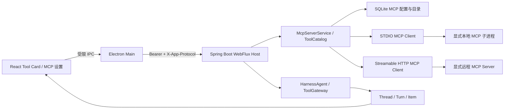
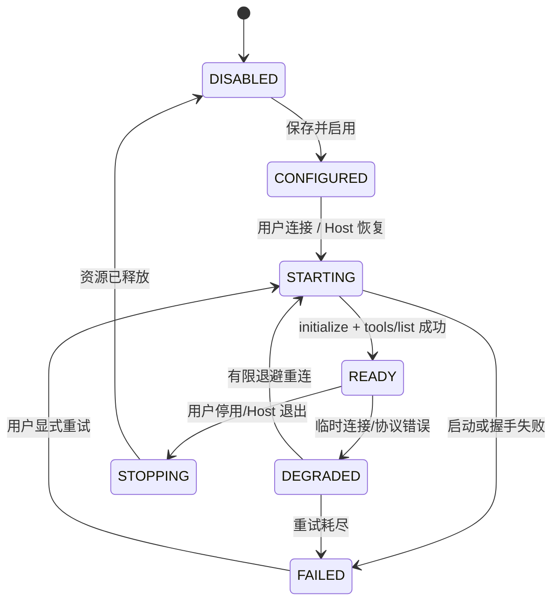

# 第 3 周详细设计：STDIO/Streamable HTTP MCP 与 Tool Card

> 状态：已定稿，可作为第 3 周开发基线  
> 日期：2026-08-12  
> 上位方案：[一期最终架构方案](../FINAL_ARCHITECTURE.md)  
> 前置交付：[第 2 周详细设计](WEEK_2_DETAILED_DESIGN.md)、[实施状态](IMPLEMENTATION_STATUS.md)

## 0. 设计结论与开工评估

第 2 周的 Thread/Turn/Item、取消、启动对账、快照恢复和 Tool 时间线投影均已通过验收；第 3 周可以开始。本周严格对应总体方案中的唯一交付：

| 总体方案阶段 | 交付内容 | 验收 |
| --- | --- | --- |
| 第 3 周 | STDIO/Streamable HTTP MCP、Tool Card | 可连接两类 MCP 并展示调用结果 |

本周交付一个由 Java Host 管理的 MCP Client Manager。它可保存非敏感 Server 配置、连接 STDIO 和 Streamable HTTP Server、同步工具目录、以结构化 Tool Calling 调用已允许的低风险演示工具，并将调用全过程以 AG-UI 事件、`Item` 和 Tool Card 展示、重启恢复。

本周不使用文本 `Thought/Action/Observation` 解析器，不暴露原始 reasoning，也不提前实现 Skill、MCP OAuth、任意 Shell、文件写入或人工审批。后者分别属于第 4、5 周；本周的真实调用只覆盖确定性的、无文件系统/网络副作用的测试 MCP 工具。

### 0.1 本周完成定义

只有 W3-A01～W3-A09 全部通过，才能将第 3 周标为完成：

1. 用户可配置、启停并查看一条 STDIO MCP Server 和一条 Streamable HTTP MCP Server。
2. 两个 Server 的 `tools/list` 可同步到统一工具目录，重名 Tool 不会冲突。
3. 结构化 Tool Call 可通过各自传输调用确定性的 `echo`/`sum` 测试工具，UI 能显示参数、状态、耗时、结果摘要和失败信息。
4. Tool Call/Result 必须先持久化为 Item，再发布 AG-UI；重启后时间线一致。
5. Token、Authorization、Cookie、MCP 原始 stderr、完整结果和 reasoning 不进入普通快照、日志或 Tool Card。

## 1. 范围与边界

### 1.1 本周必须交付

1. 新增 `agent-mcp` Java 模块，提供 MCP 配置、连接生命周期、工具目录、调用和诊断抽象。
2. 支持 **STDIO**：显式 `executable + args` 启动、JSON-RPC/MCP 初始化、`tools/list`、`tools/call`、子进程退出检测及受限 stderr 环形缓冲。
3. 支持 **Streamable HTTP**：显式 HTTPS/HTTP endpoint、初始化、会话协商、`tools/list`、`tools/call`、断线重连及协议错误处理。
4. MCP Server 配置 CRUD、启停、健康状态、最近诊断和工具目录查询；HTTP API 只供 Electron Main 调用。
5. 基于 `serverId.toolName` 的稳定 Tool ID、输入 JSON Schema 截断摘要和 Tool 启停/白名单状态。
6. 由模型原生结构化 Tool Call 或确定性测试 Provider 产生 `TOOL_CALL_*`、`TOOL_CALL_RESULT` AG-UI 事件；调用过程映射为第 2 周既定的 `TOOL_CALL`、`TOOL_RESULT` Item。
7. React Tool Card：展示 Tool 名称、Server、参数摘要、运行状态、耗时、结果摘要、错误码；历史 Tool Card 从 `ThreadSnapshot` 恢复。
8. 针对两种传输的本地测试 Server、MCP 协议测试、Host API 测试和独立 `verify-week3.ps1`。

### 1.2 明确不在本周

- 不实现 Skill 发现、`SKILL.md` 加载、资源读取或 Skill 与 Tool Group 绑定（第 4 周）。
- 不实现 `ASK` 审批、thread grant、文件根目录授权或高风险 Tool 执行（顺延后的第 6 周）。
- 不实现 MCP OAuth、市场、自动发现、自动安装或自动升级（一期外/1.1）。
- 不允许任意 Shell 字符串、PowerShell、`cmd.exe`、`sh -c`、文件写/删、进程执行或通用公网访问作为本周可调用 Tool。
- 不实现多 Agent、RAG、浏览器自动化、Computer Use 或把 MCP 结果直接呈现为模型思维过程。

### 1.3 调用边界

总体方案要求 Tool 属于不可信能力，且高风险能力默认 `ASK`。审批能力现顺延至第 6 周，因此第 3 周采用收敛的执行门：

| Tool 分类 | 第 3 周行为 |
| --- | --- |
| `DEMO_SAFE`：确定性 echo/sum，无文件、网络或进程副作用 | 仅测试 Server 可 `ALLOW`，用于验收调用链路 |
| `READ`、`NETWORK`、`WRITE`、`EXECUTE` 或分类未知 | 只同步元数据并在 UI 标记“等待第 6 周审批”；不调用 |
| 未启用、非白名单或 Schema 无法验证 | 不提供给 Agent；直接返回稳定拒绝码 |

这不是权限系统的替代品。第 6 周将以同一 `ToolDescriptor` 和 `ToolInvocation` 契约接入 `PermissionEngine`，移除本周的测试例外。

## 2. 目标架构与职责



### 2.1 职责边界

| 组件 | 职责 | 禁止事项 |
| --- | --- | --- |
| Electron Renderer | 编辑配置、展示状态/Tool Card、提交已受约束的输入 | 不知晓 Host 端口、Token、密钥、工作目录和本地文件路径 |
| Electron Main | 白名单 IPC、通过 safeStorage 保存 MCP Bearer 凭据、一次性注入 Host 内存 | 不解析 MCP 协议、不执行工具、不把密钥写配置/环境变量 |
| Java Host | REST、AG-UI、配置校验、Tool 事件持久化、调用协调 | 不向 Renderer 暴露原始 MCP payload 或 secret |
| `agent-mcp` | MCP lifecycle、传输、目录、重连、stdout/stderr 诊断脱敏 | 不依赖 Electron/React；不做权限最终决策 |
| `agent-runtime` | HarnessAgent 结构化调用、迭代计数、上下文中的结果摘要 | 不拼接文本 ReAct 协议，不持有 Transport 凭据 |
| `agent-persistence` | MCP 非敏感配置/目录、Thread/Turn/Item、审计摘要 | 不保存 Bearer Token、Cookie、Authorization 或完整私有结果 |

### 2.2 模块依赖

```text
desktop-shell ──HTTP/SSE──> agent-host ──> agent-runtime ──> agent-mcp
                                  │              │               │
                                  └──────────────┴───────────────> agent-persistence
desktop-ui ──preload IPC──> desktop-shell
```

新增模块不得反向依赖 `desktop-shell` 或 `desktop-ui`。MCP Java SDK 被封装在 `agent-mcp` 内；Host/Runtime 只依赖下述稳定接口。SDK 的具体制品版本在实现 PR 中固定并写入 Maven dependency management，升级必须通过 W3 测试矩阵。

## 3. 数据模型与迁移

第 2 周的 `thread`、`turn`、`item` 结构不重建。`V3__mcp_server_catalog.sql` 新增目录，`V4__mcp_server_soft_delete.sql` 增加软删除与活动名称唯一约束；所有字段均为非敏感元数据。

```sql
CREATE TABLE mcp_server (
  id TEXT PRIMARY KEY,
  name TEXT NOT NULL,
  transport TEXT NOT NULL,
  status TEXT NOT NULL,
  enabled INTEGER NOT NULL,
  endpoint TEXT,
  executable TEXT,
  arguments_json TEXT,
  working_directory TEXT,
  env_allowlist_json TEXT NOT NULL,
  credential_ref TEXT,
  reconnect_policy_json TEXT NOT NULL,
  last_error_code TEXT,
  last_connected_at TEXT,
  created_at TEXT NOT NULL,
  updated_at TEXT NOT NULL,
  deleted_at TEXT,
  CHECK (transport IN ('STDIO', 'STREAMABLE_HTTP')),
  CHECK ((transport = 'STDIO' AND executable IS NOT NULL AND endpoint IS NULL)
      OR (transport = 'STREAMABLE_HTTP' AND endpoint IS NOT NULL AND executable IS NULL))
);

CREATE UNIQUE INDEX uq_mcp_server_active_name ON mcp_server(name) WHERE deleted_at IS NULL;

CREATE TABLE mcp_tool (
  id TEXT PRIMARY KEY,
  server_id TEXT NOT NULL,
  name TEXT NOT NULL,
  description TEXT NOT NULL,
  input_schema_json TEXT NOT NULL,
  risk_class TEXT NOT NULL,
  enabled INTEGER NOT NULL,
  catalog_version INTEGER NOT NULL,
  created_at TEXT NOT NULL,
  updated_at TEXT NOT NULL,
  UNIQUE(server_id, name),
  FOREIGN KEY(server_id) REFERENCES mcp_server(id)
);

CREATE INDEX idx_mcp_server_enabled_status ON mcp_server(enabled, status, updated_at DESC);
CREATE INDEX idx_mcp_tool_server_enabled ON mcp_tool(server_id, enabled, name);
```

规则：

- `credential_ref` 仅是随机引用 ID；真正 Bearer Token 只在 Electron `safeStorage` 密文中，并在连接/调用时一次性注入 Host 内存。
- `arguments_json` 只保存字符串数组；绝不保存完整 shell 命令。
- `env_allowlist_json` 仅保存允许的变量名；值由 Electron Main 从受控来源解析，缺失即不传递。
- Server 删除为软禁用：先断开、清空内存凭据、保留脱敏目录审计，不直接删除历史 Item。
- `mcp_tool` 是连接后的可缓存目录，不是权限授权。`enabled=1` 仍须经过 W3 执行门或 W5 `PermissionEngine`。

### 3.1 配置 DTO

```java
sealed interface McpServerDraft permits StdioServerDraft, StreamableHttpServerDraft {}

record StdioServerDraft(
    String name, String executable, List<String> arguments,
    Path workingDirectory, List<String> allowedEnvironmentNames,
    boolean enabled, ReconnectPolicy reconnectPolicy) implements McpServerDraft {}

record StreamableHttpServerDraft(
    String name, URI endpoint, String credentialRef,
    boolean enabled, ReconnectPolicy reconnectPolicy) implements McpServerDraft {}

record ReconnectPolicy(int maxAttempts, Duration initialBackoff, Duration maxBackoff) {}
```

校验：名称 1～80 Unicode code point；Server ID 使用 `mcp_` 前缀 ULID；STDIO `executable` 必须是绝对规范路径且不是 shell；`arguments` 单项最多 4 KiB、总数最多 64；工作目录必须是已配置 workspace 的子目录；HTTP endpoint 允许显式 `http` 或 `https`，但不接受用户名密码 URL、fragment 或未经批准的 header。Bearer 仍只通过 safeStorage 和运行时内存注入；选择明文 HTTP 时，传输机密性由用户配置的网络环境承担。

## 4. MCP 生命周期与传输

### 4.1 状态机



- 默认重连：最多 3 次，250 ms、1 s、4 s；不无限循环，不阻塞 Host `READY`。
- Host 重启时，只对 `enabled=1` 的 Server 恢复连接；不会自动执行任何历史 Tool Call。
- 任意连接错误会更新 `last_error_code` 和脱敏诊断摘要；`FAILED` 的 Server 不向 Agent 注入 Tool。
- STDIO 进程退出、HTTP 401/403、协议版本不兼容、响应超时分别映射 `MCP_PROCESS_EXITED`、`MCP_AUTH_FAILED`、`MCP_PROTOCOL_MISMATCH`、`MCP_TIMEOUT`。

### 4.2 统一接口

```java
interface McpClientManager extends AutoCloseable {
  McpServerSummary save(McpServerDraft draft);
  McpServerSummary connect(String serverId, EphemeralCredential credential);
  void disconnect(String serverId);
  void delete(String serverId);
  McpServerPage list(McpServerQuery query);
  List<ToolDescriptor> listTools(String serverId);
  ToolCallResult call(ToolInvocation invocation, CancellationToken cancellationToken);
  McpDiagnostic recentDiagnostic(String serverId);
}

record ToolDescriptor(
    String id, String serverId, String name, String displayName,
    String description, JsonNode inputSchema, RiskClass riskClass, boolean enabled) {}

record ToolInvocation(
    String callId, String threadId, String turnId, String toolId,
    JsonNode arguments, Instant requestedAt) {}

record ToolCallResult(
    String callId, ToolOutcome outcome, JsonNode modelResult,
    String userSummary, String errorCode, Duration elapsed) {}
```

`ToolDescriptor.id = "mcp:" + serverId + ":" + name`，不使用 Tool 显示名作为调用键。`modelResult` 受结果大小限制后提供给 HarnessAgent；`userSummary` 为脱敏、截断后的可见摘要；两者都不包含请求 header、Token、Cookie 或 stderr。

### 4.3 STDIO Adapter

1. 使用 `ProcessBuilder(List<String>)`，`redirectErrorStream(false)`，`shell=false`；禁止 `cmd /c`、PowerShell、`sh -c` 和任何字符串拼接。
2. 创建进程时仅传递 `PATH` 等最小系统变量及配置中列出的变量；值由 Main 受控注入，日志中只记录变量名。
3. stdin/stdout 承载 MCP JSON-RPC；stderr 仅存入每 Server 最多 200 行、每行最多 2 KiB 的内存环形缓冲，先经 secret redactor。
4. 初始化超时 10 秒、`tools/list` 超时 10 秒、`tools/call` 默认 30 秒且每 Tool 可下调。取消时关闭本次请求并在 5 秒后终止仅由本应用启动的子进程。

### 4.4 Streamable HTTP Adapter

1. 使用 Host 内受控 HTTP Client；endpoint 必须通过 URI 校验，Bearer 仅写入本次请求内存 header。
2. 先 `initialize`，按服务端协商的会话标识发送后续 JSON-RPC；接收 streamable response/SSE 时按 MCP message boundary 重组。
3. 连接、目录、调用均使用同一 endpoint allowlist；不跟随跨主机重定向，不保留 Cookie，不支持 OAuth。
4. 401/403 不重试，网络连接和 5xx 可按 4.1 有界重试；重连后必须重新初始化和刷新目录。

## 5. Tool 目录、调用和事件契约

### 5.1 目录同步

```text
connect(server)
  -> initialize
  -> tools/list
  -> 校验 name/description/inputSchema 上限
  -> 识别风险类别（未知即 HIGH/不可调用）
  -> 单事务 upsert mcp_tool，并移除本次目录中消失的启用状态
  -> 更新 server=READY/catalogVersion
  -> 向 UI 发布非敏感 server.status 更新
```

Schema 限制：描述 4 KiB、schema 32 KiB、最大嵌套深度 16、最大属性 128；超限 Tool 不进入 Agent 目录，记录 `MCP_TOOL_SCHEMA_TOO_LARGE`。未知 Schema 不做猜测或宽松执行。

### 5.2 与 HarnessAgent 的边界

HarnessAgent 只接收 `ToolDescriptor` 和结构化 JSON Schema。模型返回原生 Tool Call 后，由 `ToolGateway` 执行：

```text
结构化 Tool Call
  -> 校验 toolId、enabled、JSON Schema 与 W3 执行门
  -> 持久化 TOOL_CALL_START / TOOL_CALL_ARGS
  -> McpClientManager.call(..., cancellationToken)
  -> 持久化 TOOL_CALL_RESULT
  -> 发布相同 sequence 的 AG-UI 事件
  -> 将受限 modelResult 作为 Observation 交回 HarnessAgent
```

禁止 Controller 或 React 自行发起 Tool 调用；禁止通过模型生成命令行。达到总体方案的 10 次 ReAct 迭代上限后，以 `MAX_TOOL_ITERATIONS` 终止当前 Turn。

### 5.3 AG-UI 与 Item 映射

第 2 周快照契约保持不变，仅扩充 `value` 字段：

| AG-UI 事件 | Item | 必填可见字段 |
| --- | --- | --- |
| `TOOL_CALL_START` | `TOOL_CALL` | `toolCallId`、`toolId`、`serverId`、`toolName`、`startedAt` |
| `TOOL_CALL_ARGS` | `TOOL_CALL` | `toolCallId`、脱敏后的 `argumentsSummary` 或 delta |
| `TOOL_CALL_END` | `TOOL_CALL` | `toolCallId`、`status=RUNNING` |
| `TOOL_CALL_RESULT` | `TOOL_RESULT` | `toolCallId`、`status`、`resultSummary`、`elapsedMs` |
| `RUN_ERROR` | `ERROR` | `code`、安全 `message`、可选 `toolCallId` |

所有事件必须包含已有的 `runId`、`threadId`、`turnId`、数据库分配的 `sequence` 和 UTC `timestamp`。先 `appendEvent`/`finalizeTurn`，后发布 SSE；取消后的 Tool Result 若已产生，只可写一次 `CANCELLED` 终态，不得追加新的用户可见文本。

### 5.4 Tool Card DTO

```json
{
  "id": "call_01J...",
  "turnId": "trn_01J...",
  "kind": "TOOL_CALL",
  "value": {
    "toolId": "mcp:mcp_local:echo",
    "serverId": "mcp_local",
    "toolName": "echo",
    "argumentsSummary": "{\"text\":\"hello\"}",
    "status": "SUCCEEDED",
    "resultSummary": "hello",
    "elapsedMs": 12
  }
}
```

`TimelineProjector` 只输出摘要与稳定错误码。超过 8 KiB 的参数或结果由 `ResultSanitizer` 截断为“已截断（N 字节）”；完整内容仅在当次 Agent 内存中受限使用，不保存为用户可见 Item。

## 6. Host API、Electron IPC 与 UI

所有以下 Host API 继续要求 loopback 来源、`Authorization: Bearer` 和 `X-App-Protocol: 1`。Renderer 只使用 preload 白名单。

| 方法 | 路径 | 用途 |
| --- | --- | --- |
| `GET` | `/api/v1/mcp/servers` | 分页列出非敏感 Server 摘要 |
| `POST` | `/api/v1/mcp/servers` | 保存配置，不接受 secret 值 |
| `PATCH` | `/api/v1/mcp/servers/{id}` | 修改非敏感配置/启停 |
| `POST` | `/api/v1/mcp/servers/{id}:connect` | Main 注入一次性凭据后连接并同步目录 |
| `POST` | `/api/v1/mcp/servers/{id}:disconnect` | 停止连接与本应用子进程 |
| `DELETE` | `/api/v1/mcp/servers/{id}` | 软删除、停用目录并清除凭据引用 |
| `GET` | `/api/v1/mcp/servers/{id}/tools` | 获取已脱敏 Tool Descriptor 列表 |
| `GET` | `/api/v1/mcp/servers/{id}/diagnostic` | 读取脱敏诊断摘要 |

```ts
type AgentDesktopApi = {
  listMcpServers(input?: { cursor?: string; limit?: number }): Promise<McpServerPage>;
  saveMcpServer(input: McpServerDraft): Promise<McpServerSummary>;
  connectMcpServer(input: { serverId: string; bearerToken?: string }): Promise<McpServerSummary>;
  disconnectMcpServer(serverId: string): Promise<void>;
  deleteMcpServer(serverId: string): Promise<void>;
  listMcpTools(serverId: string): Promise<ToolDescriptor[]>;
  getMcpDiagnostic(serverId: string): Promise<McpDiagnostic>;
};
```

`connectMcpServer` 的 `bearerToken` 在 preload/Main 进入 safeStorage 后只转换为 `credentialRef`；Main 通过一次性受控调用将内存凭据给 Host，随后清除临时对象。Renderer 从不获得 Host Token、MCP session ID、stderr 或完整 HTTP 错误对象。

### 6.1 React 页面

本周新增“工具与 MCP”设置入口，包含：

- Server 列表：名称、传输、启用状态、连接状态、最近安全错误码、连接/断开/重试/删除。删除需二次确认，完成后从默认列表隐藏。
- 新建/编辑表单：STDIO 与 HTTP 的互斥字段、实时前端校验、环境变量仅可选择允许名。
- Tool 目录：Server 下的 Tool 名、描述、风险等级、启用状态和不可调用原因。
- 聊天时间线：Tool Card 按 sequence 插入消息之间；运行中显示 spinner，结束显示耗时与摘要；错误可复制稳定 code，不复制 stack。

不得提供“输入任意命令”“调用任意 URL”“显示完整 stderr”或绕过 W3 执行门的按钮。

## 7. 安全设计

1. **STDIO 无 shell**：只接受结构化 `executable + args`，并使用 `ProcessBuilder` 参数数组；路径必须规范化、存在且不允许 shell binary。
2. **最小环境**：默认不转发环境变量；允许列表按名字显式声明，secret 值不进入 SQLite、日志、Tool 参数或 UI。
3. **HTTP 最小凭据**：只支持 Bearer；没有 OAuth、Cookie jar、代理凭据或 endpoint 自动发现；禁止跨主机重定向。
4. **执行门**：未知/高风险 Tool 在 W3 只同步不调用，稳定返回 `TOOL_APPROVAL_REQUIRED`，不得降级为自动允许。
5. **脱敏与限制**：对 MCP stderr、异常、结果摘要应用既有 secret redactor；参数/结果/schema/日志均有大小上限。
6. **取消与资源回收**：Turn 取消向 `CancellationToken` 广播；停止本应用启动的 STDIO 子进程，取消 HTTP request，不杀同名外部进程。
7. **审计但不泄露**：审计仅记录 serverId、toolId、风险类、结论、耗时、错误码和摘要 hash；不记录完整 payload 或 reasoning。

## 8. 错误码

| 错误码 | 语义 | UI 文案方向 |
| --- | --- | --- |
| `MCP_CONFIG_INVALID` | 配置、路径、URL 或参数不合法 | 修正配置 |
| `MCP_START_FAILED` | STDIO 子进程未启动 | 查看安全诊断并重试 |
| `MCP_PROCESS_EXITED` | 已启动子进程异常退出 | 已断开，可重连 |
| `MCP_CONNECT_FAILED` | HTTP 建连失败 | 检查 endpoint/网络 |
| `MCP_AUTH_FAILED` | Bearer 无效或无权限 | 更新凭据 |
| `MCP_PROTOCOL_MISMATCH` | 非兼容 MCP 协议/消息 | 更新 Server 或客户端 |
| `MCP_TIMEOUT` | 初始化、列表或调用超时 | 重试或缩短任务 |
| `MCP_TOOL_SCHEMA_TOO_LARGE` | Tool Schema 超过安全上限 | 此 Tool 未加载 |
| `TOOL_DISABLED` | Server/Tool 未启用 | 在设置中启用 |
| `TOOL_APPROVAL_REQUIRED` | W3 执行门拒绝高风险 Tool | 等待第 6 周审批能力 |
| `TOOL_ARGUMENT_INVALID` | 不符合 JSON Schema | 调整结构化参数 |
| `TOOL_RESULT_TOO_LARGE` | 结果超过允许大小 | 查看摘要，调整 Tool |
| `TOOL_CANCELLED` | 用户取消或 Host 停止 | 已停止 |

## 9. 实施顺序

| 工作包 | 内容 | 可演示产物 |
| --- | --- | --- |
| W3-A 配置与持久化 | `agent-mcp` 骨架、V3、Server/Tool Repository、脱敏 DTO | 保存并恢复两个 Server 配置 |
| W3-B 传输适配 | STDIO/HTTP adapter、initialize、tools/list、生命周期与诊断 | 两个本地测试 Server 均为 READY |
| W3-C 运行时桥接 | ToolCatalog、结构化调用、执行门、取消与 Item/AG-UI 映射 | 一次 echo/sum 调用形成完整时间线 |
| W3-D 桌面交互 | Main/preload IPC、MCP 设置页、Tool Card、快照恢复 | UI 连接 Server 并看到实时/历史 Tool Card |
| W3-E 验收 | 协议夹具、失败路径、重启、secret 扫描、`verify-week3.ps1` | 一条命令完成两种传输验收 |

依赖顺序为 `W3-A → W3-B → W3-C → W3-D → W3-E`。不得在 W3-B 前让 Renderer 直接模拟目录或在 W3-C 前为测试绕过持久化。

## 10. 测试设计

### 10.1 测试夹具

- **STDIO fixture**：由测试进程启动的最小 MCP Server，提供 `echo({text})` 和 `sum({a,b})`，同时可输出模拟 stderr、超时和异常退出。
- **Streamable HTTP fixture**：仅监听 `127.0.0.1:0` 的最小 MCP Server，提供相同 Tool，并可模拟初始化失败、401、5xx、断流和超大响应。
- 所有 fixture 仅在 test scope 或 `AGENT_DESKTOP_TEST_FIXTURES=1` 的独立临时 appHome 中启用；生产包不暴露测试写入 API。

### 10.2 Java 单元与集成测试

1. V3 migration 幂等、配置不含 secret、删除/禁用后 Tool 不可用。
2. STDIO 参数数组、禁止 shell、工作目录/环境变量 allowlist 校验。
3. HTTP endpoint、Bearer 注入、重定向拒绝、401 不重试。
4. 两种传输的 initialize、tools/list、稳定 `toolId`、重连和目录失效。
5. JSON Schema 通过/失败、超大 schema/结果截断和 secret redaction。
6. 调用持久化顺序：`TOOL_CALL_START → ARGS → RESULT` 的 sequence 严格递增，重放不重复写入。
7. 取消、超时和 Server 退出后仅一个终态，不遗留子进程或活跃 Tool Call。
8. 重启后配置和历史 Tool Card 恢复；不会自动重复连接失败调用或续跑历史 Tool。

### 10.3 Renderer 与 Electron 测试

1. Tool Card reducer：相同 snapshot + event 序列得到相同卡片；重复 sequence 不重复参数/结果。
2. `TOOL_CALL_RESULT` 在未选中 Thread 到达时只更新对应缓存与列表摘要。
3. 设置页表单拒绝 shell、相对 executable、无效 endpoint 和越界环境变量。
4. preload 不暴露通用 HTTP、文件、进程或 token API；所有 MCP IPC 验证 sender 与 schema。
5. 生产构建下，两个 fixture 均可通过 Main 连接，完成调用并在重启后恢复 Tool Card。

### 10.4 `verify-week3.ps1`

```text
1. mvn clean verify、TypeScript typecheck、桌面构建。
2. 创建独立临时 appHome，并启用两个本地测试 MCP fixture。
3. 通过 Electron Main 保存并连接 STDIO Server；验证 tools/list 与 echo 调用的 AG-UI、Item、Tool Card 快照。
4. 通过同一流程连接 Streamable HTTP Server；验证 sum 调用、Bearer 不落盘及失败重连。
5. 取消一个延迟 Tool Call；10 秒内为 CANCELLED，之后无新的用户可见 Tool/文本 Item。
6. 关闭并重启 Electron/Host；验证两类配置、已完成 Tool Card 和错误摘要恢复，且无历史 Tool 自动重放。
7. 扫描临时 appHome、日志和构建输出，不得命中 Token、Authorization、Cookie、完整 stderr 或 reasoning。
```

## 11. 第 3 周验收矩阵

| 编号 | 场景 | 通过条件 |
| --- | --- | --- |
| W3-A01 | STDIO 生命周期 | 显式 executable+args 的 fixture 可连接、断开、重连；不使用 shell |
| W3-A02 | Streamable HTTP 生命周期 | 显式 endpoint 的 fixture 可 initialize、断流重连并刷新目录 |
| W3-A03 | 工具目录 | 两类 Server 的 Tool 均有稳定 `serverId.toolName` 标识，重名不冲突 |
| W3-A04 | 结构化调用 | echo/sum 经原生结构化 Tool Call 完成，参数 Schema 校验有效 |
| W3-A05 | Tool Card | 实时与重启快照均显示参数摘要、状态、耗时、结果摘要和错误码 |
| W3-A06 | 取消与故障 | 取消、超时、进程退出、HTTP 401/5xx 均有唯一终态，无子进程泄漏 |
| W3-A07 | 安全 | 无 shell、无任意 URL/环境变量透传，secret/stderr/reasoning 不泄露 |
| W3-A08 | 周次边界 | 高风险/未知 Tool 不执行，返回 `TOOL_APPROVAL_REQUIRED`；未提前实现 Skill/OAuth/审批 |
| W3-A09 | 自动化 | Maven、TypeScript、两类 fixture、Electron 重启与敏感扫描均返回 0 |

## 12. Definition of Done

- STDIO 与 Streamable HTTP MCP 均可由 Java Host 生命周期管理并稳定连接。
- Tool 目录、调用状态和结果通过同一 Thread/Turn/Item 时间线持久化与恢复。
- Renderer 的 Tool Card 不解析原始数据库 JSON，不拥有系统能力或凭据。
- 任意工具调用均使用结构化 schema，不解析自然语言 ReAct 文本。
- 本周只执行确定性 `DEMO_SAFE` fixture；高风险 Tool 等待第 6 周可恢复审批。
- 两种传输的成功、失败、取消、重连、重启和脱敏均有自动化证据。
- 第 1、2 周所有验证保持通过，文档、SQLite、日志和构建产物不含明文密钥。

通过本周验收后，才进入第 4 周 Skill 发现与渐进加载；不得以 MCP Server 配置替代 Skill 目录或预先执行 Skill 脚本。
