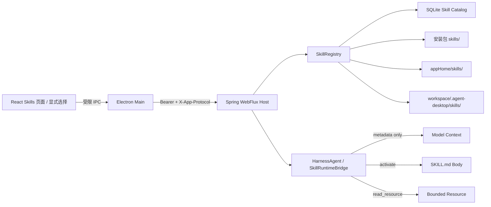

# 第 4 周详细设计：Skill 发现、显式/隐式激活与渐进加载

> 状态：已定稿，可作为第 4 周开发基线  
> 日期：2026-08-14  
> 上位方案：[一期最终架构方案](../FINAL_ARCHITECTURE.md)  
> 前置交付：[第 3 周详细设计](WEEK_3_DETAILED_DESIGN.md)、[实施状态](IMPLEMENTATION_STATUS.md)  
> 规范基线：[Agent Skills Specification](https://agentskills.io/specification)、[AgentScope Java v1.1.0-RC2](https://github.com/agentscope-ai/agentscope-java/releases/tag/v1.1.0-RC2)

## 0. 设计结论与开工评估

第 3 周 W3-A01～W3-A09 已全部通过，STDIO/Streamable HTTP MCP、Tool Card、软删除、凭据清理和重启恢复均已闭环。第 4 周可以开始。本周严格对应总体方案中的唯一交付：

| 总体方案阶段 | 交付内容 | 验收 |
| --- | --- | --- |
| 第 4 周 | Skill 发现与渐进加载 | Skill 可显式、隐式触发，资源按需读取 |

本周交付本地 Skill Catalog、Agent Skills `SKILL.md` 兼容校验、用户级/工作区级发现、启停/刷新/查看、显式与隐式激活，以及 `SKILL.md → resource` 的渐进披露链路。Java Runtime 是发现与加载的唯一可信执行边界；Renderer 只管理非敏感元数据和显式选择，不直接读取本地 Skill 文件。

本周不执行 Skill 脚本，不根据 `allowed-tools` 自动授权 Tool，不实现文件写入、Shell、审批、Skill 导入/安装、市场、自演化 Skill 或多 Agent。用户确认的本地/公开 GitHub Skill 导入属于新增第 5 周；脚本执行和高风险 Tool 顺延至第 6 周 `PermissionEngine`；市场、后台同步和无人值守自动安装不在一期范围。

### 0.1 本周完成定义

只有 W4-A01～W4-A09 全部通过，才能将第 4 周标为完成：

1. 内置、用户级和当前工作区 Skill 可被发现、校验、启停、刷新和查看；重名时使用确定性覆盖规则。
2. 初始 Agent 上下文只包含已启用 Skill 的 `name` 与 `description`，不包含正文、资源或脚本内容。
3. 用户可在输入区显式选择 Skill；未显式选择时，Agent 可仅依据 `description` 通过结构化内部调用隐式激活。
4. 激活后才加载完整 `SKILL.md`；只有已激活 Skill 可继续按需读取其资源，且所有路径都限制在该 Skill 根目录内。
5. `scripts/` 只进入资源目录，不被自动执行；`allowed-tools` 不产生任何授权效果。
6. 激活、资源读取和错误只持久化安全摘要，不把 Skill 正文、资源全文、绝对路径或原始 reasoning 写入普通 Item/日志。

## 1. 范围与边界

### 1.1 本周必须交付

1. 在 `agent-runtime` 内新增 Skill Repository/Registry/Activation 边界，并与固定版本 AgentScope Java `HarnessAgent` 的 Skill 能力适配。
2. 支持三类只读来源：安装包内置 `skills/`、`%USERPROFILE%\.agent-desktop\skills`、当前 workspace 的 `.agent-desktop\skills`。
3. 按 Agent Skills 开放规范发现每个一级子目录中的 `SKILL.md`，校验 YAML frontmatter、目录名、正文和资源清单。
4. Skill 启停、手动刷新、查看、状态诊断、来源优先级和重名覆盖；应用启动时自动完成一次有界刷新。
5. 显式激活：输入区 Skill 选择器将稳定 `skillId` 放入当前 Turn 请求；Runtime 在第一次模型调用前加载正文。
6. 隐式激活：初始上下文只注入元数据；模型以内部结构化 `skill.activate` 调用选择 Skill，Runtime 校验后加载正文并继续当前 ReAct Turn。
7. 渐进资源读取：激活结果只返回资源清单；模型再以内部结构化 `skill.read_resource` 按 `resourceId` 读取所需文本资源。
8. React “Skills”设置页、输入区显式 Skill chips、激活状态提示，以及独立 `verify-week4.ps1`。

### 1.2 明确不在本周

- 不执行 `scripts/` 中的 Python、JavaScript、Shell、Java 或二进制文件；不提供“运行脚本”按钮。
- 不实现 `PermissionEngine`、`ALLOW_ONCE`、`ALLOW_THREAD`、审批卡、文件根目录授权或危险 Tool 执行；它们顺延至第 6 周。
- 不将 Agent Skills 规范中的实验性 `allowed-tools` 当作权限白名单；本周只解析、展示和审计该字段。
- 不支持 Skill 导入/安装；用户确认的本地目录和公开 GitHub 导入属于新增第 5 周。Skill 市场、任意 URL、ZIP 文件导入、自动更新、Nacos Skill Repository 和云同步仍不在一期范围。
- 不创建、自修改、自动学习或自动保存 Skill；不实现 AgentScope 的 self-evolution 能力。
- 不实现多 Agent、subagent、RAG、向量检索、Computer Use 或浏览器自动化。
- 不允许 Renderer 传入任意本地根路径、相对路径或 URL 让 Host 读取。

### 1.3 Skill 与 Tool 的边界

Skill 是按需加载的指令与资源包，不是可执行权限，也不替代 MCP：

| 内容 | 第 4 周行为 |
| --- | --- |
| `name`、`description` | 发现时读取并进入有界元数据目录 |
| `SKILL.md` 正文 | 仅在 Skill 激活后进入当前 Turn 内存上下文 |
| `references/` 文本 | 仅由已激活 Skill 按需读取 |
| `assets/` | 发现元数据；文本资产可按需读取，二进制只返回描述符 |
| `scripts/` | 发现和展示；可按文本审阅，但绝不执行 |
| `allowed-tools` | 实验字段，仅展示；不会覆盖 W3 执行门或 W5 权限决策 |
| MCP Tool | 继续由 `ToolGateway`/`McpClientManager` 管理，不因 Skill 激活自动启用 |

## 2. 目标架构与职责



### 2.1 职责边界

| 组件 | 职责 | 禁止事项 |
| --- | --- | --- |
| Electron Renderer | Skill 列表、启停、刷新、只读查看、当前 Turn 显式选择 | 不读取文件、不提交绝对路径、不执行脚本、不解释权限字段 |
| Electron Main | 白名单 IPC、发送方/schema 校验、Host API 转发 | 不解析 YAML、不拼接文件路径、不加载 Skill 正文 |
| Java Host | REST、状态码、当前 workspace 绑定、激活事件适配 | 不把绝对路径/正文/资源全文写入普通 AG-UI 事件 |
| `SkillRegistry` | 来源扫描、规范校验、覆盖解析、目录快照与诊断 | 不执行文件、不联网、不自动安装 |
| `SkillRuntimeBridge` | 元数据注入、显式/隐式激活、资源按需加载、预算控制 | 不做最终 Tool 权限决策，不暴露任意路径读取工具 |
| `agent-persistence` | 非敏感目录、启停状态、hash、激活摘要 | 不保存 Skill 正文、资源正文、脚本内容或 secret |

### 2.2 模块依赖

```text
desktop-ui ──preload IPC──> desktop-shell ──HTTP──> agent-host
                                                     │
                                                     v
agent-persistence <── agent-runtime/skill <── HarnessAgent
                           │
                           └──> agent-mcp（仅共享 ToolDescriptor，不反向授权）
```

本周不新增反向依赖。Skill 实现位于 `agent-runtime` 的 `skill` 包；仓库根目录 `skills/` 只存内置 Skill 内容。实现时通过父 POM 的 dependency management 固定 `io.agentscope:agentscope-harness:1.1.0-RC2`，不得使用动态版本。若 AgentScope RC2 的具体 API 变化，只允许在 `AgentScopeSkillAdapter` 内处理，Host、UI 和持久化契约不依赖 `SkillBox` 的内部类型。

## 3. Agent Skills 规范兼容

### 3.1 目录与 Frontmatter

一个 Skill 至少包含：

```text
skill-name/
├─ SKILL.md
├─ scripts/       # 可选；W4 不执行
├─ references/    # 可选；按需读取
└─ assets/        # 可选；按需读取/引用
```

`SKILL.md` 必须是 UTF-8、YAML frontmatter 加 Markdown 正文。支持字段：

| 字段 | 规则 | W4 行为 |
| --- | --- | --- |
| `name` | 必填，1～64，`^[a-z0-9]+(?:-[a-z0-9]+)*$`，与父目录一致 | 作为稳定选择名 |
| `description` | 必填，1～1024，说明做什么及何时使用 | 唯一的隐式匹配文本 |
| `license` | 可选，短文本或 Skill 内相对文件引用 | 展示，不加载外部 URL |
| `compatibility` | 可选，1～500 | 展示为环境提示，不自动授权 |
| `metadata` | 可选，string→string | 保存非敏感副本，不能含 secret |
| `allowed-tools` | 可选、实验性、空格分隔字符串 | 展示但不授权 |

未知顶层字段保留到 `extensions_json` 以便前向兼容，但不驱动执行。YAML 禁止自定义 tag、对象反序列化、anchor 爆炸和递归结构；frontmatter 超过 64 KiB 直接拒绝。

### 3.2 大小与兼容性限制

- `SKILL.md` 硬上限 128 KiB；超过 500 行或估算 5,000 tokens 产生兼容性警告，但未超过硬上限仍可由用户显式激活。
- 每个 Skill 最多登记 256 个普通文件，目录深度最多 8，单文件元数据扫描不读取正文；该深度允许 scripts 下携带规范化 Office Schema 资源树。
- 每次文本资源读取上限 256 KiB；单 Turn 资源正文累计 1 MiB，激活 Skill 最多 5 个，Skill 正文累计建议不超过 20,000 tokens。
- 超过上下文预算不静默截断指令，返回稳定错误并让 Agent/用户减少激活数量或拆分 Skill。
- 二进制资源不编码进模型上下文，只返回名称、类型、大小和稳定 `resourceId`。

## 4. 来源、发现与刷新

### 4.1 固定来源和优先级

| 优先级 | Scope | 根目录 | 写入方 |
| --- | --- | --- | --- |
| 1 | `WORKSPACE` | `<workspace>\.agent-desktop\skills` | 用户/项目工具 |
| 2 | `USER` | `<appHome>\skills` | 用户 |
| 3 | `BUILTIN` | 安装包 `resources\skills` | 发布包 |

同名 Skill 只激活最高优先级的有效条目；低优先级条目标记 `SHADOWED` 并在设置页显示覆盖来源。不同来源的文件绝不合并。高优先级条目无效时不静默回退到同名低优先级 Skill，避免替换攻击；用户修复、停用或移除后刷新才重新解析。

W4 不支持任意自定义根目录。工作区改变时切换 `WORKSPACE` source，并为下一 Turn 重建元数据目录；运行中的 Turn 使用开始时冻结的 Skill 快照。

### 4.2 扫描算法

```text
refresh(scope)
  -> 解析受信根目录 real path
  -> 枚举根目录的一级普通子目录（不跟随 symlink/reparse point）
  -> 查找精确文件名 SKILL.md
  -> 有界读取 frontmatter，校验 name/description/目录名
  -> 流式计算 SKILL.md SHA-256，不把正文写数据库
  -> 枚举普通资源元数据并生成 resourceId
  -> 解析跨 scope 重名和 SHADOWED 状态
  -> 单事务替换 catalog snapshot
  -> 发布非敏感 refresh summary
```

规则：

1. 启动时刷新一次；设置页提供手动刷新。本周不启用文件 watcher，避免半写入文件和事件风暴。
2. 刷新使用 generation；成功扫描后一次提交。单个无效 Skill 记录诊断但不使其他 Skill 消失；根目录级 I/O 失败保留上一代目录并返回失败。
3. 已删除条目标记 `MISSING` 并从默认可用列表隐藏；历史激活记录保留。
4. `enabled` 是 `(scope, name)` 的用户配置；内容刷新不得自动把用户停用的 Skill 重新启用。
5. 激活前重验 `content_hash`。发现文件已变化时返回 `SKILL_STALE` 并触发一次有界刷新，不在同一调用中加载未审计新内容。

## 5. 数据模型与 V5 迁移

新增 `V5__skill_catalog.sql`。数据库只保存目录、状态、hash 和安全审计，不保存正文或资源内容。

```sql
CREATE TABLE skill_source (
  id TEXT PRIMARY KEY,
  scope TEXT NOT NULL,
  workspace_id TEXT NOT NULL DEFAULT '',
  root_path TEXT NOT NULL,
  enabled INTEGER NOT NULL CHECK (enabled IN (0,1)),
  generation INTEGER NOT NULL DEFAULT 0,
  last_scan_status TEXT NOT NULL,
  last_error_code TEXT,
  last_scanned_at TEXT,
  created_at TEXT NOT NULL,
  updated_at TEXT NOT NULL,
  UNIQUE(scope, workspace_id, root_path),
  CHECK (scope IN ('BUILTIN','USER','WORKSPACE'))
);

CREATE TABLE skill_entry (
  id TEXT PRIMARY KEY,
  source_id TEXT NOT NULL,
  name TEXT NOT NULL,
  relative_directory TEXT NOT NULL,
  description TEXT NOT NULL,
  license TEXT,
  compatibility TEXT,
  metadata_json TEXT NOT NULL,
  allowed_tools_text TEXT,
  extensions_json TEXT NOT NULL,
  status TEXT NOT NULL,
  enabled INTEGER NOT NULL CHECK (enabled IN (0,1)),
  content_hash TEXT NOT NULL,
  warning_codes_json TEXT NOT NULL,
  shadowed_by_id TEXT,
  discovered_at TEXT NOT NULL,
  updated_at TEXT NOT NULL,
  UNIQUE(source_id, relative_directory),
  FOREIGN KEY(source_id) REFERENCES skill_source(id)
);

CREATE TABLE skill_resource (
  id TEXT PRIMARY KEY,
  skill_id TEXT NOT NULL,
  relative_path TEXT NOT NULL,
  kind TEXT NOT NULL,
  media_type TEXT,
  byte_size INTEGER NOT NULL,
  content_hash TEXT,
  executable_candidate INTEGER NOT NULL CHECK (executable_candidate IN (0,1)),
  UNIQUE(skill_id, relative_path),
  FOREIGN KEY(skill_id) REFERENCES skill_entry(id)
);

CREATE TABLE skill_activation (
  turn_id TEXT NOT NULL,
  skill_id TEXT NOT NULL,
  activation_reason TEXT NOT NULL,
  content_hash TEXT NOT NULL,
  activated_at TEXT NOT NULL,
  PRIMARY KEY(turn_id, skill_id),
  FOREIGN KEY(turn_id) REFERENCES turn(id),
  FOREIGN KEY(skill_id) REFERENCES skill_entry(id)
);

CREATE INDEX idx_skill_entry_status_name ON skill_entry(enabled,status,name);
CREATE INDEX idx_skill_resource_skill_kind ON skill_resource(skill_id,kind,relative_path);
```

`root_path` 是本机非敏感配置，只返回 scope 和友好相对位置给 Renderer；普通快照、Agent 上下文和日志不输出绝对路径。`metadata_json`/`extensions_json` 经过深度、字段数、大小和 secret-name 检查。

## 6. 渐进加载与激活状态机

### 6.1 三阶段披露

```text
阶段 1 DISCOVERED
  当前可用 Skill 的 name + description + skillId 进入元数据目录

阶段 2 ACTIVATED
  显式选择，或模型结构化调用 skill.activate(skillId)
  -> 重验 enabled/status/hash/budget
  -> 加载完整 SKILL.md 正文到当前 Turn 内存上下文
  -> 返回资源清单，不读取资源正文

阶段 3 RESOURCE_LOADED
  模型结构化调用 skill.read_resource(skillId, resourceId)
  -> 要求 Skill 已激活
  -> 重验普通文件、real path、hash、大小与累计预算
  -> 只把该资源内容返回当前 Turn
```

初始系统上下文不得包含 `SKILL.md` body、资源文本、脚本文本、绝对路径、`allowed-tools` 或未知扩展字段。元数据目录按 `name` 排序并带 generation/hash；最多 200 个可用 Skill、总描述 64 KiB，超过时返回 `SKILL_CATALOG_TOO_LARGE`，不随机丢弃。

### 6.2 显式激活

- 输入区提供可搜索的 Skill 选择器，选择值为稳定 `skillId`；最多选择 5 个。
- `StartTurnInput` 新增 `explicitSkillIds: string[]`。Main 只校验 ID 格式和数量，Host 再校验其属于当前 workspace 的可用目录。
- 显式 Skill 在第一次模型请求前加载；任一无效项返回明确错误，不静默改为隐式匹配或同名低优先级 Skill。
- UI 可把 `$skill-name` 转换为选择 chip，但 Runtime 只信任结构化 ID，不从自然语言猜测绝对路径。

### 6.3 隐式激活

- HarnessAgent 只看到 `name` 和 `description`，并获得内部只读工具 `skill.activate`。
- 当用户请求与 description 匹配时，模型用原生结构化 Tool Calling 提交 `skillId`；不解析“请使用某 Skill”之类自由文本为文件操作。
- `skill.activate` 是 Runtime 内部上下文加载动作，不是 MCP Tool，不显示普通 Tool Card，也不获得网络、文件写入或进程权限。
- 激活结果追加 `STATUS` Item 和 `CUSTOM skill.activated` 事件，只包含 `skillId`、`name`、`scope`、`reason=EXPLICIT|IMPLICIT`、`contentHash`。
- 禁止保存或展示模型选择 Skill 的原始 reasoning；只记录最终激活决定。

### 6.4 资源读取

`skill.read_resource` 参数只接受当前激活结果返回的 `resourceId`，不接受任意路径。资源目录生成时保存相对路径；读取时重新执行：

1. `sourceRoot + relativeDirectory + relativePath` 规范化；real path 必须仍位于同一 Skill 根目录。
2. 文件必须为普通文件，不是 symlink、junction、device、FIFO 或目录。
3. 当前 hash/大小必须与目录一致；不一致返回 `SKILL_STALE`。
4. UTF-8 文本才返回正文；二进制返回 `SKILL_RESOURCE_BINARY` 描述符，不进入模型上下文。
5. `scripts/` 资源即使是文本也标记 `executableCandidate=true`；W4 只能审阅内容，不能调用执行器。

## 7. Runtime 与事件契约

### 7.1 稳定接口

```java
interface SkillRegistry {
  SkillPage list(SkillQuery query);
  SkillDetail get(String skillId, boolean includeInstructions);
  SkillRefreshResult refresh(SkillScope scope, String workspaceId);
  SkillSummary setEnabled(String skillId, boolean enabled);
  SkillCatalogSnapshot snapshot(String workspaceId);
}

interface SkillRuntimeBridge {
  SkillTurnContext prepare(String turnId, String workspaceId, List<String> explicitSkillIds);
  ActivatedSkill activate(String turnId, String skillId, ActivationReason reason);
  SkillResourceContent readResource(String turnId, String skillId, String resourceId);
}

record SkillMetadata(String id, String name, String description, SkillScope scope) {}
record ActivatedSkill(String id, String name, String instructions,
                      String contentHash, List<SkillResourceDescriptor> resources) {}
```

`AgentScopeSkillAdapter` 把这些契约接入 RC2 `HarnessAgent`/Skill 状态 API。应用自身负责来源、启停、路径和审计；不得让框架默认文件工具、shell backend、auto-upload 或 self-evolution 绕过本设计。若使用 `SkillBox`，必须显式关闭代码执行和自动保存能力。

### 7.2 Item/AG-UI 映射

| 事件 | Item visibility | 字段 |
| --- | --- | --- |
| `CUSTOM skill.activated` | `USER`/`STATUS` | skillId、name、scope、reason、contentHash |
| `CUSTOM skill.activation_failed` | `USER`/`ERROR` | skillId、稳定 errorCode、安全 message |
| `CUSTOM skill.resource_loaded` | `SYSTEM_AUDIT`/`STATUS` | skillId、resourceId、kind、byteSize、contentHash |
| `CUSTOM skill.catalog_refreshed` | 不进入会话；设置页状态 | generation、valid/invalid/shadowed 数量 |

Skill 正文和资源全文只作为当次模型 Observation 存在于内存，不成为 AG-UI value、普通 Item、错误弹窗或日志。重启后历史会话可以显示“曾激活哪个 Skill”，但不自动重放激活或续跑 Turn。

## 8. Host API、Electron IPC 与 UI

### 8.1 Host API

所有接口继续要求 loopback、启动 Bearer 和 `X-App-Protocol: 1`。

| 方法 | 路径 | 用途 |
| --- | --- | --- |
| `GET` | `/api/v1/skills` | 按 scope/status 列出非敏感摘要 |
| `GET` | `/api/v1/skills/{id}` | 获取详情和只读 `SKILL.md` 文本 |
| `GET` | `/api/v1/skills/{id}/resources` | 获取资源描述符，不返回正文 |
| `GET` | `/api/v1/skills/{id}/resources/{resourceId}` | 设置页只读查看受限文本资源 |
| `POST` | `/api/v1/skills:refresh` | 刷新指定 scope/当前 workspace |
| `PATCH` | `/api/v1/skills/{id}` | 仅修改 `enabled` |

详情接口返回正文仅用于用户主动查看；响应设置 `text/plain` 语义并作为纯文本渲染，不执行 Markdown HTML、链接、图片、脚本或自定义组件。

### 8.2 preload API

```ts
type AgentDesktopApi = {
  listSkills(input?: { scope?: SkillScope; status?: SkillStatus }): Promise<SkillPage>;
  getSkill(skillId: string): Promise<SkillDetail>;
  listSkillResources(skillId: string): Promise<SkillResourceDescriptor[]>;
  readSkillResource(input: { skillId: string; resourceId: string }): Promise<SkillResourceView>;
  refreshSkills(scope?: SkillScope): Promise<SkillRefreshResult>;
  setSkillEnabled(input: { skillId: string; enabled: boolean }): Promise<SkillSummary>;
};

type StartTurnInput = {
  threadId?: string;
  message: string;
  explicitSkillIds?: string[];
};
```

IPC 不暴露 `readFile(path)`、`scanDirectory(path)`、`runScript`、通用 HTTP 或通用 Host invoke。

### 8.3 React 页面

新增“Skills”入口：

- 列表显示 name、description、scope、enabled、status、覆盖关系、compatibility warning 和最近错误码。
- 支持按 scope/status 筛选、手动刷新、启停、打开只读 `SKILL.md` 和资源清单。
- 无效 Skill 仍可在“诊断”筛选中查看安全错误，不把解析异常 stack 暴露给用户。
- 输入区提供显式 Skill 选择器和已选 chips；发送后选择清空，不默认跨 Turn 保留。
- 时间线显示“已显式/隐式启用 `<name>`”的小型状态条，不伪装成 Tool Card。
- viewer 必须转义内容；Skill 内链接只显示文本，不自动导航、不读取 URL、不加载本地图片。

## 9. 安全设计

1. **固定根目录**：仅扫描内置、用户和当前 workspace 三个根；不接受 Renderer/模型提供的根路径。
2. **路径规范化**：扫描和每次读取都校验 real path；拒绝 symlink、junction、reparse point、设备文件和目录逃逸。
3. **内容不可信**：Skill 指令可影响模型行为，但不能改变 Host 系统策略、MCP 执行门或未来 `PermissionEngine` 决策。
4. **无脚本执行**：W4 不注册 Skill script executor；文件扩展名、shebang、`allowed-tools` 和正文指令都不能触发进程。
5. **渐进披露**：发现只进入元数据上下文；正文和资源只进入当前 Turn 内存，受单文件/总量/数量预算控制。
6. **无隐式授权**：`allowed-tools`、compatibility 和 metadata 都不产生 Tool、网络、文件或环境变量权限。
7. **脱敏**：frontmatter、正文、资源和解析异常经过 secret detector；疑似凭据不会进入 UI/日志/Item，Skill 标记 `SKILL_SECRET_DETECTED`。
8. **审计**：记录最终激活/资源读取决定及 hash，不记录正文、资源内容、绝对路径或原始 reasoning。
9. **刷新隔离**：运行中 Turn 固定 generation；刷新只影响后续 Turn，避免正文在一次推理中途被替换。

## 10. 错误码

| 错误码 | 语义 | UI 文案方向 |
| --- | --- | --- |
| `SKILL_SOURCE_UNAVAILABLE` | 根目录不可读 | 检查目录权限后刷新 |
| `SKILL_INVALID_FRONTMATTER` | YAML 或必填字段不合法 | 修复 SKILL.md 元数据 |
| `SKILL_NAME_INVALID` | name/目录不符合 kebab-case | 修改目录和 name |
| `SKILL_DUPLICATE_NAME` | 同一 scope 存在冲突 | 保留一个目录后刷新 |
| `SKILL_SHADOWED` | 被高优先级同名 Skill 覆盖 | 查看覆盖来源 |
| `SKILL_DISABLED` | Skill 已停用 | 在设置中启用 |
| `SKILL_NOT_FOUND` | ID 不在当前 catalog | 刷新 Skill 列表 |
| `SKILL_STALE` | 文件与 catalog hash 不一致 | 已触发刷新，请重试 |
| `SKILL_CATALOG_TOO_LARGE` | 元数据目录超过预算 | 停用或移除部分 Skill |
| `SKILL_CONTEXT_BUDGET_EXCEEDED` | 正文累计超过 Turn 预算 | 减少显式 Skill 或拆分内容 |
| `SKILL_RESOURCE_NOT_FOUND` | resourceId 无效/已移除 | 刷新 Skill |
| `SKILL_RESOURCE_OUT_OF_SCOPE` | 路径逃逸或非普通文件 | 资源被安全拒绝 |
| `SKILL_RESOURCE_TOO_LARGE` | 文本资源超过上限 | 拆分资源 |
| `SKILL_RESOURCE_BINARY` | 二进制不能进入文本上下文 | 仅显示资源描述 |
| `SKILL_SCRIPT_EXECUTION_BLOCKED` | W4 拒绝执行脚本 | 等待第 6 周审批执行链路 |
| `SKILL_SECRET_DETECTED` | 内容疑似包含凭据 | 移除 secret 后刷新 |

## 11. 实施顺序

| 工作包 | 内容 | 可演示产物 |
| --- | --- | --- |
| W4-A 规范与目录 | V5、来源、scanner、frontmatter/resource 校验、覆盖规则 | 三个 scope 的有效/无效 Skill 列表 |
| W4-B 渐进加载 | metadata snapshot、显式激活、内部 `skill.activate`、资源读取与预算 | 证明正文/资源分别按阶段加载 |
| W4-C Runtime/事件 | Harness adapter、Turn snapshot、激活审计和 AG-UI 状态 | 显式/隐式激活进入同一会话时间线 |
| W4-D 桌面交互 | Host API、Main/preload、Skills 页面、composer chips | 启停/刷新/查看/选择闭环 |
| W4-E 验收 | Skill fixtures、越界/脚本/刷新/重启/secret 测试、`verify-week4.ps1` | 一条命令完成 W4 验收和 W3 回归 |

依赖顺序为 `W4-A → W4-B → W4-C → W4-D → W4-E`。不得先在 UI 模拟 Skill，不得把整库正文注入模型，不得为验收绕过路径和脚本执行边界。

## 12. 测试设计

### 12.1 Fixtures

- `explicit-summary`：显式选择后才加载正文，引用 `references/format.md`。
- `implicit-code-review`：description 明确匹配“代码审查”，测试 Provider 产生结构化 `skill.activate`。
- `resource-on-demand`：正文引用两个资源，只读取用户请求需要的一个。
- `script-blocked`：包含 `scripts/run.js` 和“立即执行”指令，断言 marker 文件始终不存在。
- `invalid-*`：覆盖非法 name、目录不匹配、空 description、恶意 YAML、超大正文、symlink/junction、越界资源和疑似 secret。
- 三 scope 放置同名 Skill，验证 workspace > user > builtin 及 `SHADOWED` 状态。

### 12.2 Java 单元与集成测试

1. V5 migration、目录快照恢复、启停保留和 removed→MISSING。
2. Agent Skills 必填/可选字段、kebab-case、目录名一致性、YAML 安全限制。
3. 三 scope 优先级、同 scope 冲突和无效高优先级不静默回退。
4. symlink/junction、`..`、大小写路径、Windows reserved path 和刷新 TOCTOU 拒绝。
5. discovery context 只含 name/description；正文在 activate 前加载次数为 0。
6. 显式激活在首个模型请求前完成；隐式激活只接受结构化 skillId。
7. 未激活 Skill、错误 resourceId、二进制、超大/变更资源均稳定拒绝。
8. scripts 不产生进程，`allowed-tools` 不改变 ToolGateway 结果；W3 高风险 Tool 继续 `TOOL_APPROVAL_REQUIRED`。
9. generation 冻结、并发刷新、取消和重启不重复激活历史 Turn。
10. Item/AG-UI/日志/SQLite 不包含正文、资源全文、绝对路径、secret 或 reasoning。

### 12.3 Renderer/Electron 测试

1. Skill 列表/筛选/启停/刷新/只读 viewer；viewer 对 HTML/脚本/链接全部按文本处理。
2. 显式选择 chips 只向 Main 发送稳定 ID，发送后清空；disabled/shadowed Skill 不可选择。
3. 未选 Skill 到达 catalog refresh 时不修改当前输入；运行中 Turn 不被刷新替换。
4. preload 无通用文件/进程/URL API，所有 Skill IPC 校验 sender、ID、数量和 schema。
5. 生产构建下显式、隐式和资源按需读取均可完成，重启后目录/启停和历史激活摘要恢复。

### 12.4 `verify-week4.ps1`

```text
1. mvn clean verify、TypeScript typecheck、桌面生产构建，并执行第 3 周回归。
2. 创建隔离 appHome/workspace，写入内置、用户、工作区 Skill fixtures。
3. 启动 Electron/Host；验证启动只扫描 metadata，Skill body/resource load counter 均为 0。
4. 显式选择 explicit-summary；验证正文在首个模型调用前加载，未引用资源仍为 0。
5. 触发 implicit-code-review；验证只根据 description 产生结构化激活并记录 IMPLICIT。
6. 请求 resource-on-demand 的单个引用；验证只读取目标 resourceId，另一个资源仍未加载。
7. 验证禁用、shadow、刷新、stale、越界、超大、二进制与恶意 YAML 错误码。
8. 验证 script marker 不存在，allowed-tools 未授权任何 W3 高风险 Tool。
9. 关闭并重启；验证 catalog/启停/激活摘要恢复，历史 Turn 不自动重放。
10. 扫描 appHome、SQLite、日志、事件和构建输出，不得命中 fixture secret、正文哨兵、绝对路径或 reasoning。
```

## 13. 第 4 周验收矩阵

| 编号 | 场景 | 通过条件 |
| --- | --- | --- |
| W4-A01 | 多 scope 发现 | builtin/user/workspace 均发现；优先级、shadow 和无效项确定性 |
| W4-A02 | 规范兼容 | name/description/可选字段符合 Agent Skills 规范，错误码稳定 |
| W4-A03 | 管理 UI | 可启停、刷新、查看正文/资源描述，Renderer 不直接读文件 |
| W4-A04 | 显式激活 | 用户选择的 Skill 在首个模型请求前加载，选择按 Turn 隔离 |
| W4-A05 | 隐式激活 | 未显式选择时，仅依据 description 通过结构化调用激活正确 Skill |
| W4-A06 | 渐进资源 | 启动不加载正文，激活不加载资源，只按 resourceId 读取所需资源 |
| W4-A07 | 安全边界 | 无路径逃逸、无脚本执行、无 allowed-tools 隐式授权、无正文/secret 泄露 |
| W4-A08 | 周次边界 | 未实现审批、写文件、Shell、市场、远程安装、自演化或多 Agent |
| W4-A09 | 自动化 | Maven、TypeScript、Electron、显式/隐式/资源、重启、W3 回归和敏感扫描均返回 0 |

## 14. Definition of Done

- 用户级、工作区级和内置 Skill 均以统一 catalog 管理；设置页可启停、刷新和查看。
- 初始上下文只含 name/description；完整 `SKILL.md` 与资源分别在激活和按需读取时加载。
- 显式和隐式激活使用同一稳定 skillId、generation、预算和审计边界。
- Skill 内容不能直接执行脚本、启用 MCP Tool、扩大文件/网络/进程权限或修改 Host 策略。
- 路径、YAML、内容大小、TOCTOU、重复名称、secret 和重启均有自动化证据。
- 第 1～3 周所有验证保持通过，W4 不提前实现第 5 周导入能力或第 6 周审批与根目录控制。

通过本周验收后，进入新增第 5 周 Skill 导入与安装；`PermissionEngine`、Approval Card 和文件根目录控制顺延至第 6 周。W4 的 `allowed-tools`、脚本候选和资源描述符只为后续权限设计提供输入，不代表任何预授权。
