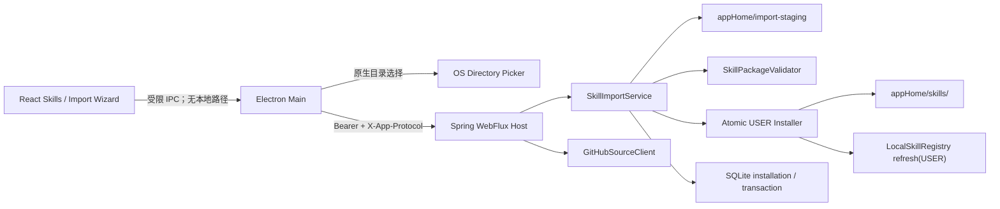
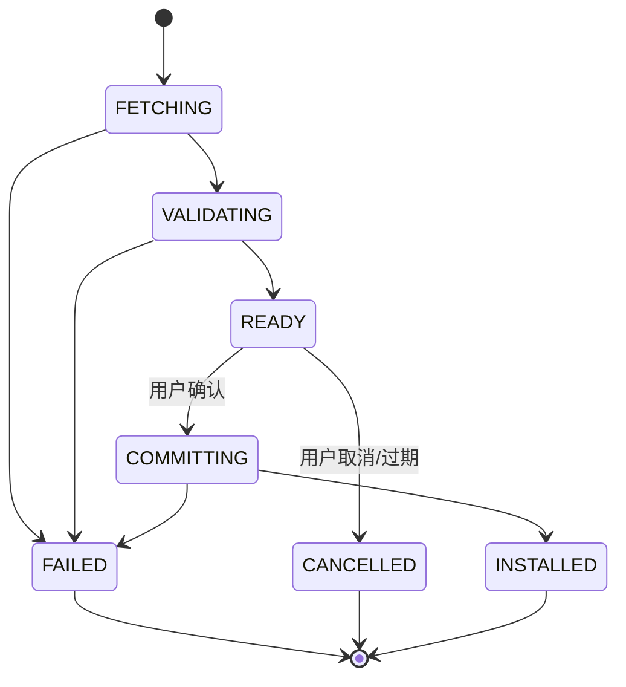

# 第 5 周详细设计：Skill 导入与安装

> 状态：已实现并通过第 5 周自动化验收  
> 日期：2026-08-18  
> 上位方案：[一期最终架构方案](../FINAL_ARCHITECTURE.md)  
> 前置交付：[第 4 周详细设计](WEEK_4_DETAILED_DESIGN.md)、[实施状态](IMPLEMENTATION_STATUS.md)  
> 规范基线：[Agent Skills Specification](https://agentskills.io/specification)、[GitHub REST API](https://docs.github.com/en/rest/repos/contents)、[AgentScope Java v1.1.0-RC2](https://github.com/agentscope-ai/agentscope-java/releases/tag/v1.1.0-RC2)

## 0. 设计结论与开工评估

第 4 周 W4-A01～W4-A09 已全部通过，固定三 scope Skill Catalog、规范校验、显式/隐式激活和渐进资源加载已经闭环。新增第 5 周只扩展“如何把用户明确选择的外部 Skill 安全复制到现有 USER 根目录”，不改变 Skill 的发现、激活、Tool 权限和脚本执行模型。

调整后的一期排期为：

| 总体方案阶段 | 交付内容 | 验收 |
| --- | --- | --- |
| 第 5 周 | Skill 导入与安装 | 本地目录与公开 GitHub Skill 可预检、确认安装、追溯和回滚 |
| 第 6 周 | 权限审批与根目录控制 | 高风险操作均可暂停、批准或拒绝 |
| 第 7 周 | 打包、升级、崩溃恢复 | 可安装、升级，异常退出不丢失已持久化事件 |
| 第 8～9 周 | 兼容性、稳定性与内测 | 模型、MCP、取消、恢复和安全边界测试通过 |

本周实现用户主动发起的本地目录和公开 GitHub 导入。导入必须经过“检查 → 用户确认 → 原子安装”三道门，最终只写入 `appHome/skills/<skill-name>/`，并由现有 `SkillRegistry` 重新发现。导入不等于激活或授权；新安装 Skill 默认停用，用户审阅后再通过现有启停能力启用。

本周不执行 Skill 脚本，不自动授权 `allowed-tools`，不自动安装或启用 MCP Server，不实现 PermissionEngine、市场、私有 GitHub、任意 URL、ZIP 文件导入、后台同步或自动更新。原第 5 周 PermissionEngine 与人工审批完整顺延至第 6 周。

### 0.1 本周完成定义

只有 W5-A01～W5-A10 全部通过，才能将第 5 周标为完成：

1. 用户可从系统目录选择器选择一个包含 `SKILL.md` 的本地目录；Renderer 不接收也不提交绝对路径。
2. 用户可输入公开 GitHub 仓库、ref 和 Skill 子目录；Host 将 ref 解析成固定 commit SHA 后获取内容。
3. 外部内容先进入应用管理的隔离 staging；通过路径、大小、文件类型、secret 和 Agent Skills 规范校验后才生成预览。
4. 预览展示来源、名称、描述、许可证、资源、脚本候选、兼容性、依赖提示、冲突与最终安装状态，不加载或执行内容。
5. 用户二次确认后才安装；目标限定为 USER scope，新安装默认停用，安装过程可恢复、可回滚且不会留下半安装目录。
6. 安装来源、GitHub commit、子目录、包 hash、内容 hash、安装时间和替换关系进入可信数据库；外部 `_user_meta.json` 不作为可信来源。
7. `agents/openai.yaml` 仅按受限扩展 schema 提取展示信息和 MCP 依赖提示，不改变隐式激活、ToolGateway 或后续 PermissionEngine。
8. 删除和替换均需显式确认；删除只影响由本应用管理的 USER 安装，不删除内置、工作区或任意外部原目录。
9. 导入、删除、回滚和清理不把绝对路径、正文、资源内容、凭据或 Authorization 写入普通日志、Item 或 Renderer 状态。
10. `verify-week5.ps1` 覆盖 Java、TypeScript、生产 Renderer、真实 Host、恶意包、崩溃恢复、指标提取兼容性及 Week 4 完整回归。

### 0.2 外部指标提取 Skill 兼容性基线

开工前已将本轮提供的 `indicator-extraction` 外部目录复制到受控临时 staging，并通过当前 Java Host/`LocalSkillRegistry` 真实扫描：

| 检查项 | 结果 |
| --- | --- |
| 目录/`name` | `indicator-extraction`，一致且符合 kebab-case |
| 文件 | 7 个，共 54,934 bytes |
| `SKILL.md` | 23,090 bytes、211 行、约 2,861 tokens |
| Catalog 结果 | `VALID`，无 warning |
| 资源 | 6 个全部发现；`references/` 正确分类 |
| 扩展文件 | `agents/openai.yaml`、`_user_meta.json` 当前按 `other` 资源处理 |

因此标准目录和渐进资源链路无需重写。W5 的新增工作集中在安全取得来源、安装事务、可信 provenance，以及对 `agents/openai.yaml` 的非授权型依赖提示。

## 1. 范围与边界

### 1.1 本周必须交付

1. `agent-runtime` 新增 `SkillImportService`、单 Skill 包校验器、staging/安装事务和来源追踪契约。
2. `agent-host` 新增本地目录源适配和 GitHub 公共仓库客户端；所有下载、校验和文件复制均由 Java 完成。
3. Electron Main 使用原生目录选择框取得一次性本地来源；preload/Renderer 只获得取消状态或导入会话结果。
4. 支持 GitHub 仓库根目录或仓库内指定子目录，支持默认分支、branch、tag 或 commit 输入；最终统一固定为 commit SHA。
5. 安装预检、冲突检查、显式提交、卸载和最近一次替换回滚。
6. 在现有 Skills 页面增加“导入 Skill”、来源选择、检查进度、清单预览、风险/依赖提示和确认对话框。
7. 增加 V6 migration、安装来源审计、启动时 staging/安装事务恢复及 `verify-week5.ps1`。
8. 使用指标提取 Skill 验证外部结构兼容；自动化使用脱敏的等价 fixture，不把用户目录内容提交到仓库。

### 1.2 明确不在本周

- 不支持 Skill 市场、仓库搜索、推荐、评分、发布、账号同步或组织分发。
- 不支持私有 GitHub、GitHub 登录/PAT、GitLab、Gitee、任意 HTTP URL、Nacos Skill Repository 或云盘。
- 不支持用户上传 ZIP/TAR；GitHub 内容优先通过 Contents API 获取，不调用 `git clone`，不执行 Git hooks、submodule 或 LFS。
- 不轮询远端、不提示后台更新、不自动下载、不自动替换；再次导入是一次新的用户操作。
- 不向 WORKSPACE 或 BUILTIN scope 安装；工作区 Skill 仍由用户自行放入固定工作区根目录。
- 不执行 `scripts/`，不创建 Shell/文件写入 Tool，不自动安装 MCP Server，不自动修改 MCP 配置。
- 不实现 `PermissionEngine`、Approval Card、`ALLOW_ONCE`、`ALLOW_THREAD` 或文件根目录授权；这些完整顺延至第 6 周。
- 不信任外部安装元数据、README 徽章、GitHub stars、release 签名或 Skill 中的“已审核”声明。

### 1.3 导入、安装、启用和授权的边界

| 动作 | 含义 | 本周规则 |
| --- | --- | --- |
| 导入检查 | 将一次性外部来源复制到 staging 并解析 | 不影响 Catalog，不进入模型上下文 |
| 安装 | 将已检查的同一份内容原子复制到 USER 根目录 | 必须用户确认，默认停用 |
| 启用 | 允许现有 W4 Runtime 在后续 Turn 选择该 Skill | 复用现有 `PATCH /skills/{id}` |
| 激活 | 把 Skill 指令加载进当前 Turn | 继续遵守 W4 显式/隐式和预算规则 |
| Tool 授权 | 决定 MCP/文件/网络/执行能力能否调用 | 本周不实现，不能由导入或 Skill 内容授予 |

安装确认是设置页的直接用户操作，不创建 `WAITING_APPROVAL` Turn，也不能被模型或 Skill 指令触发。

## 2. 目标架构与职责



### 2.1 职责边界

| 组件 | 职责 | 禁止事项 |
| --- | --- | --- |
| Electron Renderer | 选择来源类型、填写 GitHub 参数、展示预览、提交安装/删除/回滚确认 | 不接收本地绝对路径、不下载、不解压、不读文件、不直接写 USER 根 |
| Electron Main | sender/schema 校验、原生目录选择、Host 转发 | 不解析 YAML、不验证 Skill、不持久化来源路径、不调用 Git CLI |
| Java Host | REST、GitHub HTTPS 客户端、超时/响应限制、错误映射 | 不接受模型发起导入，不开放通用下载或任意路径读取 API |
| `SkillImportService` | 会话、staging、校验、冲突、原子安装、删除、回滚、恢复 | 不执行资源，不自动启用，不修改 MCP/权限配置 |
| `SkillPackageValidator` | 复用 W4 frontmatter/resource/path/secret 规则并生成不可变 manifest | 不写 Catalog，不信任外部元数据 |
| `LocalSkillRegistry` | 安装成功后扫描固定 USER 根并生成稳定 Skill ID | 不联网、不承担下载和安装事务 |
| `agent-persistence` | 来源、commit/hash、安装/回滚事务和安全审计 | 不保存正文、资源内容、本地来源绝对路径或凭据 |

### 2.2 模块依赖

```text
desktop-ui ──preload IPC──> desktop-shell ──HTTP──> agent-host
                                                     │
                                                     ├── GitHubSourceClient
                                                     v
agent-persistence <── agent-runtime/skill/importing ──> agent-runtime/skill validator
                                      │
                                      └──> LocalSkillRegistry（仅安装后 refresh）
```

从 `LocalSkillRegistry` 提取无数据库副作用的 `SkillPackageValidator`；W4 registry 和 W5 importer 必须共用同一套名称、YAML、大小、资源和 secret 规则，禁止复制一份较宽松的导入校验器。

## 3. 来源契约

### 3.1 本地目录

用户必须选择 Skill 根目录本身，该目录一级包含 `SKILL.md`。不自动向上、向下搜索多个 Skill，也不接受文件选择。

```text
selected-directory/
├─ SKILL.md
├─ agents/          # 可选扩展
├─ references/      # 可选
├─ assets/          # 可选
└─ scripts/         # 可选；只复制和标记，绝不执行
```

安全流程：

1. Renderer 调用无路径参数的 `selectAndInspectLocalSkill()`。
2. Main 校验 sender 后打开原生目录选择框；取消时不创建会话。
3. Main 将系统选择结果直接发给 Host，绝对路径不经过 Renderer。
4. Host 使用 `NOFOLLOW_LINKS` 检查来源根及每个条目，拒绝 symlink、junction、reparse point、hardlink 风险、设备文件和目录逃逸。
5. Host 逐文件复制到新 staging 目录，并在复制前后比较类型、大小和 hash；变化返回 `SKILL_IMPORT_SOURCE_CHANGED`。
6. 本地原目录永不修改、移动或删除；数据库只记录 `LOCAL_DIRECTORY`，不记录绝对路径。

### 3.2 公开 GitHub

UI 使用三个字段避免 `/tree/<ref>/<path>` 中 ref 含 `/` 的歧义：

```text
repositoryUrl: https://github.com/<owner>/<repo>
ref:           可选 branch/tag/commit；空值表示远端默认分支
subdirectory:  可选仓库内 POSIX 相对目录；空值表示仓库根
```

Host 只允许 `https`、主机精确等于 `github.com`，owner/repo 使用 GitHub 合法字符白名单；拒绝凭据 URL、IP、端口、query、fragment、路径逃逸和大小写/Unicode 混淆。网络请求只允许 `api.github.com`，不跟随到未授权主机。

获取步骤：

1. 解析并规范化 owner/repo/ref/subdirectory。
2. 通过 GitHub REST 将 ref 解析成 40 位 commit SHA；所有后续读取只使用该 SHA。
3. 通过 Contents API 从指定子目录有界递归获取文件；拒绝 symlink、submodule、超深目录和非 file/dir 类型。
4. 文件内容写入新 staging，逐项校验 API path、Git blob SHA、字节数和本地 SHA-256。
5. 生成来源预览：canonical repository、requested ref、resolved commit、subdirectory 和 package hash。
6. GitHub 403/429 返回稳定限流错误和 reset 提示；不通过代理错误页或网页抓取降级。

W5 不下载或解压用户提供的 ZIP/TAR，因此不产生 Zip Slip 解压面。未来若改用 GitHub Archive API 或增加 ZIP 导入，必须先新增独立安全解压器，拒绝 `..`、绝对/盘符路径、symlink/hardlink、重复/大小写碰撞、压缩炸弹和越界输出；未完成这些验收前不得启用 archive 路径。

### 3.3 来源和包限制

| 限制 | 值 | 行为 |
| --- | --- | --- |
| 同时活动导入会话 | 3 | 超过返回 `SKILL_IMPORT_BUSY` |
| 会话有效期 | 15 分钟 | 到期不可 commit，删除 staging |
| 单 Skill 普通文件 | 256 | 与 W4 一致 |
| 最大目录深度 | 8 | 与 W4 一致；兼容 scripts 下内置 Office Schema 等规范化资源树 |
| `SKILL.md` | 128 KiB | 与 W4 一致 |
| 单资源 | 256 KiB | 与 W4 一致 |
| 包总大小 | 20 MiB | 超过直接拒绝 |
| GitHub 单请求 | 30 秒 | 超时取消整个检查 |
| GitHub 检查总时长 | 2 分钟 | 超时清理 staging |
| staging 全局预算 | 100 MiB | 先清理过期会话，仍不足则拒绝 |

## 4. 检查会话与 Manifest

### 4.1 状态机



会话 ID 使用不可猜测的 `imp_` 前缀随机 ID，只保存在 Host 内存和 Renderer 当前设置页状态；进程退出后会话失效。启动时删除无对应活动安装事务且超过 24 小时的 staging 目录。

### 4.2 不可变检查结果

```java
record SkillImportManifest(
    String sessionId,
    ImportSourceSummary source,
    String name,
    String description,
    String license,
    String compatibility,
    String skillDocumentHash,
    String packageHash,
    long totalBytes,
    List<SkillResourceDescriptor> resources,
    List<SkillDependencyHint> dependencies,
    List<String> warningCodes,
    SkillInstallConflict conflict,
    Instant expiresAt) {}
```

`packageHash` 按规范化 POSIX 相对路径排序后，对 `path + NUL + size + NUL + sha256` 聚合计算。commit 时重新计算 staging manifest 并与检查结果做常量时间比较；任何变化返回 `SKILL_IMPORT_STALE`，不得继续安装。

### 4.3 外部扩展元数据

标准 `SKILL.md` 仍是唯一必需入口。其他文件均先作为普通资源处理：

- `_user_meta.json`：可以作为 `other` 资源保留，但其中 `source`、`installedAt`、名称或信任状态不参与安装决策。
- `agents/openai.yaml`：使用独立、安全、只读的可选扩展解析器；只识别 `interface`、`dependencies.tools[]` 和 `policy.allow_implicit_invocation` 的基础类型，未知字段忽略并保留普通资源身份。
- `dependencies.tools[].type=mcp`：根据现有 MCP catalog 显示 `AVAILABLE`、`DISABLED`、`UNAVAILABLE` 或 `UNKNOWN`；不自动新增、连接、启用或授权 Server。
- `default_prompt`：只在预览中作为纯文本摘要，不注入当前或未来 Turn。
- `allow_implicit_invocation`：只显示来源声明；最终隐式激活仍由 W4 `enabled + description + Runtime policy` 决定。

扩展 YAML 使用与 `SKILL.md` 相同的安全构造器，最大 64 KiB、禁止 alias/递归/custom tag，解析失败产生 warning，不使一个标准 Skill 失效；但疑似 secret 仍使整个导入失败。

## 5. 冲突、安装、删除与回滚

### 5.1 冲突规则

检查时基于 `name` 和当前 catalog 返回：

| 场景 | 预览 | 可提交动作 |
| --- | --- | --- |
| USER 无同名目录 | `NONE` | `INSTALL` |
| USER 同名且 package hash 相同 | `IDENTICAL` | `NO_OP`，不重复写入 |
| USER 同名且内容不同 | `REPLACE_REQUIRED` | 用户勾选替换并提交 expected hash |
| WORKSPACE 同名覆盖 USER | `WILL_BE_SHADOWED` warning | 可安装，但默认停用并明确不会立即生效 |
| BUILTIN 同名 | USER 将按 W4 优先级覆盖 BUILTIN | 必须显示覆盖 warning |
| 同 scope 目录冲突/现有无效项 | `CONFLICTED` | 先清理冲突，不允许安装 |

Renderer commit 只提交 `sessionId`、`action` 和预览中的 `expectedExistingContentHash`；Host 重查当前目标，防止检查后被其他进程替换。

### 5.2 原子安装事务

安装目标固定为 `appHome/skills/<validated-name>`。每个 name 同时只允许一个安装事务：

1. 获取应用内 name 锁，并在 V6 写入 `PREPARING` 事务。
2. 在与 USER 根同卷、但不属于 Catalog 扫描范围的 `appHome/skill-install-work/<transactionId>/<name>` 创建 incoming，从 staging 逐文件复制，禁止跟随链接。
3. 重新验证 incoming manifest、package hash 和每个文件 hash。
4. 若替换，将现有目标重命名为 `appHome/skill-backups/<name>/<transactionId>`，并记录旧 hash。
5. 使用 `ATOMIC_MOVE` 将 incoming 重命名为最终目录；不支持原子移动时返回稳定错误，禁止退化为逐文件覆盖。
6. 调用 `refresh(USER)`，要求新 entry 为预期 `name + contentHash + VALID`。
7. 写入可信 installation/provenance，状态变为 `COMMITTED`；新 entry 强制 `enabled=false`。
8. 任一步失败都恢复旧目录、清理 incoming、刷新上一代 catalog，并记录安全错误码。

备份只保留最近一次成功替换版本，默认保留 7 天；用户可在 Skills 页面执行一次显式回滚。回滚本身复用相同事务、hash 校验、默认停用和 refresh 规则。

### 5.3 删除

只允许删除存在 `skill_managed_install` 记录且 `managed_by_app=true` 的 USER Skill。删除前显示名称、来源和是否被 workspace 覆盖；确认后将目录原子移动到事务 trash，刷新成功后再异步清理。删除不得触及外部本地来源、GitHub、BUILTIN、WORKSPACE 或未被本应用管理的 USER 目录。

## 6. 持久化设计

新增 Flyway `V6__skill_installation.sql`。`skill_managed_install` 表示当前受管安装，revision 表保存当前和最近一次可回滚版本：

```sql
CREATE TABLE skill_managed_install (
  id TEXT PRIMARY KEY,
  skill_name TEXT NOT NULL UNIQUE,
  scope TEXT NOT NULL CHECK (scope = 'USER'),
  managed_by_app INTEGER NOT NULL CHECK (managed_by_app IN (0,1)),
  current_revision_id TEXT,
  backup_revision_id TEXT,
  created_at TEXT NOT NULL,
  updated_at TEXT NOT NULL
);

CREATE TABLE skill_install_revision (
  id TEXT PRIMARY KEY,
  installation_id TEXT NOT NULL,
  revision_state TEXT NOT NULL CHECK (revision_state IN ('ACTIVE','BACKUP','REMOVED')),
  source_type TEXT NOT NULL CHECK (source_type IN ('LOCAL_DIRECTORY','GITHUB')),
  repository_url TEXT,
  requested_ref TEXT,
  resolved_commit_sha TEXT,
  source_subdirectory TEXT,
  package_hash TEXT NOT NULL,
  skill_content_hash TEXT NOT NULL,
  backup_key TEXT,
  installed_at TEXT NOT NULL,
  FOREIGN KEY(installation_id) REFERENCES skill_managed_install(id)
);

CREATE TABLE skill_install_transaction (
  id TEXT PRIMARY KEY,
  skill_name TEXT NOT NULL,
  operation TEXT NOT NULL CHECK (operation IN ('INSTALL','REPLACE','REMOVE','ROLLBACK')),
  state TEXT NOT NULL CHECK (state IN ('PREPARING','BACKED_UP','MOVED','COMMITTED','ROLLED_BACK','FAILED')),
  expected_package_hash TEXT,
  previous_package_hash TEXT,
  last_error_code TEXT,
  created_at TEXT NOT NULL,
  updated_at TEXT NOT NULL
);
```

约束：

- 本地绝对路径、Skill 正文、资源正文、GitHub 响应和凭据不入库。
- `repository_url` 只保存规范化 `https://github.com/<owner>/<repo>`，不得含 query、fragment、userinfo 或 token。
- transaction/revision 不保存 staging/backup 绝对路径；路径只能由 `appHome + transactionId/backup_key + validated name` 重建。
- `current_revision_id`、`backup_revision_id` 必须在同一事务中指向本 installation 的 revision；SQLite 外键与 Repository 校验共同保证该不变量。
- 启动恢复按 state 和磁盘目录确定 commit 或 rollback；不能确定时保持旧版本并将新目录隔离为 quarantine，不猜测成功。

## 7. 稳定服务契约

```java
interface SkillImportService {
  SkillImportManifest inspectLocal(Path selectedByMain);
  SkillImportManifest inspectGitHub(GitHubSkillSource source);
  SkillInstallResult commit(String sessionId, InstallAction action,
                            String expectedExistingContentHash);
  SkillInstallResult remove(String skillId);
  SkillInstallResult rollback(String skillId);
  void cancel(String sessionId);
  ImportRecoveryResult recover();
}

interface SkillPackageValidator {
  ValidatedSkillPackage validate(Path isolatedSkillRoot);
}

record GitHubSkillSource(String repositoryUrl, String ref, String subdirectory) {}
record SkillDependencyHint(String type, String value, DependencyStatus status) {}
```

`SkillImportService` 只能被设置 API 调用，不注册为 Agent Tool，不进入 HarnessAgent Tool Group，也不暴露给 `SkillRuntimeBridge`。任何模型产生的“导入这个 GitHub Skill”只能得到说明性回复，不能触发下载或安装。

## 8. Host API、Electron IPC 与 UI

### 8.1 Host API

所有接口继续要求 loopback、启动 Bearer、`X-App-Protocol: 1`、严格 JSON schema 和有界 body。

| 方法 | 路径 | 用途 |
| --- | --- | --- |
| `POST` | `/api/v1/skill-imports:inspect-local` | Main 传递原生选择结果；不由 preload 接收路径 |
| `POST` | `/api/v1/skill-imports:inspect-github` | 检查公开 GitHub repo/ref/subdirectory |
| `POST` | `/api/v1/skill-imports/{sessionId}:commit` | 用户确认后安装或替换 |
| `DELETE` | `/api/v1/skill-imports/{sessionId}` | 取消检查并清理 staging |
| `DELETE` | `/api/v1/skills/{skillId}/installation` | 删除本应用管理的 USER 安装 |
| `POST` | `/api/v1/skills/{skillId}/installation:rollback` | 回滚最近一次替换 |

检查响应不返回 staging、本地来源或目标绝对路径。网络错误只返回稳定 errorCode、GitHub request ID 的安全摘要和可重试时间，不返回响应头、token 或完整 body。

### 8.2 preload API

```ts
type AgentDesktopApi = {
  selectAndInspectLocalSkill(): Promise<SkillImportManifest | { cancelled: true }>;
  inspectGitHubSkill(input: {
    repositoryUrl: string;
    ref?: string;
    subdirectory?: string;
  }): Promise<SkillImportManifest>;
  commitSkillImport(input: {
    sessionId: string;
    action: 'INSTALL' | 'REPLACE' | 'NO_OP';
    expectedExistingContentHash?: string;
  }): Promise<SkillInstallResult>;
  cancelSkillImport(sessionId: string): Promise<void>;
  removeInstalledSkill(skillId: string): Promise<SkillInstallResult>;
  rollbackInstalledSkill(skillId: string): Promise<SkillInstallResult>;
};
```

preload 不增加 `selectDirectory()`、`readFile()`、`download()`、`extractArchive()`、`installFromPath(path)` 或通用 Host invoke。Main 对本地检查 IPC 不接受 Renderer 参数，确保页面脚本不能指定任意路径。

### 8.3 React Import Wizard

Skills 页面增加“导入 Skill”按钮，流程为：

1. 选择“本地目录”或“公开 GitHub”。
2. 本地直接打开系统选择器；GitHub 填写仓库 URL、ref、子目录。
3. 显示有界进度：正在获取、正在校验、可安装、失败；关闭弹窗会 cancel 会话。
4. 预览显示 name/description、来源、commit、license、compatibility、总大小、资源分类、脚本候选、MCP 依赖、warning 和冲突。
5. 安装/替换使用二次确认；替换必须输入或勾选明确确认，不使用默认焦点危险按钮。
6. 成功后回到 Skills 列表，新 Skill 显示“已安装，未启用”；用户主动打开详情和启用。
7. 本应用管理的 USER Skill 显示来源、commit、安装时间、删除和可用时的回滚入口。

所有 Skill 文本继续按纯文本展示；不渲染外部 HTML、不加载远程图片、不自动打开链接。GitHub 仓库链接只有用户再次点击并确认后才能通过系统浏览器打开，本周可先只显示不可点击文本。

## 9. 安全设计

1. **用户在环**：检查不安装，commit 必须来自当前可见设置页的显式确认；模型、Skill、MCP 和网页内容不能调用导入 API。
2. **受控来源**：本地来源必须来自 Main 原生选择器；远端只允许公开 `github.com` 和固定 GitHub API 主机，不提供任意 URL fetch。
3. **固定内容**：GitHub ref 在检查开始时固定成 commit SHA；commit 使用同一 staging/package hash，不重新读取浮动分支。
4. **隔离 staging**：外部内容不直接写 USER 根；staging 位于 appHome 管理目录，拒绝链接、设备文件、路径逃逸、大小写碰撞和 Windows 保留名。
5. **无 archive 面**：W5 不处理 ZIP/TAR；不得为实现 GitHub 导入临时调用不受控解压库。未来启用前必须通过 Zip Slip/炸弹/链接矩阵。
6. **无代码执行**：脚本只作为 `executableCandidate` 展示；shebang、扩展名、`allowed-tools` 和安装说明均不能启动进程。
7. **无权限继承**：安装、启用和激活都不产生 MCP/文件/网络/执行授权；`agents/openai.yaml` 仅提供依赖提示。
8. **secret 拒绝**：沿用 W4 secret detector；疑似凭据使检查失败，不进入预览、日志、SQLite 或错误 body。
9. **原子与恢复**：不逐文件覆盖现有 Skill；transaction、incoming、backup 和 refresh 必须形成可恢复状态机。
10. **审计最小化**：记录来源类型、固定 commit、hash、动作、结果和稳定错误码，不记录正文、资源内容、本地绝对路径或 GitHub 响应 body。
11. **资源消耗**：限制并发、文件数量、深度、单文件、总大小、请求时长和 staging 总量，取消时传播到 HTTP/文件复制。
12. **供应链提示**：公开 GitHub、commit SHA 和 hash 只提供可追溯性，不等于可信签名；UI 必须明确“来源未由应用背书”。

## 10. 错误码

| 错误码 | 语义 | UI 文案方向 |
| --- | --- | --- |
| `SKILL_IMPORT_CANCELLED` | 用户取消目录选择或检查 | 已取消，不产生变更 |
| `SKILL_IMPORT_BUSY` | 会话或 staging 预算达到上限 | 等待当前检查完成后重试 |
| `SKILL_IMPORT_SOURCE_INVALID` | 本地目录/GitHub 参数不合法 | 选择包含 SKILL.md 的目录或修正仓库信息 |
| `SKILL_IMPORT_SOURCE_CHANGED` | 本地复制期间源发生变化 | 保持源目录稳定后重新检查 |
| `SKILL_IMPORT_GITHUB_NOT_FOUND` | repo/ref/subdirectory 不存在或非公开 | 检查仓库与引用 |
| `SKILL_IMPORT_GITHUB_RATE_LIMITED` | GitHub 403/429 | 在提示时间后重试 |
| `SKILL_IMPORT_NETWORK_FAILED` | TLS、DNS、超时或受控 HTTP 失败 | 检查网络后重试 |
| `SKILL_IMPORT_UNSUPPORTED_ENTRY` | symlink/submodule/device/archive 等不支持条目 | 移除不安全条目 |
| `SKILL_IMPORT_PACKAGE_TOO_LARGE` | 文件数、深度、单文件或总量超限 | 精简 Skill 内容 |
| `SKILL_IMPORT_CASE_COLLISION` | 规范化/大小写路径冲突 | 修改冲突文件名 |
| `SKILL_IMPORT_INVALID_SKILL` | W4 规范校验失败 | 展示对应 `SKILL_*` 子错误码 |
| `SKILL_IMPORT_SECRET_DETECTED` | 包含疑似凭据 | 移除 secret 后重新检查 |
| `SKILL_IMPORT_EXPIRED` | 会话超过 15 分钟 | 重新检查 |
| `SKILL_IMPORT_STALE` | staging 或目标 hash 已变化 | 重新检查并确认 |
| `SKILL_INSTALL_CONFLICT` | 现有目标与预览不一致 | 刷新列表后重新确认 |
| `SKILL_INSTALL_ATOMIC_MOVE_UNAVAILABLE` | 无法保证原子替换 | 保留旧版本并报告失败 |
| `SKILL_INSTALL_ROLLBACK_FAILED` | 安装失败且自动恢复异常 | 保持隔离并提示诊断编号 |
| `SKILL_INSTALL_NOT_MANAGED` | 请求删除非应用管理目录 | 仅可删除本应用安装的 USER Skill |
| `SKILL_INSTALL_BACKUP_NOT_FOUND` | 没有可回滚版本 | 隐藏或停用回滚入口 |

W4 的 `SKILL_INVALID_FRONTMATTER`、`SKILL_NAME_INVALID`、`SKILL_RESOURCE_OUT_OF_SCOPE`、`SKILL_RESOURCE_TOO_LARGE` 和 `SKILL_SECRET_DETECTED` 作为 `SKILL_IMPORT_INVALID_SKILL` 的安全 detail code 复用，禁止出现两套语义不同的校验错误。

## 11. 实施顺序

| 工作包 | 内容 | 可演示产物 |
| --- | --- | --- |
| W5-A 校验重构 | 提取 `SkillPackageValidator`、manifest/hash、V6 | W4 scanner 与 W5 importer 共用规则 |
| W5-B 来源与 staging | 本地选择链路、GitHub client、限制、取消和清理 | 两类来源均生成相同预览 |
| W5-C 安装事务 | 冲突、原子安装、默认停用、删除、回滚、恢复 | 替换失败仍保留旧 Skill |
| W5-D 依赖与审计 | `agents/openai.yaml` 提示、provenance、MCP readiness | 指标提取 Skill 显示依赖但不自动授权 |
| W5-E 桌面交互 | Host API、Main/preload、Import Wizard、管理入口 | 完整检查/确认/安装/启用流程 |
| W5-F 验收 | 恶意 fixture、GitHub fake、真实 Renderer、重启与 W4 回归 | `verify-week5.ps1` 一键返回 0 |

依赖顺序为 `W5-A → W5-B → W5-C → W5-D → W5-E → W5-F`。不得先让 UI 直接复制目录，不得为 GitHub 导入暴露通用下载，不得在事务和恢复完成前实现替换按钮。

## 12. 测试设计

### 12.1 Fixtures

- `local-standard-skill`：最小标准 SKILL.md、references/assets，验证本地预览和默认停用。
- `github-subdirectory-skill`：fake GitHub 仓库中非根目录 Skill，branch 最终固定到 commit SHA。
- `indicator-extraction-sanitized`：复刻 `SKILL.md + agents/openai.yaml + references/ + _user_meta.json` 结构，不复制用户或业务私有内容。
- `replace-v1/v2`：同名不同 hash，验证冲突、备份、替换和回滚。
- `dependency-missing`：声明 MCP 依赖，验证只提示不安装、不启用、不授权。
- `malicious-*`：非法 YAML、目录名不一致、secret、symlink/junction、hardlink、路径逃逸、大小写碰撞、Windows 保留名、超深、超大、复制期间变化。
- `github-*`：404、403/429、超时、重定向到非白名单主机、symlink、submodule、ref 漂移和 API 列表变化。

开发机可通过 `verify-week5.ps1 -ExternalSkillFixture <path>` 传入本轮指标提取 Skill 做额外人工验收；脚本不保存、不打印该绝对路径，未传参数时不执行开发者扩展检查。正式 release gate 必须使用仓库内脱敏 fixture，不能依赖个人目录。

### 12.2 Java 单元与集成测试

1. V6 migration、installation/transaction CRUD、敏感字段不落库和旧 V5 数据兼容。
2. W4 registry 与 W5 validator 对同一 fixture 产生相同 name、contentHash、resource hash、warning 和错误码。
3. 本地根/子项 symlink、junction、reparse、hardlink、TOCTOU、设备文件和源变化稳定拒绝。
4. GitHub URL/ref/subdirectory 规范化、host allowlist、commit 固定、分页、限流、超时、取消和响应上限。
5. 文件数、深度、正文/资源/总量、staging 并发和全局预算边界。
6. `_user_meta.json` 不影响可信来源；`agents/openai.yaml` 只生成提示，恶意 YAML/secret 安全拒绝。
7. 安装、同包 no-op、替换 expected hash、workspace shadow warning 和同 scope 冲突。
8. 在 PREPARING/BACKED_UP/MOVED/refresh 失败各点注入崩溃，重启后旧或新版本必须唯一且 catalog 一致。
9. 新安装默认停用；安装/回滚不改变 ToolGateway，脚本 marker 永不存在，MCP catalog 不增加记录。
10. 删除只作用于 managed USER；外部来源、BUILTIN、WORKSPACE 和手工 USER 目录不变。
11. 日志、SQLite、HTTP body、异常和 Item 不包含本地绝对路径、正文、资源、fixture secret、Authorization 或 reasoning。

### 12.3 Renderer/Electron 测试

1. 真实点击导入按钮、本地/GitHub tab、取消和关闭清理；Renderer 进程状态中不存在选择路径。
2. 预览完整显示来源、固定 commit、资源、脚本、dependency、warning 和 conflict。
3. 安装和替换二次确认；默认停用；成功后列表刷新并可用现有 viewer 审阅、再手动启用。
4. managed USER Skill 可删除和回滚；非 managed、BUILTIN、WORKSPACE 不出现危险入口。
5. preload 不存在通用路径、文件、下载、archive 或安装 API；所有 IPC 校验 sender、ID、URL 字段、长度和枚举。
6. Fake GitHub 下完成子目录导入；生产构建不需要真实网络，测试不消耗 GitHub rate limit。
7. 重启后 provenance、默认停用、替换/回滚状态恢复，临时会话和过期 staging 不恢复到 UI。

### 12.4 `verify-week5.ps1`

```text
1. mvn clean verify、TypeScript typecheck、桌面生产构建，并执行第 4 周完整回归。
2. 创建隔离 appHome/workspace、脱敏指标提取 fixture、替换 fixture 和恶意来源。
3. 启动 fake GitHub API，提供默认分支、branch/tag/commit、子目录、限流和恶意条目响应。
4. 启动 Electron/Host；真实点击本地导入，验证预览、确认、默认停用、viewer 和手动启用。
5. GitHub 导入子目录；验证 requested ref 固定为 commit SHA，远端 ref 随后变化不影响当前 staging。
6. 验证 agents/openai.yaml 中 MCP 依赖只提示；MCP catalog、ToolGateway 和脚本 marker 均不变化。
7. 执行同包 no-op、v1→v2 替换、注入失败、自动恢复和显式回滚；任何时刻只有一个完整目标。
8. 验证非法 YAML、secret、symlink/junction、路径/大小写碰撞、超限、429、超时和非白名单重定向。
9. 删除 managed USER，确认外部本地来源、BUILTIN、WORKSPACE 和手工 USER 目录均未被删除。
10. 关闭并重启；验证 provenance/catalog/停用状态恢复，过期 staging 清理。
11. 扫描 Renderer 状态、appHome、SQLite、日志、事件和构建输出，不得命中绝对路径、正文哨兵、secret、Authorization 或 reasoning。
```

## 13. 第 5 周验收矩阵

| 编号 | 场景 | 通过条件 |
| --- | --- | --- |
| W5-A01 | 本地目录检查 | 仅 Main 原生选择；受控 staging；Renderer 不接触绝对路径 |
| W5-A02 | GitHub 检查 | 仅公开 github.com；repo/ref/subdir 规范化并固定 commit SHA |
| W5-A03 | 标准兼容 | W4/W5 共用校验器；标准 Skill、资源和扩展文件结果一致 |
| W5-A04 | 安装预览 | 来源、hash、license、资源、脚本、依赖、warning、冲突完整且无正文/路径泄露 |
| W5-A05 | 原子安装 | USER scope、显式确认、默认停用；失败/崩溃不留下半安装目录 |
| W5-A06 | 来源追踪 | GitHub commit/subdir/package hash 可审计；外部 metadata 不成为可信来源 |
| W5-A07 | 替换/删除/回滚 | expected hash 防竞态；旧版本可恢复；只删除 managed USER |
| W5-A08 | 安全与权限 | 无任意 URL、archive、路径逃逸、脚本执行、MCP 自动安装或隐式 Tool 授权 |
| W5-A09 | 指标提取验证 | 外部结构校验通过；openai.yaml 依赖可提示；Skill 可审阅并在启用后沿用 W4 激活链路 |
| W5-A10 | 自动化与回归 | Java、TS、生产 Renderer、fake GitHub、重启、敏感扫描和 W4 回归一键返回 0 |

## 14. Definition of Done

- 本地目录和公开 GitHub Skill 使用同一 manifest、校验、staging 和安装事务。
- Renderer 永远不拥有本地路径、文件读取、下载、解压或直接安装能力。
- GitHub 浮动 ref 在检查时固定为 commit SHA；安装使用同一不可变 staging 和 package hash。
- 只有通过 Agent Skills/W4 安全校验的完整包可写入 USER 根；新安装默认停用。
- 外部 `_user_meta.json` 不可信；`agents/openai.yaml` 只提供展示和 MCP readiness，不改变 Runtime/权限。
- 替换、删除、回滚和崩溃恢复均不会损坏外部来源、旧版本或固定三 scope Catalog。
- Skill 内容不能执行脚本、启用 MCP、扩大 Tool 权限、发起下一次导入或修改 Host 策略。
- 所有关键安全、供应链、事务、UI 和回归场景均有 `verify-week5.ps1` 自动化证据。
- 第 1～4 周验证保持通过；本周不提前实现第 6 周 PermissionEngine 或第 7 周打包能力。

通过本周验收后，才进入顺延后的第 6 周 `PermissionEngine`、Approval Card 和文件根目录控制。第 5 周安装来源、脚本候选、`allowed-tools` 和 MCP 依赖提示只作为后续权限判断的输入，不构成任何预授权。
