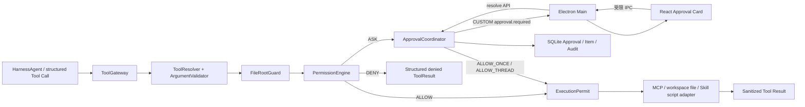
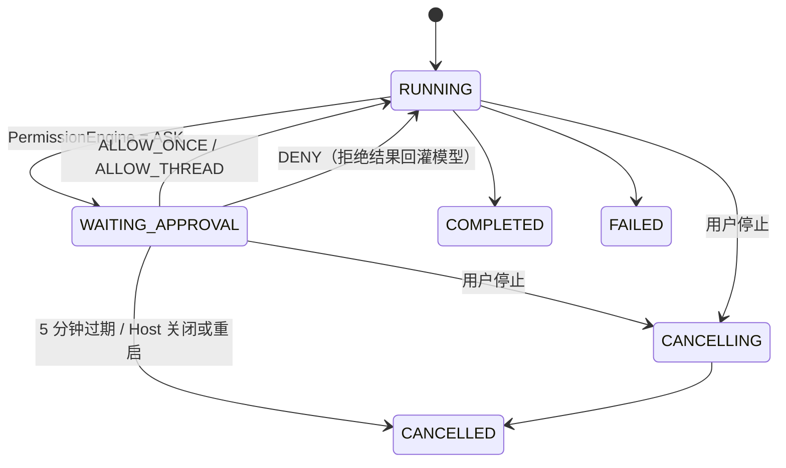

# 第 6 周详细设计：PermissionEngine、审批卡与文件根目录控制

> 状态：已定稿，评审后可开工  
> 日期：2026-08-21  
> 上位方案：[一期最终架构方案](../FINAL_ARCHITECTURE.md)  
> 一期契约：[阶段一详细设计](PHASE_1_DETAILED_DESIGN.md)  
> 前置交付：[第 3 周 MCP 与 Tool Card](WEEK_3_DETAILED_DESIGN.md)、[第 4 周 Skill 发现与渐进加载](WEEK_4_DETAILED_DESIGN.md)、[第 5 周 Skill 导入与安装](WEEK_5_DETAILED_DESIGN.md)、[实施状态](IMPLEMENTATION_STATUS.md)

## 0. 设计结论与开工评估

第 5 周 W5-A01～W5-A10 已全部通过，MCP Tool、Skill 元数据/资源、脚本候选、安装来源和依赖提示均已形成稳定输入；第 6 周所需的 Thread/Turn/Item、取消、重启对账、Tool Card 与 SSE 事件链路也已存在。当前信息足够开始第 6 周开发，不需要改变总体架构或补充新的产品范围。

本周严格对应总体方案中的唯一交付：

| 总体方案阶段 | 交付内容 | 验收 |
| --- | --- | --- |
| 第 6 周 | 权限审批与根目录控制 | 高风险操作均可暂停、批准或拒绝 |

设计采用以下结论：

1. 所有模型发起的外部能力调用统一经过 `ToolGateway -> PermissionEngine`；MCP、Skill、文件或脚本均不能绕过。
2. 权限结果只有 `ALLOW`、`ASK`、`DENY`。`ASK` 将 Turn 原子切换为 `WAITING_APPROVAL`，持久化 Approval 与可恢复卡片，再保持 SSE 打开等待用户决定。
3. 用户决定固定为 `ALLOW_ONCE`、`ALLOW_THREAD`、`DENY`。`ALLOW_THREAD` 只保存在 Host 内存，限当前 Thread，Host 重启即失效；一期不提供“始终允许”。
4. 文件根目录是能力上界，不是操作授权。根目录必须由用户通过原生目录选择器预先声明；根内读取、写入仍分别经过权限策略，越界请求直接 `DENY`，不能在审批卡中临时扩大根。
5. 第 3 周 `McpClientManager` 内的 `DEMO_SAFE` 临时执行门被移除；Manager 只负责连接、Schema、调用和取消，最终授权只由 `PermissionEngine` 作出。
6. 第 4～5 周的 `allowed-tools`、脚本候选、来源、commit/hash 和 MCP 依赖只参与风险说明与执行前重验，不产生预授权。
7. 保留 AgentScope 通用 filesystem/shell 工具禁用状态。本周只注册应用自有、参数受限的文件工具和 Skill 脚本执行入口，不开放任意文件 API 或任意 Shell 字符串。
8. 审批只授权被展示且被指纹绑定的能力。Tool、Server 配置、Skill 内容、脚本 hash、文件根或参数在等待期间发生变化，原批准失效，必须重新评估。

### 0.1 开工前差异评估

当前代码与目标之间存在明确但可收敛的差异：

| 现状 | 第 6 周处理 |
| --- | --- |
| V1 已有 `approval` 表，但没有 Repository、状态转换或 API | V7 扩展并正式启用该表，不创建语义重复的新 Approval 主表 |
| `WAITING_APPROVAL` 已被取消/启动对账识别，但 Runtime 从未进入该状态 | 增加原子 `requestApproval/resolveApproval` 持久化命令 |
| W3 在 `SdkMcpClientManager.call` 内拒绝非 `DEMO_SAFE` | 移除临时策略；执行前改由 `PermissionEngine` 统一判断 |
| 未知 MCP Tool 被保存为 `enabled=false` | “可用性/启停”与“授权”分离；连接且 Schema 合法的 Tool 可用，但每次按策略 `ASK` |
| Tool 参数当前以原始 JSON 写入可见 Item | 改为 capability-aware 脱敏摘要；原始参数和文件正文不落普通 Item/日志 |
| Timeline 只投影 Message、Tool、Skill | 增加 `APPROVAL` 投影，实时事件与重启快照使用同一 DTO |
| 默认 workspace 已持久化，但没有可管理的根目录授权 | V7 新增 `file_root`，默认 workspace 作为首个根，其他根仅能通过 Main 原生选择器添加 |

### 0.2 本周完成定义

只有 W6-A01～W6-A12 全部通过，才能将第 6 周标为完成：

1. 所有结构化 Tool Call 在执行前都由统一权限引擎评估；不存在 MCP Manager、Skill 或 Host Controller 的旁路。
2. `ASK` 在一个数据库事务中写入 pending Approval、`APPROVAL` Item 并把 Turn 置为 `WAITING_APPROVAL`，随后才发布 `CUSTOM approval.required`。
3. Approval Card 可选择允许一次、当前会话允许或拒绝；重复提交、冲突提交、过期提交均幂等且不会重复执行 Tool。
4. `ALLOW_ONCE` 只授权同一个 call/参数/目标指纹；`ALLOW_THREAD` 只授权同一 Thread、同一能力指纹，Host 重启后失效。
5. 用户拒绝后生成结构化拒绝 Tool Result 并恢复 ReAct；审批超时、等待中取消、窗口关闭或 Host 重启均安全终止，不默认允许。
6. 用户可通过原生目录选择器声明文件根及 `READ_ONLY/READ_WRITE` 上界；Renderer 不提交任意绝对路径。
7. 文件工具只接受 `rootId + relativePath`，规范化、real path、链接/reparse、保留目录和 TOCTOU 重验均通过；根外访问不能通过审批放行。
8. `workspace.read_text` 和 `workspace.write_text` 走真实受控文件适配器；写入必须 `ASK`，无半写文件，读取/写入正文不进入 Timeline、Approval 或日志。
9. 已激活 Skill 的脚本只能通过 `skill.run_script` 结构化入口执行，绑定 skill/resource/content hash，使用参数数组和受限环境；不支持的解释器或任意命令直接拒绝。
10. 未知/高风险 MCP Tool 可触发真实暂停，并在批准后执行原来的同一调用；工具或 Server 指纹变化会使批准失效。
11. 审批决定、自动允许、硬拒绝、根目录变更均有脱敏审计；Token、Cookie、Authorization、正文、完整参数、绝对私有路径和 reasoning 不泄露。
12. `verify-week6.ps1` 覆盖 Java、TypeScript、真实 Renderer、审批三分支、超时/取消/重启、文件越界/链接/竞态、Skill 脚本、MCP 和 Week 5 完整回归。

## 1. 范围与边界

### 1.1 本周必须交付

1. `agent-runtime`：`PermissionEngine`、策略模型、thread grant、执行许可、调用指纹、参数摘要与 `ToolGateway` 重构。
2. `agent-persistence`：Approval 状态事务、权限审计、文件根目录 Repository、V7 migration 和 Timeline Approval 投影。
3. `agent-host`：审批挂起/恢复协调、5 分钟超时、取消/重启失效、Approval API、File Root API 和稳定错误映射。
4. `agent-mcp`：移除 W3 临时授权判断，补充 Tool/Server 指纹与执行前目录/Schema/连接状态重验。
5. 应用自有文件工具：`workspace.read_text`、`workspace.write_text`，统一使用 `rootId + relativePath`。
6. 受限 Skill 脚本入口：`skill.run_script`，只接受当前 Turn 已激活 Skill 的脚本 resourceId，不接受模型提供的 executable 或 Shell 字符串。
7. Electron Main/preload：审批决定 IPC、原生目录选择和根目录管理 IPC；所有入口做 sender、ID、枚举、长度与对象形状校验。
8. React：可实时与重启恢复的 Approval Card、倒计时、已决状态，以及文件根目录设置区。
9. `verify-week6.ps1`、权限/路径恶意 fixtures、审批 Renderer smoke 和第 5 周完整回归。

### 1.2 明确不在本周

- 不实现全局永久授权、`ALLOW_ALWAYS`、组织策略、角色权限、管理员审批、多用户或远程审批。
- 不实现审批队列批量通过、后台自动批准、按自然语言规则批准或让模型代替用户作决定。
- 不把 Skill `allowed-tools`、安装来源、GitHub commit、作者声明、MCP annotations 或 Tool description 当作可信权限策略。
- 不启用 AgentScope 通用 filesystem/shell 工具，不提供任意绝对路径读写、任意 executable、Shell command string、`cmd /c` 或动态解释器下载。
- 不新增文件删除、移动、递归遍历、二进制写入或通用网络请求工具；这些能力即使未来增加，也必须复用本周权限和根目录契约。
- 不把 Approval 当作操作系统沙箱。STDIO MCP 与已批准脚本仍以当前用户权限运行；UI 必须明确来源不可信，根目录约束只对应用解析和传递的路径形成强制边界。
- 不实现 MCP OAuth、浏览器自动化、Computer Use、多 Agent、RAG、Skill 市场、后台同步或自我修改。
- 不实现第 7 周安装包、自动升级和通用崩溃续跑；本周只复用既有启动对账，使等待审批安全失效。

### 1.3 启用、根目录与授权的关系

| 控制 | 回答的问题 | 是否可执行 |
| --- | --- | --- |
| Skill 安装/启用/激活 | 指令包是否可被当前 Turn 使用 | 否；不授予 Tool、文件或进程能力 |
| MCP Server/Tool 启用 | 能力是否进入可用目录 | 否；所有 MCP Tool 仍进入权限评估 |
| File Root 启用 | 应用最多可触及哪棵目录、允许读还是读写 | 否；根内具体操作仍按策略决定 |
| `ALLOW_ONCE` | 是否执行当前精确调用 | 是；仅一次且仅当前 invocation fingerprint |
| `ALLOW_THREAD` | 当前 Thread 后续是否可复用同一能力 | 是；仅内存、仅相同 subject/resource scope/fingerprint |
| `DENY` | 当前调用是否被拒绝 | 否；向模型返回安全的结构化拒绝结果 |

## 2. 目标架构与职责



### 2.1 组件职责

| 组件 | 职责 | 禁止事项 |
| --- | --- | --- |
| React Renderer | 展示安全摘要、倒计时、三种决定和历史结果；管理根目录标签/模式 | 不生成 Approval、不改 capability/risk/target、不提交本地路径、不直接执行 Tool |
| Electron Main | sender/schema 校验、原生目录选择、Host API 转发、窗口关闭时触发安全停止 | 不自行计算权限、不保存 thread grant、不读取 Tool 原始结果 |
| Java Host | Turn 状态事务、SSE 保活、审批 resolve/timeout/cancel、事件适配 | 不在 Controller 中执行 Tool、不接受模型调用审批/根目录管理 API |
| `PermissionEngine` | 策略顺序、硬拒绝、ASK、thread grant 命中与撤销 | 不联网、不读文件正文、不持久化永久允许 |
| `ApprovalCoordinator` | pending handle、5 分钟等待、幂等 resolve、取消/失效与 Runtime 唤醒 | 不改变请求内容，不把 DENY 静默转为 ALLOW |
| `ToolGateway` | 唯一执行入口；解析 descriptor、校验参数、构造指纹、取得 permit、执行前重验 | 不信任 Skill/MCP 自报权限，不在无 permit 时调用高风险 adapter |
| `FileRootGuard` | 根登记、路径规范化、链接/reparse/real path/模式/保留目录/竞态验证 | 不接受未登记绝对路径，不把根选择等同写授权 |
| MCP Manager | 连接、目录、Schema、调用、超时、取消、结果脱敏 | 不作最终权限决定，不把 Tool description 当作可信分类 |
| Skill Script Adapter | resourceId 解析、hash 重验、固定执行计划、进程树取消、输出限制 | 不接受 executable/Shell string，不根据 shebang 自动下载或发现解释器 |
| Persistence | Approval、根、审计和 Timeline 安全投影 | 不保存 thread grant、文件/脚本正文、原始参数、secret 或 reasoning |

### 2.2 模块依赖

```text
desktop-ui ──preload IPC──> desktop-shell ──HTTP/SSE──> agent-host
                                                          │
                                                          ├── ApprovalCoordinator
                                                          ├── PermissionStore / ConversationStore
                                                          v
agent-persistence <── agent-runtime/permission <── ToolGateway ──> agent-mcp
                                      │
                                      ├── workspace file adapter
                                      └── SkillScriptAdapter ──> SkillRegistry（只读解析）
```

`agent-runtime` 不依赖 Electron；`agent-mcp` 不依赖权限实现。Host 负责把 Runtime 的 `ASK` 连接到持久化与 UI，但权限规则本身保持可单元测试。

## 3. 权限模型

### 3.1 稳定类型

```java
enum CapabilityClass { READ, WRITE, EXECUTE, NETWORK, UNKNOWN, DEMO_SAFE }
enum PolicyAction { ALLOW, ASK, DENY }
enum ApprovalDecision { ALLOW_ONCE, ALLOW_THREAD, DENY }

record PermissionSubject(
    String kind,          // MCP_TOOL | WORKSPACE_FILE | SKILL_SCRIPT
    String subjectId,
    String displayName,
    String sourceId,
    String sourceFingerprint) {}

record ResourceScope(
    String rootId,
    String relativeTarget,
    String endpointOrigin,
    String skillId,
    String resourceId,
    String contentHash) {}

record PermissionRequest(
    String callId,
    String threadId,
    String turnId,
    CapabilityClass capability,
    PermissionSubject subject,
    ResourceScope resource,
    String argumentsHash,
    String invocationFingerprint,
    SafeInvocationSummary summary,
    Instant requestedAt) {}

sealed interface PolicyEvaluation {
  record Allowed(GrantSource source) implements PolicyEvaluation {}
  record ApprovalRequired(ApprovalDraft draft) implements PolicyEvaluation {}
  record Denied(String errorCode) implements PolicyEvaluation {}
}
```

现有 `McpModels.RiskClass` 在本周统一收敛为上面的 capability 语义；为减少迁移，Java 枚举可暂保原名，但数据库、事件和 UI 文案必须使用读取/写入/执行/网络/未知含义，不能把 Server 自报内容直接提升为可信分类。

UI 风险等级由应用固定映射：`READ=medium`、`WRITE/NETWORK=high`、`EXECUTE/UNKNOWN=critical`、`DEMO_SAFE=low`。风险等级只决定提示强度，不覆盖 capability、根目录或策略结果。

### 3.2 默认策略矩阵

策略按“硬拒绝优先，grant 次之，默认策略最后”执行：

| 请求 | 默认结果 | 说明 |
| --- | --- | --- |
| 已保存官方 Provider 的 `model.invoke` | `ALLOW` | 仍受 Provider Profile 和 safeStorage 边界约束，不属于普通 Tool |
| `skill.activate`、`skill.read_resource` | `ALLOW` | Runtime 内部只读动作，已被固定 Skill 根、resourceId、hash 和预算限制 |
| 测试开关下的 `DEMO_SAFE` fixture | `ALLOW` | 仅自动化；生产目录不得出现该分类 |
| `workspace.read_text` | `ASK` | 根目录只是上界；读取可能暴露私有数据 |
| `workspace.write_text` | `ASK` | 写入默认 ASK，必须绑定目标与内容 hash |
| `skill.run_script` | `ASK` | 固定脚本与执行计划，仍属于 EXECUTE |
| 任意 MCP Tool，包括 READ/NETWORK/WRITE/EXECUTE/UNKNOWN | `ASK` | MCP 元数据不可信；用户允许公网不等于允许 Tool 自动联网 |
| Tool/Server/Skill/root 未启用或不存在 | `DENY` | 配置问题不能通过 Approval 绕过 |
| 参数 Schema 非法、路径越界、保留目录、链接/reparse、模式不足 | `DENY` | 安全不变量不能由用户临时放宽 |
| 未支持解释器、任意 executable、Shell 字符串 | `DENY` | 不生成“点允许即可执行”的误导卡片 |

`UNKNOWN` 允许进入 `ASK`，但 Approval Card 必须明确“应用无法验证该工具的实际副作用”，`ALLOW_THREAD` 文案必须明确它授权的是该精确 MCP Tool，而不是 Server 中全部工具。

### 3.3 策略求值顺序

```text
1. 校验 Turn 仍活动、未取消，callId 在 Turn 内唯一。
2. 解析 ToolDescriptor；校验 Server/Tool/Skill/root 当前启用且可用。
3. 校验结构化参数和大小；生成安全摘要及 SHA-256，不持久化原始参数。
4. 对文件/脚本解析 ResourceScope；执行 FileRootGuard 和 Skill hash 重验。
5. 命中硬拒绝 -> DENY，并写脱敏审计；不创建 Approval。
6. 计算 subjectFingerprint + resourceScopeFingerprint + policyVersion。
7. 查询当前 Host 内存中的 thread grant；完全匹配 -> ALLOW。
8. 命中仅测试 DEMO_SAFE -> ALLOW。
9. 其余外部能力 -> ASK。
```

策略 `policyVersion` 初始为 `1`，进入 invocation fingerprint。安全规则变化后提升版本，旧的内存 grant 自动失配。

## 4. 调用指纹、Permit 与 Thread Grant

### 4.1 Invocation fingerprint

```text
SHA-256(
  policyVersion + NUL +
  threadId + NUL + callId + NUL +
  subject.kind + NUL + subject.id + NUL + subject.sourceFingerprint + NUL +
  capability + NUL + canonicalResourceScope + NUL +
  canonicalArgumentsHash
)
```

- JSON 参数使用确定性 key 排序、数值规范和 UTF-8 编码后计算 hash。
- `ALLOW_ONCE` 绑定完整 invocation fingerprint，只能由该 call 消耗一次。
- Approval 期间不重新从模型取参数；允许后执行内存中同一个不可变 `PreparedInvocation`。
- 执行前再次解析 descriptor/root/script hash；任何变化返回 `APPROVAL_STALE`，不复用旧允许。

### 4.2 `ALLOW_THREAD` 范围

Thread grant key 不包含 callId/argumentsHash，但必须包含：

```text
threadId + subject.kind + subject.id + sourceFingerprint +
capability + resourceScopeClass + policyVersion
```

具体规则：

| Subject | Thread grant 范围 |
| --- | --- |
| MCP Tool | 精确 `serverId + toolName + server config revision + catalog/schema hash`；不扩展到同 Server 其他 Tool |
| 文件读取/写入 | 精确 `rootId + mode + capability`；READ grant 不推出 WRITE，根版本变化即失效 |
| Skill 脚本 | 精确 `skillId + resourceId + contentHash + interpreter profile`；Skill 替换/刷新后失效 |

grant 只存在 `ConcurrentHashMap<threadId, Set<Grant>>`：

- 跨当前 Host 生命周期、跨同 Thread 后续 Turn 可复用。
- Host 重启、Thread 归档、根删除/停用、MCP 配置变更、Skill hash 变更时清除或自然失配。
- 不写 SQLite、JSONL、localStorage 或 Renderer 状态。
- 审计只记录用户曾选择 `ALLOW_THREAD`，不表示重启后仍有效。

### 4.3 Execution Permit

`ExecutionPermit` 是 Runtime 内部不可由 JSON/IPC/模型构造的短生命周期对象，包含 invocation fingerprint、grant source、issuedAt 和单次消费标记。高风险 adapter 的执行方法必须接收 permit；重复消费返回 `PERMISSION_PERMIT_CONSUMED`。

## 5. Approval 与 Turn 状态机



### 5.1 请求审批

`PermissionStore.requestApproval` 在一个 SQLite 事务中：

1. 校验 Turn 当前为 `RUNNING` 且没有 pending Approval。
2. 插入 `approval(decision='PENDING')`，只保存安全请求摘要和各种 hash。
3. 更新 Turn 为 `WAITING_APPROVAL`。
4. 追加 `APPROVAL`/`USER` Item，取得严格递增 sequence。
5. 追加 `permission_audit(action='ASK')`。

事务提交后才发布：

```json
{
  "type": "CUSTOM approval.required",
  "value": {
    "schemaVersion": 1,
    "approvalId": "apr_...",
    "toolCallId": "call_...",
    "capability": "WRITE",
    "risk": "high",
    "title": "允许写入工作区文件？",
    "summary": "workspace.write_text 将写入 项目根 / docs/summary.md",
    "source": {"kind":"WORKSPACE_FILE","displayName":"项目根"},
    "target": {"rootId":"root_...","displayPath":"项目根 / docs/summary.md"},
    "choices": ["ALLOW_ONCE", "ALLOW_THREAD", "DENY"],
    "requestFingerprint": "sha256:...",
    "expiresAt": "2026-08-21T10:05:00Z"
  }
}
```

事件不包含文件正文、脚本正文、完整 MCP 参数、绝对路径、endpoint 凭据、环境变量值或原始 Tool description。

### 5.2 解析审批

`POST /api/v1/approvals/{approvalId}:resolve` 接收：

```json
{
  "decision": "ALLOW_ONCE",
  "expectedRequestFingerprint": "sha256:..."
}
```

同一事务内：

1. 校验 ID 格式、Approval 为 `PENDING`、fingerprint 相等、Turn 为 `WAITING_APPROVAL`、当前时间早于 `expires_at`。
2. 把 decision 写为 `ALLOW_ONCE/ALLOW_THREAD/DENY`，记录本地用户与 resolved time。
3. 把 Turn 切回 `RUNNING`。
4. 追加 `CUSTOM approval.resolved` 对应的 `APPROVAL` Item 和审计。
5. 提交后唤醒内存 pending handle。

幂等规则：

- 相同 decision 的重试返回原结果，不再次 signal、不重复执行。
- 不同 decision 的第二次提交返回 `APPROVAL_ALREADY_RESOLVED`。
- fingerprint 不同返回 `APPROVAL_STALE`。
- 已过期先原子写 `EXPIRED` 并取消 Turn，再返回 `APPROVAL_EXPIRED`。
- `DENY` 生成 `ToolCallResult{outcome=FAILED,errorCode=TOOL_PERMISSION_DENIED}`，再由 HarnessAgent 选择安全替代路径；它不是整个 Turn 的失败。

### 5.3 超时、取消、关闭与重启

- 审批有效期固定 5 分钟，不由 Skill、Tool 或 UI 修改。
- 超时：Approval=`EXPIRED`、Turn=`CANCELLED`、终态错误码 `APPROVAL_EXPIRED`；不继续模型循环。
- 等待中停止：先把 Turn 切为 `CANCELLING`，Approval=`CANCELLED`，唤醒 wait handle 并最终 `CANCELLED`。
- 窗口关闭：Electron 走既有 Host 停止；仍 pending 的 Approval 绝不转换为允许。
- Host 异常退出：启动对账把 `WAITING_APPROVAL` 置 `CANCELLED/APPROVAL_INVALIDATED`；内存 grant 全丢失，不恢复执行。
- Renderer reload 但 Host 未退出：Main 持有的 SSE/Run 不随旧 Renderer listener 销毁；pending Approval 可从 ThreadSnapshot 恢复并继续 resolve，不能依赖仅存在于 React state 的卡片。

## 6. 文件根目录模型

### 6.1 根目录不是授权

文件根表示“最多允许访问的目录范围”。选择 `READ_WRITE` 只允许写请求进入 `ASK`，不会自动执行写入；`READ_ONLY` 根上的写请求直接 `FILE_ROOT_MODE_DENIED`，Approval Card 不显示允许按钮。

默认 `%USERPROFILE%\.agent-desktop\workspace` 注册为 `ws_default` 的首个 `READ_WRITE` 根。新增根必须由用户在设置页调用无路径参数的 `selectAndAddFileRoot()`，Main 使用原生目录选择器取得路径并直接提交 Host；Renderer 只接收 rootId、label、mode 和掩码展示路径。

### 6.2 受保护目录

以下目录不能被登记为普通文件根，也不能被一个更高层根覆盖：

- `appHome/data`、`secrets`、`logs`、`cache`、`skills`、`import-staging`、`skill-install-work`、`skill-backups`。
- Java/Electron 安装目录、当前数据库文件和操作系统设备命名空间。
- 一个包含 `appHome` 的上级目录，例如直接选择整个用户主目录；默认 `appHome/workspace` 是唯一允许的 appHome 子树例外。

根登记时保存 canonical real path 和不透明 identity/hash；列表与审计使用 rootId、label 和路径 hash。SQLite 必须保存实际 canonical path 才能由 Java 执行边界重验，但普通 Item、日志和 Renderer DTO 不返回完整绝对路径。

### 6.3 路径参数

文件 Tool 只接受：

```json
{
  "rootId": "root_...",
  "relativePath": "docs/summary.md"
}
```

规则：

1. `relativePath` 使用 `/` 作为协议分隔符，长度不超过 1024，深度不超过 32。
2. 拒绝绝对路径、UNC、盘符、空段、`.`、`..`、NUL、控制字符、ADS `:`、Windows 保留名和末尾点/空格。
3. 使用登记的 canonical root 解析，不能使用模型或 Renderer 提交的 base path。
4. 对根及所有已存在路径段读取 `NOFOLLOW_LINKS` 属性，拒绝 symlink、junction、reparse point、device、FIFO 和 socket。
5. 已存在目标执行 `toRealPath()`，必须仍 `startsWith(canonicalRoot)`；不存在目标要求最近已存在父目录满足同样约束。
6. 执行前后比较 root/parent file identity、root version 与目标属性；发生替换返回 `FILE_PATH_CHANGED`。
7. 根删除、停用、mode 收窄或 canonical identity 变化后，所有关联 thread grant 失效。

### 6.4 应用自有文件工具

#### `workspace.read_text`

- capability=`READ`，默认 `ASK`。
- 只读普通 UTF-8 文件，单次最多 1 MiB；拒绝二进制、目录、链接和设备文件。
- 内容只进入当前 Tool Result/模型上下文，不写 Item、Approval 或普通日志。
- UI 只显示 root label、相对路径、字节数、内容 hash 和结果摘要。

#### `workspace.write_text`

- capability=`WRITE`，默认 `ASK`；要求 root mode=`READ_WRITE`。
- 输入正文最多 1 MiB；Approval 绑定 content hash、目标和 overwrite 标志，不展示正文。
- 默认 `overwrite=false`；覆盖现有文件必须在摘要中明确显示并纳入 fingerprint。
- 在同一父目录写随机临时文件，flush/close 后执行受控原子 move；失败时清理临时文件，不留下半写目标。
- 写入前后重验父目录 identity 和根版本；不得修改受保护目录或跟随链接。

本周不注册 delete/move/list-tree/binary-write。未来增加时必须分别定义 capability、摘要、根 mode、竞态和回滚语义，不能复用 write_text 的允许来扩大能力。

## 7. Skill 脚本执行边界

`skill.run_script` 是本周唯一进程执行入口，capability=`EXECUTE`，始终 `ASK`。它只接受：

```json
{
  "skillId": "skill_...",
  "resourceId": "res_...",
  "workingRootId": "root_...",
  "arguments": ["--format", "json"]
}
```

执行计划必须由应用生成：

1. Skill 在当前 Turn 已激活，且仍 `VALID + enabled`；shadow、missing 或刷新失败均拒绝。
2. resource 属于该 Skill、`kind=scripts`、`executableCandidate=true`，real path 仍在固定 Skill 根，当前 hash 与 Catalog/Approval 相等。
3. 一期 Windows 首个 production profile 只支持 `.ps1`，使用受信系统 PowerShell 的固定绝对路径和固定参数 `-NoLogo -NoProfile -NonInteractive -File <resolved-script>`；尊重机器现有 Execution Policy，不传 `Bypass`；不支持 `.cmd/.bat`、任意 `.exe`、shebang 发现或模型指定解释器。
4. `ProcessBuilder(List<String>)` 逐项传参，禁止 Shell command string；参数最多 32 个、单项 1024 字符、总计 8 KiB，拒绝 NUL。
5. working directory 来自已登记 rootId；环境从空白开始，只加入运行时必需的固定系统变量和显式批准的变量名，永不从 Skill 内容读取环境授权。
6. 默认超时 30 秒，stdout/stderr 各最多 512 KiB；stderr 先脱敏，只把有界摘要返回 UI/模型。
7. Turn 取消或超时时终止本应用启动的进程及其后代，不按名称杀其他进程。
8. Approval Card 必须提示“脚本来源不可信，将以当前 Windows 用户权限运行；文件根不是操作系统沙箱”。

`allowed-tools` 只能作为卡片上的“Skill 声明”提示，不影响 `ASK`、脚本 profile、根目录或 MCP grant。脚本安装/替换后 content hash 变化，原 thread grant 立即失效。

如果目标环境不存在受信 PowerShell profile，脚本返回 `SCRIPT_INTERPRETER_UNAVAILABLE`，不尝试联网安装或从 `PATH` 猜测解释器。

## 8. MCP 接入 PermissionEngine

### 8.1 可用性与授权分离

W6 后 `ToolDescriptor.enabled` 只表示 Server/Tool 配置可用，不表示已授权：

```text
MCP tools/list
  -> 校验描述与 JSON Schema 上限
  -> 生成稳定 mcp:{serverId}:{toolName}
  -> 保存 enabled/catalogVersion/schemaHash
  -> 模型结构化调用
  -> ToolGateway + PermissionEngine（所有 MCP 默认 ASK）
  -> permit 后 McpClientManager.call
```

`SdkMcpClientManager.call` 移除 `riskClass != DEMO_SAFE -> TOOL_APPROVAL_REQUIRED` 分支，但继续校验 Tool 存在/启用、Server READY、参数 Schema、超时与取消。Host 和测试禁止直接调用它执行模型请求；所有生产 Tool Call 都必须经 `ToolGateway`。

### 8.2 MCP 指纹

MCP subject fingerprint 至少包含：

- serverId、transport、endpoint origin 或 executable/args/working-root 的安全 hash。
- Server config revision、catalogVersion、toolName、input schema hash。
- 应用可信 risk override（若存在）；不采信 Tool 自报“只读/安全”。

连接重建但配置/catalog/schema 均未变化时可复用同一 thread grant；Server 编辑、重连刷新出新 catalogVersion、Tool Schema 变化或启停变化后必须重新 `ASK`。

Approval 摘要展示 Server/Tool 名、transport、可信 capability、经过脱敏和截断的参数摘要。HTTP Bearer、环境值、完整 endpoint query、stderr 和原始响应不展示。

## 9. Runtime 与 ReAct 恢复

### 9.1 稳定调用接口

```java
interface PermissionEngine {
  PolicyEvaluation evaluate(PermissionRequest request);
  ExecutionPermit allowOnce(ResolvedApproval approval);
  ExecutionPermit allowThread(ResolvedApproval approval);
  void clearThread(String threadId);
}

interface ToolGateway {
  PreparedInvocation prepare(ToolInvocation invocation);
  ToolCallResult execute(PreparedInvocation invocation,
                         ExecutionPermit permit,
                         CancellationToken cancellation);
}

interface ApprovalCoordinator {
  Mono<ResolvedApproval> await(PermissionRequest request, CancellationToken cancellation);
  ApprovalResolution resolve(String approvalId, ApprovalDecision decision,
                             String expectedRequestFingerprint);
}
```

### 9.2 ReAct 算法

```text
结构化 Tool Call
  -> 持久化 TOOL_CALL_START 与脱敏 TOOL_CALL_ARGS
  -> ToolGateway.prepare
  -> PermissionEngine.evaluate
     ALLOW -> issue permit
     DENY  -> 生成结构化拒绝 ToolResult
     ASK   -> 持久化并发布 Approval，Turn=WAITING_APPROVAL，await
              ALLOW_ONCE/ALLOW_THREAD -> issue permit
              DENY -> 结构化拒绝 ToolResult
              timeout/cancel/restart -> 结束 Turn
  -> execute 前重验 descriptor/root/hash/fingerprint
  -> adapter 执行并生成内存 modelResult + 可见安全摘要
  -> 持久化 TOOL_CALL_RESULT 摘要
  -> 把 Tool Result 回灌同一个 HarnessAgent Run，继续 ReAct
```

SSE 在 `WAITING_APPROVAL` 时保持打开并可发送心跳，但不发送新的文本 delta 或执行事件。审批等待不占用 boundedElastic 工作线程；使用 Reactor `Sinks.One`/`Mono.timeout`。同一 Turn 同时最多一个 pending Approval，同一 Thread 仍最多一个活动 Turn。

Tool 拒绝不是 Provider error。Runtime 必须给模型稳定、无策略细节泄露的结果，例如：

```json
{"ok":false,"error":{"code":"TOOL_PERMISSION_DENIED","message":"The user denied this tool call."}}
```

## 10. 持久化设计

新增 Flyway `V7__permission_approval_and_file_roots.sql`。V1 已存在 `approval` 主表，本周只扩展并启用：

```sql
ALTER TABLE approval ADD COLUMN thread_id TEXT REFERENCES thread(id);
ALTER TABLE approval ADD COLUMN call_id TEXT;
ALTER TABLE approval ADD COLUMN tool_id TEXT;
ALTER TABLE approval ADD COLUMN capability_class TEXT;
ALTER TABLE approval ADD COLUMN risk_level TEXT;
ALTER TABLE approval ADD COLUMN request_fingerprint TEXT;
ALTER TABLE approval ADD COLUMN subject_fingerprint TEXT;
ALTER TABLE approval ADD COLUMN arguments_hash TEXT;
ALTER TABLE approval ADD COLUMN resolution_code TEXT;
ALTER TABLE approval ADD COLUMN created_at TEXT;

CREATE UNIQUE INDEX uq_approval_call ON approval(call_id);
CREATE UNIQUE INDEX uq_approval_pending_turn
  ON approval(turn_id) WHERE decision = 'PENDING';
CREATE INDEX idx_approval_turn_created ON approval(turn_id, created_at DESC);

CREATE TABLE file_root (
  id TEXT PRIMARY KEY,
  workspace_id TEXT NOT NULL REFERENCES workspace(id),
  label TEXT NOT NULL,
  canonical_path TEXT NOT NULL,
  canonical_path_hash TEXT NOT NULL,
  root_identity TEXT,
  mode TEXT NOT NULL CHECK (mode IN ('READ_ONLY','READ_WRITE')),
  enabled INTEGER NOT NULL CHECK (enabled IN (0,1)),
  version INTEGER NOT NULL,
  created_at TEXT NOT NULL,
  updated_at TEXT NOT NULL,
  UNIQUE(workspace_id, canonical_path)
);

CREATE INDEX idx_file_root_workspace_enabled
  ON file_root(workspace_id, enabled, label);

CREATE TABLE permission_audit (
  id TEXT PRIMARY KEY,
  thread_id TEXT,
  turn_id TEXT,
  approval_id TEXT,
  call_id TEXT,
  action TEXT NOT NULL,
  capability_class TEXT NOT NULL,
  subject_id TEXT,
  subject_fingerprint TEXT,
  resource_scope_hash TEXT,
  decision TEXT NOT NULL,
  error_code TEXT,
  created_at TEXT NOT NULL
);

CREATE INDEX idx_permission_audit_turn_created
  ON permission_audit(turn_id, created_at DESC);
```

约束：

- `approval.decision` 使用 `PENDING/ALLOW_ONCE/ALLOW_THREAD/DENY/EXPIRED/CANCELLED/INVALIDATED`。
- `request_json` 只存 UI 安全 DTO；原始 arguments、文件/脚本正文、绝对目标路径、MCP response 和环境值不入库。
- `file_root.canonical_path` 是执行必需的可信本地配置，只能通过 Root Repository 读取；快照和普通 API 映射为 label/masked path/path hash。
- `permission_audit` 不保存 thread grant 内容；只保存当时决定和安全 hash。
- V7 migration 后启动服务把 `workspace.root_path` 登记为默认 root；如果 canonical 校验失败则保持禁用并报告 `FILE_ROOT_UNAVAILABLE`，不静默扩大到上级目录。
- 既有 `reconcileUnfinishedTurns` 扩展为同事务对账：所有 `PENDING` Approval 更新为 `INVALIDATED`，对应 `WAITING_APPROVAL` Turn 更新为 `CANCELLED/APPROVAL_INVALIDATED` 并追加终态 Item；不能只改 Turn 而留下可提交的 pending 记录。

### 10.1 持久化命令

```java
interface PermissionStore {
  ApprovalRequested requestApproval(ApprovalDraft draft);
  ApprovalResolution resolveApproval(String approvalId, ApprovalDecision decision,
                                       String expectedFingerprint, Instant now);
  ApprovalResolution expireApproval(String approvalId, Instant now);
  void cancelPendingForTurn(String turnId, String code, Instant now);
  List<ApprovalSummary> pendingForTurn(String turnId);

  List<FileRootSummary> listRoots(String workspaceId);
  FileRootSummary addRoot(FileRootDraft draft);
  FileRootSummary updateRoot(String rootId, FileRootMode mode, boolean enabled,
                             long expectedVersion);
  void removeRoot(String rootId, long expectedVersion);
}
```

所有状态命令与对应 Item/审计写入同一事务。Controller 不拼接 SQL，也不分别更新 Turn 和 Approval。

### 10.2 Timeline 投影

`TimelineEntry.kind` 增加 `APPROVAL`。`TimelineProjector` 按 `approvalId` 把 required/resolved/expired/cancelled Item 合并为一张卡，位置取首次 required 的 sequence，值只包含安全 Approval DTO。ThreadSnapshot `schemaVersion` 从 `1` 提升到 `2`，Host 协议头仍为 `X-App-Protocol: 1`；desktop-shell/desktop-ui 必须显式接受 schema 2，不能把 Approval 当作未知或损坏 Item。

历史快照中的 `PENDING` 只在同一 Host 仍持有对应 pending handle 时可操作。Host 重启对账后必须投影为 `INVALIDATED`；Renderer 不能仅凭数据库中旧的按钮状态提交允许。

## 11. Host、Electron 与 UI 契约

### 11.1 Host API

| 方法 | 路径 | 用途 |
| --- | --- | --- |
| `POST` | `/api/v1/approvals/{approvalId}:resolve` | 幂等提交三种决定 |
| `GET` | `/api/v1/workspaces/{workspaceId}/file-roots` | 查询安全 Root DTO |
| `POST` | `/api/v1/workspaces/{workspaceId}/file-roots` | Main 提交原生选择的路径、label 和 mode |
| `PATCH` | `/api/v1/file-roots/{rootId}` | 修改 mode/enable，带 expectedVersion |
| `DELETE` | `/api/v1/file-roots/{rootId}` | 删除非默认根，带 expectedVersion |

所有接口继续要求 loopback、Bearer session token 和 `X-App-Protocol: 1`。Approval resolve 不能由模型 Tool、SkillRuntimeBridge 或网页内容访问；Root POST 的绝对路径只在 Main -> Host 内部通道出现，不返回 Renderer。

### 11.2 preload API

```ts
type AgentDesktopApi = {
  resolveApproval(input: {
    approvalId: string;
    decision: 'ALLOW_ONCE' | 'ALLOW_THREAD' | 'DENY';
    expectedRequestFingerprint: string;
  }): Promise<ApprovalResolution>;

  listFileRoots(workspaceId: string): Promise<FileRootSummary[]>;
  selectAndAddFileRoot(input: {
    workspaceId: string;
    mode: 'READ_ONLY' | 'READ_WRITE';
  }): Promise<FileRootSummary | { cancelled: true }>;
  updateFileRoot(input: {
    rootId: string;
    mode: 'READ_ONLY' | 'READ_WRITE';
    enabled: boolean;
    expectedVersion: number;
  }): Promise<FileRootSummary>;
  removeFileRoot(input: { rootId: string; expectedVersion: number }): Promise<void>;
};
```

不暴露 `readFile/writeFile/runCommand/approveAll/addRoot(path)` 等通用 IPC。

### 11.3 Approval Card

卡片进入 Chat Timeline，与 Tool Card 相邻：

1. 标题使用应用可信 capability 文案，不直接使用 MCP/Skill 提供的 HTML/Markdown。
2. 展示 Tool/Server/Skill 来源、读取/写入/执行/网络/未知、目标摘要、风险说明和剩余时间。
3. `DENY` 是安全默认操作；危险允许按钮不获得默认焦点，Escape 等同拒绝前必须二次确认或保持无操作。
4. `ALLOW_THREAD` 文案必须具体，例如“本次应用运行期间，在当前会话允许此工具”；不写“始终允许”。
5. 提交后立即禁用三个按钮并等待 Host 结果；网络/IPC 重试携带同一 fingerprint。
6. 已解决卡片展示“允许一次/当前会话允许/已拒绝/已过期/已取消”，历史卡片只读。
7. 对 `UNKNOWN` MCP 和脚本显示额外警告；不渲染外部 HTML、远程图片或可点击参数 URL。
8. `WAITING_APPROVAL` 时保留“停止”按钮；用户仍可取消整个 Turn。

### 11.4 文件根设置

- 在“工具与 MCP”设置页增加“文件访问范围”，列出 label、masked path、mode、状态和版本。
- 添加按钮先选择 `READ_ONLY/READ_WRITE`，再打开系统目录选择器；取消不产生数据库记录。
- mode 从 READ_WRITE 收窄到 READ_ONLY、停用或删除需要确认，并立即使相关 thread grant 失效。
- 默认 workspace 根可停用/收窄，但不能删除；不得通过文本框粘贴路径。
- 根之间重叠时采用最具体 root；如果 mode/身份冲突则拒绝新增，不靠顺序猜测。

## 12. 安全与隐私设计

1. **唯一入口**：模型外部能力只能走 ToolGateway；MCP Manager、文件 adapter、脚本 adapter 不注册为 Controller Tool。
2. **硬拒绝不可审批**：路径越界、链接、Schema 非法、禁用能力、任意 executable 和受保护目录不生成可放行卡片。
3. **所见即所批**：Approval 绑定调用、来源、目标、参数 hash、策略版本和过期时间；等待期间变更即 stale。
4. **最小授权**：once 精确到调用，thread 精确到当前会话和能力 scope；无永久/全局/Server 全部 Tool 授权。
5. **重启 fail closed**：pending Approval 与 thread grant 均不恢复；等待 Turn 取消，不自动重放 Tool。
6. **根目录控制**：只使用 rootId + relativePath；real path 和文件身份在执行前后重验；根选择不等于写授权。
7. **无原始参数泄露**：替换当前 `arguments().toString()` Timeline 行为，改用按 capability 的安全摘要和 hash。
8. **内容不落盘**：文件内容、脚本 stdout 全文、MCP 完整结果只在受限内存链路存在；可见 Item 保存摘要、大小、hash 和错误码。
9. **进程最小化**：固定 interpreter + 参数数组 + 最小环境 + 有界 cwd/输出/超时；不使用 `cmd /c` 或任意 Shell string。
10. **来源不可信**：Skill/MCP description、allowed-tools、GitHub commit 和签名缺失都不能改变策略；卡片纯文本展示。
11. **本地路径隐私**：执行数据库保存 canonical path，但 Renderer、普通日志、Item、错误 body 和审计只使用 root label、相对路径或 path hash。
12. **竞态与幂等**：callId 唯一、permit 单次消费、resolve expected fingerprint、root expectedVersion 和执行前重验共同防止重复/换目标执行。

## 13. 错误码

| 错误码 | 语义 | UI 文案方向 |
| --- | --- | --- |
| `TOOL_PERMISSION_DENIED` | 用户拒绝当前 Tool | 已拒绝，Agent 可选择其他方式 |
| `TOOL_APPROVAL_REQUIRED` | 内部兼容码；调用必须暂停审批 | 不再作为 W3 终态直接显示 |
| `APPROVAL_NOT_FOUND` | Approval ID 不存在 | 审批已失效，刷新会话 |
| `APPROVAL_ALREADY_RESOLVED` | 冲突的重复决定 | 已由另一操作处理 |
| `APPROVAL_EXPIRED` | 超过 5 分钟 | 已过期，本轮已安全停止 |
| `APPROVAL_STALE` | 请求/Tool/root/hash 已变化 | 内容已变化，请重新发起 |
| `APPROVAL_INVALIDATED` | Host 关闭/重启使审批失效 | 应用重启后不会继续执行 |
| `PERMISSION_PERMIT_CONSUMED` | permit 被重复使用 | 调用已处理，不会重复执行 |
| `FILE_ROOT_NOT_FOUND` | rootId 不存在 | 在设置中重新选择目录 |
| `FILE_ROOT_UNAVAILABLE` | 根不可访问或身份变化 | 重新确认目录 |
| `FILE_ROOT_MODE_DENIED` | READ_ONLY 根收到写请求 | 将根改为读写后重新发起 |
| `FILE_PATH_INVALID` | 相对路径格式非法 | 调整目标路径 |
| `FILE_PATH_OUT_OF_SCOPE` | 目标不在已声明根 | 先在设置中添加允许根 |
| `FILE_PATH_LINK_UNSUPPORTED` | 链接/junction/reparse/设备路径 | 使用普通文件目录 |
| `FILE_PATH_CHANGED` | 检查与执行间目录/文件变化 | 文件已变化，请重试 |
| `FILE_TOO_LARGE` | 读写超过 1 MiB | 缩小文件或拆分操作 |
| `FILE_NOT_UTF8` | 非 UTF-8 文本 | 本期只支持 UTF-8 文本 |
| `FILE_ALREADY_EXISTS` | overwrite=false 且目标存在 | 明确请求覆盖后重新审批 |
| `SCRIPT_NOT_ACTIVATED` | Skill 未在当前 Turn 激活 | 先激活对应 Skill |
| `SCRIPT_STALE` | Skill/resource hash 已变化 | 重新加载 Skill 后再运行 |
| `SCRIPT_INTERPRETER_UNAVAILABLE` | 无受信解释器 profile | 当前环境不支持该脚本 |
| `SCRIPT_TIMEOUT` | 超过 30 秒 | 已停止脚本进程树 |
| `SCRIPT_OUTPUT_TOO_LARGE` | 输出超过上限 | 已截断并停止/失败 |

错误 body、UI 和日志不得附带原始绝对路径、命令行、正文、环境值、MCP response 或堆栈。

## 14. 实施顺序

| 工作包 | 内容 | 可演示产物 |
| --- | --- | --- |
| W6-A 数据与状态 | V7、PermissionStore、Approval/Turn 原子事务、Timeline 投影 | pending/resolved/expired 可重启恢复为安全状态 |
| W6-B 权限内核 | PermissionEngine、fingerprint、permit、thread grant、摘要器 | once/thread/deny 与 stale 单元测试 |
| W6-C ToolGateway/MCP | 移除 W3 临时门、统一 prepare/evaluate/execute、结果回灌 | UNKNOWN MCP 真正暂停后可批准执行 |
| W6-D 文件根与文件 Tool | 原生选择、RootGuard、read/write adapter、设置 API | 根内读写、根外/链接/竞态稳定拒绝 |
| W6-E Skill 脚本 | 激活/resource/hash/profile/进程取消/输出限制 | PowerShell fixture 经审批运行，任意命令拒绝 |
| W6-F 桌面交互 | Main/preload、Approval Card、倒计时、历史恢复、根设置 | 真实 Renderer 完成三种决定和取消 |
| W6-G 验收 | 恶意 fixtures、重启、泄漏扫描、Week 5 回归 | `verify-week6.ps1` 一键返回 0 |

依赖顺序为 `W6-A -> W6-B -> W6-C -> W6-D/W6-E -> W6-F -> W6-G`。不得先让 UI 直接调用现有 Manager，不得先移除 W3 执行门再补 PermissionEngine，不得在参数摘要脱敏完成前展示 Approval Card。

## 15. 测试设计

### 15.1 Java 单元与集成测试

1. V7 从现有 V6 数据库升级；V1 approval 数据兼容，默认 workspace root 正确登记。
2. PermissionEngine 对全部 capability、硬拒绝、DEMO_SAFE test-only、unknown MCP 和 policy version 的矩阵测试。
3. canonical JSON/arguments/subject/resource/invocation fingerprint 确定性与碰撞边界。
4. `ALLOW_ONCE` 单次消费；`ALLOW_THREAD` 跨同 Thread Turn 命中、跨 Thread 不命中、重启/配置/root/hash 变化失效。
5. request Approval 的 Approval/Turn/Item/Audit 原子性；每个失败注入点回滚一致。
6. resolve 相同决定幂等、冲突决定、过期、stale、取消竞态、执行完成同时 resolve 等场景。
7. 审批等待不占用工作线程，SSE 保持，5 分钟虚拟时钟超时确定性。
8. `rootId + relativePath` 覆盖盘符、UNC、`..`、ADS、保留名、末尾点/空格、大小写、symlink、junction、reparse、设备和根替换。
9. read/write 覆盖 UTF-8、二进制、大小上限、覆盖标志、临时文件、原子 move、取消与 TOCTOU。
10. Skill 脚本覆盖未激活、disabled/shadowed、resource 非 script、hash 变化、不支持解释器、参数限制、超时、输出上限和进程树取消。
11. MCP 高风险 Tool 先 ASK，批准后只执行一次；Server config/catalog/schema 变化返回 stale。
12. SQLite、Item、HTTP error、普通日志不含 fixture secret、正文 marker、原始参数、绝对路径、Authorization、Cookie 或 reasoning。

### 15.2 Renderer/Electron 测试

1. 真实事件生成 Approval Card；三按钮、倒计时、来源、target 和风险文案完整。
2. 允许一次后当前 Tool 执行；相同 Tool 再调用重新 ASK。
3. 当前会话允许后同 Thread 同 scope 不再 ASK；新 Thread 仍 ASK；重启后原 Thread 再次 ASK。
4. 拒绝后 Tool Card 显示安全拒绝，Agent 可继续；不会误显示 RUN_ERROR。
5. 等待中点击停止、超时和关闭窗口均不会执行 Tool，历史卡片显示终态。
6. Renderer reload 后从 snapshot 恢复 pending 卡片并可提交；已决卡片不可再次操作。
7. 原生选择根时 Renderer 不接收绝对路径；根列表只含 masked path，不能输入任意 path。
8. mode 收窄、停用、删除确认可用且使 grant 失效；默认 root 不可删除。
9. preload 没有通用文件、命令、Manager call 或 approve-all API，所有 IPC 拒绝错误 sender/ID/枚举/超长字段。

### 15.3 Fixtures

- `approval-mcp-unknown`：W3 本地 MCP `danger` Tool，只写测试 marker，验证批准前 marker 不存在、批准后仅出现一次。
- `workspace-file-root`：根内普通文件、根外哨兵、只读根、链接/junction、竞态替换、UTF-8/二进制和超大文件。
- `skill-script-safe.ps1`：输出固定摘要并在授权 root 写 marker；不读取凭据或公网。
- `skill-script-stale`：审批等待期间替换脚本 hash，验证旧批准失效。
- `permission-secret`：参数含 Authorization/Cookie/token/正文 marker，验证所有可见与持久化面脱敏。

### 15.4 `verify-week6.ps1`

```text
1. mvn clean verify、npm typecheck、npm build，并执行 Week 5 完整回归。
2. 创建隔离 appHome/workspace、READ_ONLY/READ_WRITE roots、根外哨兵和恶意路径 fixtures。
3. 启动本地 STDIO/HTTP MCP fixtures 和真实 Electron/Host。
4. UNKNOWN MCP：验证 ASK -> ALLOW_ONCE -> 执行一次；第二次再 ASK；DENY 不执行。
5. ALLOW_THREAD：同 Thread 复用；新 Thread 不复用；修改 Server catalog 后重新 ASK。
6. 文件读取/写入：根内通过审批，根外/链接/只读写/竞态全部硬拒绝且不能点允许绕过。
7. Skill 脚本：激活后 ASK，批准执行固定计划；替换 hash、任意 executable 和不支持解释器拒绝。
8. 等待中取消、虚拟超时、Renderer reload、Host 异常退出与重启；确认无 Tool/脚本/写入晚到执行。
9. 扫描 appHome、SQLite、日志、SSE 捕获和 Renderer state，不得命中 secret、正文、完整参数、绝对路径或 reasoning。
10. 第二次启动验证历史 Approval/Tool Card 可恢复，但 pending 不续跑、thread grant 已失效。
```

## 16. 第 6 周验收矩阵

| 编号 | 场景 | 通过条件 |
| --- | --- | --- |
| W6-A01 | 统一权限入口 | MCP、文件、Skill 脚本全部经 ToolGateway/PermissionEngine，无 Manager/IPC 旁路 |
| W6-A02 | ASK 原子暂停 | Approval、APPROVAL Item、Audit、Turn=WAITING_APPROVAL 同事务，提交后才发事件 |
| W6-A03 | 三种决定 | ALLOW_ONCE、ALLOW_THREAD、DENY 均幂等、可观察且 Tool 最多执行一次 |
| W6-A04 | 授权作用域 | once 精确绑定调用；thread 仅当前 Thread/Host 生命周期/能力 scope，变更与重启失效 |
| W6-A05 | 超时/取消/恢复 | 5 分钟、停止、窗口关闭、Host 重启均 fail closed；pending 不自动恢复执行 |
| W6-A06 | Approval Card | 实时/快照一致，显示可信摘要、来源、风险、倒计时和终态，无危险默认焦点 |
| W6-A07 | 根目录管理 | 仅原生选择器登记，默认/附加根、mode、版本和保护目录规则有效 |
| W6-A08 | 文件边界 | rootId+relative path、real path、链接/reparse、保留目录、TOCTOU 和原子写全部通过 |
| W6-A09 | Skill 脚本 | 仅已激活且 hash 一致脚本、固定解释器/参数数组/最小环境；始终 ASK，可取消 |
| W6-A10 | MCP 迁移 | 非 DEMO_SAFE Tool 不再由 Manager 直接拒绝；UNKNOWN 经批准可执行且目录变化 stale |
| W6-A11 | 安全审计 | 决定/拒绝/root 变更可追踪；无正文、原始参数、绝对路径、secret、stderr 或 reasoning 泄露 |
| W6-A12 | 自动化回归 | Java、TS、生产 Renderer、审批/文件/脚本/MCP、重启和 Week 5 回归一键返回 0 |

## 17. Definition of Done

- 高风险操作在任何实际副作用前可确定性进入 `WAITING_APPROVAL`，并可允许一次、当前会话允许或拒绝。
- Approval 与 Turn/Item/Audit 事务一致；实时 SSE、Renderer reload 和历史 Snapshot 呈现同一结果。
- `ALLOW_THREAD` 只驻留 Host 内存并受精确能力指纹约束；不存在永久、全局或由 Skill/MCP 自行授予的权限。
- 文件根是不可通过审批突破的上界；应用自有读写工具不接受绝对路径，不跟随链接，不触及保留目录，不产生半写。
- Skill 脚本只有在激活、hash 重验、固定执行计划和人工审批同时满足时才可运行；任意 Shell/executable 继续拒绝。
- MCP 可用性与授权完全分离，W3 临时 `DEMO_SAFE` 门只保留测试自动允许，生产高风险 Tool 统一进入权限引擎。
- 拒绝给模型结构化 Tool Result，超时/取消/关闭/重启 fail closed；任何竞态都不会使同一 Tool 重复执行。
- 日志、SQLite 可见 Item、Approval Card 和错误响应不包含正文、完整参数、私有绝对路径、凭据或 reasoning。
- 第 1～5 周验证保持通过；本周不提前实现第 7 周打包升级或第 8～9 周兼容性扩展。

通过 W6-A01～W6-A12 后，才进入第 7 周打包、升级与崩溃恢复。本周形成的 Approval、权限审计、根目录和安全失效契约将作为安装版异常退出与升级迁移的强制回归基线。
