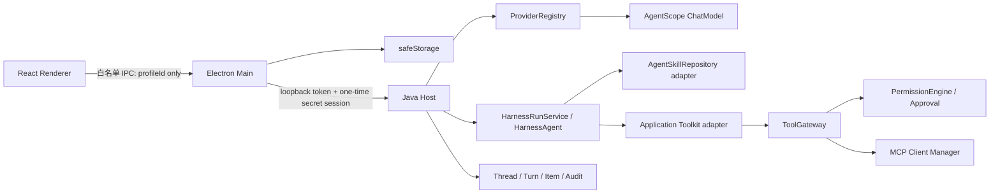

# 第 8 周详细设计：核心兼容性、稳定性基线与受控内测

> 状态：实施中；2026-08-28 已补录交互、Skill 执行、上下文与输出物优化，仍须通过 W8 总门禁  
> 日期：2026-08-25；最近修订：2026-08-28  
> 上位方案：[一期最终架构方案](../FINAL_ARCHITECTURE.md)  
> 前置设计：[第 7 周详细设计](WEEK_7_DETAILED_DESIGN.md)  
> 后续设计：[第 9 周详细设计](WEEK_9_DETAILED_DESIGN.md)  
> 例外与生产待办：[第 7 周发布就绪清单](WEEK_7_RELEASE_READINESS.md)、[生产发布资料与门禁待办](PRODUCTION_RELEASE_TODO.md)  
> 实施状态：[阶段一实施状态](IMPLEMENTATION_STATUS.md)  
> 外部兼容基线：[AgentScope Java 1.1.0-RC2](https://github.com/agentscope-ai/agentscope-java/releases/tag/v1.1.0-RC2)、[DeepSeek Models & Pricing](https://api-docs.deepseek.com/quick_start/pricing/)、[阿里云百炼文本生成模型](https://help.aliyun.com/zh/model-studio/text-generation-model)

## 0. 结论与设计约束

本设计严格展开总体方案的以下阶段，不引入一期外能力：

| 总体方案阶段 | 总交付 | 总验收 |
| --- | --- | --- |
| 第 8 周 | 核心兼容性、稳定性基线与受控内测 | 双 Provider/MCP Transport 核心合同、取消/恢复/安全回归、2 小时稳定性基线和小范围内测通过 |
| 第 9 周 | 兼容扩面、长稳、反馈收敛与一期总验收 | Windows/网络/真实样本矩阵、8 小时以上长稳、P0/P1 清零和发布建议 |

总体方案最初把第 8～9 周合并描述；2026-08-28 修订已将其拆分为两个可验收阶段，但不改变原定范围：

- **第 8 周**：关闭正式模型/Harness 基线缺口，建立模型与 MCP 核心兼容矩阵，完成取消、恢复、安全边界回归，形成 2 小时稳定性基线并放行小范围受控内测。
- **第 9 周**：扩大设备、网络和内测人群覆盖，执行 8 小时及以上长稳与反馈闭环，完成一期总验收和发布建议。

本周采用以下强制结论：

1. 允许在第 7 周仍为 `development-only` 时开始第 8 周开发，但这是项目负责人的显式例外，不等于 W7-A01～W7-A12 已全部通过。
2. W8 开发可使用 `internal/unsigned` unpacked 或安装包；任何外部内测分发前，必须先在一次性 Windows 用户或 VM 中补齐 W7 真实安装、升级、卸载和重装证据。
3. 正式 Publisher、品牌、EULA/隐私和 Authenticode 只阻塞 production，不阻塞本周内部开发；全部进入独立生产待办。
4. 当前生产路径固定为 Windows x64。macOS/Linux、ARM64 和广泛硬件矩阵不提前进入本周。
5. AgentScope Java 继续固定 `1.1.0-RC2`。即使上游存在更新版本，本周也不顺带升级框架；升级必须另做兼容评估和完整回归。
6. 模型必须通过 AgentScope `HarnessAgent` 的结构化 Tool Calling 执行 ReAct。禁止继续以 Mock Provider 作为生产默认，禁止解析 `Thought/Action/Observation` 文本。
7. Harness 的 Shell、内置文件工具、Subagent、RAG、长期记忆写回和自动工具恢复均关闭；只注册应用拥有的 Skill 与 `ToolGateway` 适配器。
8. 不展示、持久化或导出模型原始 reasoning/thinking；只展示可见回答、状态摘要、Tool/Approval 和稳定错误码。
9. 兼容失败必须显式失败，不得静默更换模型、区域、endpoint、Tool schema 或降级安全策略。
10. 内测不引入遥测、崩溃自动上传、账号系统或远程反馈后台；诊断包由用户预览后本地导出并手工提交。

### 0.1 当前基线审计

| 当前实现 | 与总体方案的差距 | 第 8 周处理 |
| --- | --- | --- |
| `HostConfiguration` 固定创建 `MockModelProvider` | 尚无正式模型调用 | 引入受控 Provider Catalog、内存密钥会话和正式模型适配器 |
| `ModelProvider` 只有 `id + stream` | 无能力声明、错误归一、健康检查和多 Profile | 引入 `ProviderRegistry`、`ModelProfile`、`ProviderCapabilities` 和稳定错误码 |
| `HarnessTurnBinding` 被放入 `ChatRequest`，但 Mock Provider 不消费 | 实际 ReAct 循环仍由 Host 递归拼接，未由 HarnessAgent 执行 | 引入 `HarnessRunService`，由 HarnessAgent 负责模型/工具循环，Host 只做事件、持久化和审批协调 |
| Main 可保存 DeepSeek/Qwen key，但 UI 无 Provider 设置页，Host 无密钥注入 | 密钥无法形成正式运行闭环 | 新增 Provider Settings、一次性内存 secret session 与连接校验 |
| Renderer 固定 `modelProfileId=mock` | 用户不能选择模型/Provider | Profile 选择写入 Thread，Turn 固定使用开始时快照 |
| 已有停止，但无用户可见“重试”和运行中 steering | Chat 一期范围未闭合 | 在 Harness 安全边界内补齐重试与下一安全点 steering |
| MCP 两类 Transport 与故障测试已存在 | 缺统一跨 Transport 兼容矩阵与长稳证据 | 扩充 schema、断流、限流、取消、重连和资源泄漏测试 |
| W7 自动化仅以 skip 模式通过 | 安装态证据不完整 | W8 可开工；内测候选放行前补齐无 skip W7 门禁 |
| 无安全诊断导出 | 内测问题难以复现 | 增加纯本地、显式确认、allowlist 的脱敏诊断包 |

### 0.2 本周完成定义

只有 W8-A01～W8-A14 全部通过，才把第 8 周标记完成：

1. 生产默认不再是 Mock Provider；Mock 只存在于测试 Profile，且发布构建无法选择。
2. DeepSeek 与 Qwen 两个官方 Profile 都通过本地协议夹具，并使用低权限测试密钥各完成一次真实流式文本与结构化 Tool Call 验收；缺密钥时本周不能完成。
3. HarnessAgent 是唯一 ReAct 编排者，最大迭代 10；Host 不再实现第二套模型/工具递归循环。
4. AgentScope 所有一期外内置能力关闭，Tool 执行只能经过 `ToolGateway -> PermissionEngine -> Approval`。
5. STDIO 与 Streamable HTTP MCP 在同一套 schema、错误、取消、重连和泄漏矩阵中通过。
6. Provider、MCP、Skill 脚本、审批等待和 UI 断流各阶段的取消都幂等、有界且零晚到副作用。
7. 重试创建新 Turn，不篡改旧 Turn；steering 只在下一模型安全点生效，不插入正在执行的副作用。
8. Host/Main/Renderer/Provider/MCP 异常后的恢复保持 W7 的“已持久化恢复、未完成不重放”。
9. 安全回归证明 Renderer 无系统能力、密钥只在 safeStorage/Host 内存、根目录不越界、reasoning 不泄漏。
10. 100 个确定性 Turn 与 2 小时 soak 无挂死、无孤儿子进程、SQLite `integrity_check=ok`，资源增长满足本设计阈值。
11. 诊断包仅包含 allowlist 字段，经过敏感哨兵扫描，且只能由用户显式本地导出。
12. 无 skip 的 W7 安装门禁已在一次性环境通过，当前 W8 internal 候选有新 manifest 与 SHA-256。
13. 至少 3 名受控技术内测者完成核心脚本，P0/P1 缺陷为 0，反馈可追踪。
14. `verify-week8.ps1 -Profile beta` 与 Week 7→3 完整回归返回 0，并输出可审计摘要。

## 1. 范围与非范围

### 1.1 本周必须交付

1. `agent-runtime`：Provider Catalog/Registry、DeepSeek 与 Qwen 模型工厂、HarnessAgent 运行器、事件与错误归一、取消桥接。
2. `agent-host`：Provider Profile API、一次性 secret session、连接校验、运行时 Profile 解析、Retry/Steering 协调、诊断快照。
3. `agent-persistence`：Provider Profile 状态、重试关系和 steering Item 所需的 V8 migration；不持久化密钥。
4. `desktop-shell`：Provider 密钥 safeStorage 闭环、白名单 IPC、Host secret 注入、诊断包本地导出。
5. `desktop-ui`：Provider 设置与选择、连接状态、能力提示、Retry/Steering、兼容错误和内测标识。
6. `agent-mcp`：两类 Transport 的统一兼容夹具、取消/重连/限流/异常协议测试与泄漏计数。
7. `scripts`：`verify-week8.ps1`、Provider/MCP fixture、2 小时 soak、内测候选和脱敏扫描。
8. `docs/phase-1`：受控内测运行手册、反馈模板、已知问题和第 8 周验收证据。

### 1.2 明确不在本周

- 不升级 AgentScope 版本，不接入 2.x API，不启用 Subagent/A2A、多 Agent 或复杂 Graph。
- 不增加 OpenAI、Anthropic、Gemini、Ollama 等新 Provider；总体方案列出的扩展能力留到后续兼容迭代。
- 不开放用户任意填写 Provider base URL、HTTP header 或模型协议插件。
- 不支持本地模型下载、发现、启动或 GPU 管理。
- 不实现 MCP OAuth、Resources/Prompts 产品化、MCP 市场或远程 MCP 自动发现。
- 不实现后台自动更新、远程配置、遥测、崩溃自动上传或在线反馈服务。
- 不实现 Shell 无审批、浏览器自动化、Computer Use、RAG/向量库、Skill 自动执行。
- 不执行 macOS/Linux/ARM64 或大规模硬件认证；它们不属于当前 Windows x64 首发基线。
- 不把第 9 周的扩大设备覆盖、8 小时以上长稳、扩大内测人群和反馈收敛提前宣称完成。

## 2. 第 8 周与第 9 周边界

| 维度 | 第 8 周 | 第 9 周 |
| --- | --- | --- |
| 模型 | DeepSeek/Qwen 核心 Profile、Harness 契约、真实最小验收 | 区域/代理/账号差异扩展与已知兼容问题收敛 |
| MCP | STDIO/Streamable HTTP 核心协议与故障矩阵 | 更多真实 Server 样本和版本差异 |
| 稳定性 | 100 Turn、2 小时 soak、4 个并行 Thread 上限 | 8 小时以上 soak、更多数据量和设备组合 |
| Windows | 主开发环境 + 1 个一次性干净环境 | 扩大 Windows 版本、硬件和企业镜像覆盖 |
| 内测 | 3～5 名受控技术用户，小范围脚本化验证 | 扩大人群、收敛体验问题、形成一期发布建议 |
| 发布 | internal/unsigned，补 W7 安装证据 | 仍可 internal；production 取决于生产待办是否关闭 |

## 3. 目标运行架构



职责约束：

- Renderer 只看到 Profile 元数据、连接状态和脱敏错误；永远看不到 API Key、Host token、MCP Bearer 或原始 Provider 响应。
- Main 是 safeStorage 密文的唯一读取者。它只在连接校验或启动 Turn 前把明文放入一次性 loopback 请求，随后清空引用。
- Host 用有 TTL、一次消费、绑定 Provider 的 `ProviderSecretSession` 暂存密钥；Turn 结束、取消、Host 退出或 TTL 到期立即移除。
- `ProviderRegistry` 只解析安装包内受信 Catalog，不能根据模型输出或 Renderer 输入创建任意 endpoint。
- `HarnessRunService` 负责模型/Tool ReAct 循环；`TurnCoordinator` 只负责生命周期、Item 写入、取消和审批事件映射。
- 所有 Tool 都是应用适配器。不得把 AgentScope 默认 Shell、filesystem、subagent、memory 或 pending-tool recovery 暴露给模型。

## 4. Provider Catalog 与密钥生命周期

### 4.1 安装包内 Catalog

新增 `packaging/provider-catalog.json`，纳入 release manifest hash：

```json
{
  "schemaVersion": 1,
  "profiles": [
    {
      "id": "deepseek-v4-pro",
      "providerId": "deepseek",
      "displayName": "DeepSeek V4 Pro",
      "adapter": "OPENAI_COMPATIBLE",
      "modelId": "deepseek-v4-pro",
      "region": "global",
      "capabilities": ["STREAM_TEXT", "STRUCTURED_TOOL_CALL", "CANCEL"]
    },
    {
      "id": "qwen3.7-flash",
      "providerId": "qwen",
      "displayName": "Qwen 3.7 Flash",
      "adapter": "DASHSCOPE",
      "modelId": "qwen3.7-flash",
      "region": "account-bound",
      "capabilities": ["STREAM_TEXT", "STRUCTURED_TOOL_CALL", "CANCEL"]
    }
  ]
}
```

Catalog 规则：

1. `id/providerId/modelId/adapter/region` 都是固定值，Profile ID 不能直接作为 URL。
2. DeepSeek 使用官方 OpenAI-compatible endpoint 和 AgentScope `OpenAIChatModel`/DeepSeek formatter；Qwen 使用 `DashScopeChatModel`。
3. Qwen 的目标账号与区域必须在连接校验中确认；候选模型不可用时返回 `MODEL_NOT_AVAILABLE`，不得替换成其他 Qwen 模型。
4. Catalog 远程更新、任意 endpoint 和用户自定义 header 不在一期。变更 Catalog 必须随应用版本、manifest 和回归发布。
5. `MockModelProvider` 仅在 `agentdesktop.test-fixtures=true` 且 internal test process 下注册；production classpath 运行时请求 `mock` 必须返回 `PROFILE_NOT_AVAILABLE`。

### 4.2 能力与错误契约

```java
record ModelProfile(
    String id,
    String providerId,
    String modelId,
    ProviderAdapter adapter,
    Set<ProviderCapability> capabilities,
    String catalogVersion) {}

record ProviderCheckResult(
    String profileId,
    ProviderStatus status,
    Set<ProviderCapability> observedCapabilities,
    String errorCode,
    Instant checkedAt) {}
```

稳定错误码至少包括：

| 类别 | 错误码 | 用户行为 |
| --- | --- | --- |
| 配置 | `PROFILE_NOT_AVAILABLE`、`MODEL_NOT_AVAILABLE`、`REGION_MISMATCH` | 返回设置页，不自动切换 |
| 凭据 | `PROVIDER_KEY_MISSING`、`PROVIDER_AUTH_FAILED` | 重新输入 key，旧 key 不回显 |
| 配额/限流 | `PROVIDER_QUOTA_EXCEEDED`、`PROVIDER_RATE_LIMITED` | 可显式重试；不自动无限重试 |
| 网络 | `PROVIDER_UNREACHABLE`、`PROVIDER_TIMEOUT`、`PROVIDER_STREAM_BROKEN` | 旧 Turn 失败或取消，保留已提交文本 |
| 协议 | `PROVIDER_PROTOCOL_ERROR`、`TOOL_CALL_INVALID` | fail closed，不执行不完整 Tool |
| 上下文 | `CONTEXT_LIMIT_EXCEEDED` | 允许 Harness 做一次受控压缩；仍失败则终止 |
| 取消 | `PROVIDER_CANCELLED` | 映射为 Turn `CANCELLED`，不是错误弹窗 |

原始 HTTP body、header、request ID、reasoning 和 Provider SDK exception 只用于内存内分类；对 UI、数据库和诊断包输出稳定码与安全文案。

### 4.3 一次性 Secret Session

```text
Renderer: checkProvider(profileId)
  -> Main 从 safeStorage 解密 provider key
  -> Main POST /api/v1/provider-secret-sessions
       { providerId, apiKey } + Host capability token
  -> Host 返回随机 secretSessionId（TTL 5 分钟、一次消费、provider 绑定）
  -> Main POST /api/v1/providers/{profileId}:check { secretSessionId }
  -> Host 消费并清除；Renderer 只得到脱敏结果
```

启动 Turn 时重复相同注入流程，由 Main 在 `/agui/run` 前追加 `secretSessionId`；Renderer 构造的 run input 中不得出现该字段。Host 访问日志禁止记录这两个 endpoint 的 body。密钥不得进入命令行、环境变量、Spring property、Thread/Turn/Item、异常、heap dump 或诊断包。

## 5. HarnessAgent 正式接入

### 5.1 单一 ReAct 编排器

新增 `HarnessRunService`，替代 `TurnCoordinator.streamProvider(...depth)` 的应用自实现递归：

```text
TurnCoordinator
  -> 建立 Turn / EventWriter / CancellationScope
  -> HarnessAgentFactory.create(profile, secret, skillBinding, appToolkit)
  -> HarnessAgent.stream(messages, RuntimeContext)
  -> HarnessEventAdapter
       -> visible text / status / tool / approval / error
  -> EventWriter 按 sequence 持久化
  -> 原子终结 Turn
```

硬性配置：

- `maxIters(10)`；达到上限返回 `MAX_ITERATIONS_REACHED`。
- `disableShellTool()`、`disableFilesystemTools()`、`disableSubagents()`、`disableMemoryTools()`、`disableMemoryHooks()`。
- `disableSessionPersistence()`；一期会话真相源仍是应用 SQLite Item 流，避免双状态源。
- `enablePendingToolRecovery(false)`；崩溃后不恢复未完成 Tool。
- `enableAgentTracingLog(false)`；不输出 reasoning 或原始模型事件。
- 只注入 `AgentScopeSkillAdapter` 的受控 repository 与应用拥有的 Toolkit。
- 上下文压缩只处理应用提供的历史消息，压缩结果不得自动写 `MEMORY.md`；压缩后仍保留 Tool/Approval 因果引用。

### 5.2 Tool 与审批适配

AgentScope Toolkit 中每个描述符只是 `ToolGateway` 的代理：

```text
Harness structured ToolCall
  -> ApplicationToolAdapter.validateSchema
  -> ToolGateway.prepare
  -> PermissionEngine.evaluate
     -> ALLOW: ExecutionPermit -> execute
     -> ASK: 持久化 Approval -> 暂停 adapter Mono -> 等待用户
     -> DENY: 结构化 ToolResult(errorCode)
  -> 受限 ToolResult 回灌同一个 Harness Run
```

适配器不得直接访问文件、启动进程、连接 MCP 或把 `allowed-tools` 当授权。Approval 等待时不得占用阻塞线程；取消、过期、Host 重启均使等待完成为稳定拒绝/取消结果。

### 5.3 事件过滤

仅允许映射：可见 Text、ToolCall、ToolResult、Approval、Status、Error 和使用量摘要。任何 `ThinkingBlock`、reasoning detail、Provider 原始 chunk、完整 Tool 参数/结果和 SDK debug event 都在 `HarnessEventAdapter` 边界丢弃并由测试断言不可达。

## 6. 模型兼容性矩阵

### 6.1 自动协议夹具

每个适配器必须通过同一合同：

| 场景 | 预期 |
| --- | --- |
| 流式中文/英文/Unicode | 顺序正确、无乱码、只生成一个消息开始/结束 |
| chunk 边界拆分 JSON/UTF-8 | 正确重组；非法 UTF-8/JSON 返回协议错误 |
| 单个结构化 Tool Call | ID、name、arguments 完整后才执行 |
| 并行/多个 Tool Call | 按框架事件顺序处理；一期应用侧最大并行 4，不越过审批 |
| Tool arguments 超限/Schema 不符 | `TOOL_CALL_INVALID`，零副作用 |
| 401/403 | `PROVIDER_AUTH_FAILED`，不回显响应 body |
| 404 模型不存在 | `MODEL_NOT_AVAILABLE`，不静默换模型 |
| 429/配额耗尽 | 稳定限流/配额码；仅用户显式重试 |
| 5xx/断流/超时 | 有界失败，已提交文本保留，Turn 可重试 |
| 取消与响应竞态 | cancel 胜出后不再持久化文本或执行新 Tool |
| reasoning/thinking 字段 | 不进入 SSE、SQLite、日志和诊断包 |
| 上下文超限 | 最多一次受控压缩重试，不循环压缩 |

### 6.2 真实 Provider 最小验收

真实验收使用测试账号自有 key，由 safeStorage 输入，不写脚本参数或环境变量。每个 Profile 完成：

1. 连接校验与实际 model ID 可用性检查。
2. 一次中英文流式回答。
3. 一次确定性、只读、无敏感数据的结构化 Tool Call。
4. 一次运行中取消。
5. 一次无效 key 验收，确认错误脱敏。
6. appHome、日志、诊断包和进程命令行敏感哨兵扫描。

真实 Provider 的时延和输出内容具有外部不确定性，不以措辞一致性作为门禁；只验收协议、状态、安全和 Tool Call 结构。若项目方未提供可用测试 key，本项状态必须为 `BLOCKED_EXTERNAL`，不得以 Mock 结果冒充真实模型通过。

## 7. MCP 兼容性矩阵

### 7.1 公共合同

STDIO 与 Streamable HTTP 必须共享：初始化/能力协商、Tool catalog、schema 校验、调用、取消、超时、错误归一、结果上限和审计契约。Transport 只负责字节与连接，不拥有权限决策。

| 维度 | STDIO | Streamable HTTP |
| --- | --- | --- |
| 正常 | 启动、initialize、listTools、call | initialize、listTools、call、会话保持 |
| 凭据 | 仅 allowlist 环境，无 shell | Bearer 由 safeStorage 临时注入 |
| 噪声 | stdout 仅协议，stderr 有界脱敏 | header/body 不写日志 |
| 故障 | 启动失败、进程退出、半包、超时 | 401、404、429、5xx、断流、超时 |
| 取消 | 传播 token，只终止应用拥有子进程 | 取消 HTTP exchange，不无限等待 |
| 重连 | 有界退避，不重放 call | 有界退避，不重放 call |
| 清理 | 无孤儿进程/pipe/thread | 无遗留连接/session/secret |

### 7.2 Tool schema 与结果

覆盖 string、number/integer、boolean、enum、array、nested object、required、additionalProperties、空 schema、过深 schema、循环/非法引用和超限描述。无法安全转换的 schema 应把 Tool 标记为 `INCOMPATIBLE_SCHEMA`，而不是向模型提供弱化 schema。

Tool Result 必须区分 `modelResult` 与 `userSummary`；两者都受大小、深度和敏感字段过滤。二进制、超限或不受支持 content type 仅保存受控工件引用或错误摘要，不把原始内容塞入上下文。

## 8. 取消、重试与 Steering

### 8.1 统一 CancellationScope

每个 Turn 建立一个 `CancellationScope`，向 Harness、Provider、Approval、MCP、Skill script 和应用 Tool 传播。状态规则：

| 取消点 | 行为 | 最终状态 |
| --- | --- | --- |
| 等待首个 Provider chunk | 关闭 stream，不自动重试 | `CANCELLED` |
| 正在输出文本 | 保留已提交 delta，取消后无新 delta | `CANCELLED` |
| Tool arguments 未完整 | 丢弃未完成调用，零执行 | `CANCELLED` |
| 等待 Approval | Approval=`CANCELLED`，grant 不产生 | `CANCELLED` |
| MCP/Skill 执行中 | 传播 token；超时后只终止应用拥有资源 | `CANCELLED` 或稳定超时码 |
| Tool 已有外部副作用、结果未提交 | 不重放，显示结果未知提示 | `CANCELLED` |
| cancel 与正常完成竞态 | 数据库 CAS 只允许一个终态 | 单一终态 |

本地取消请求 500 ms 内进入 `CANCELLING`；正常协作目标 2 秒内结束，硬上限 10 秒。超过上限仍终结为 `CANCELLED` 并记录脱敏 `CANCEL_TIMEOUT`，不能让 UI 永久运行中。

### 8.2 重试

- 仅 `FAILED`、`CANCELLED`、`INTERRUPTED` Turn 可重试；运行中 Turn 不可重试。
- 重试创建新 `turnId/runId`，记录 `retryOfTurnId`，复制原用户输入与当时显式 Skill 选择，但重新解析当前 Provider Profile 和 Tool catalog。
- 旧 Turn、Item、Tool 和 Approval 不修改、不删除、不重放。
- 若 Profile 已不可用，先返回设置错误；不得改用其他模型。
- UI 明确显示“新运行”，并允许回到原 Turn 证据。

### 8.3 运行中 Steering

- Steering 是新的用户指令 Item，不是修改旧 prompt，也不是取消后重试的别名。
- 只在 Tool 完成/拒绝后、下一次模型调用前的安全点注入；不得中断正在发生的外部写操作。
- 每个 Turn 最多排队 5 条，每条 4 KiB，总量 16 KiB；超限拒绝。
- Steering 到达终态后返回 `TURN_ALREADY_FINISHED`，不创建隐式新 Turn。
- Steering 文本与普通用户消息同样持久化和脱敏审计，但不进入诊断包。

## 9. 恢复与稳定性

### 9.1 恢复矩阵

| 故障 | 恢复行为 | 禁止行为 |
| --- | --- | --- |
| Provider 断流 | 当前 Turn 失败，保留已提交 Item，允许显式重试 | 自动换模型、自动重放 Tool |
| MCP 断线 | Server 状态 DEGRADED，有界重连 | 重放在途 call |
| Host 崩溃 | Main 最多重启一次，启动对账未完成 Turn | 恢复 secret/grant/Approval |
| Renderer reload/crash | 重载 snapshot，旧 sender 失效 | 重发 run/cancel/tool |
| Main 崩溃 | Host 因父进程 EOF 退出；下次启动对账 | 遗留 Host/MCP 子进程 |
| SQLite busy/磁盘满 | 当前写入失败并停止 Turn，数据库不损坏 | 继续产生未持久化 UI 事件 |
| Catalog/manifest 篡改 | 启动 fail closed | 退回 Mock 或忽略 hash |

### 9.2 稳定性负载

Commit gate 使用确定性 Provider/MCP fixture；soak 使用可控延迟、断流和取消注入：

1. 100 个顺序 Turn，其中至少 20 个 Tool Call、20 个取消、10 个 Approval。
2. 最多 4 个不同 Thread 并行；同一 Thread 仍只允许一个 active Turn。
3. 连续 2 小时混合运行，每 5 分钟采集进程 RSS、Java heap、线程、句柄、子进程、SQLite 连接和 SSE subscriber 数。
4. warm-up 后 RSS 增长不超过 `max(256 MiB, 25%)`，且最后 30 分钟无持续单调增长；超阈值必须形成缺陷，不能只重启规避。
5. soak 结束无孤儿 Java/MCP/Skill 子进程，无 pending Approval/secret session，无 RUNNING Turn。
6. SQLite `PRAGMA integrity_check` 为 `ok`，Item sequence 连续且无重复终态。
7. fixture 环境应用侧首事件开销 p95 小于 500 ms；取消进入 CANCELLING p95 小于 500 ms，终结 p95 小于 2 秒、最大 10 秒。

外部 Provider 的公网延迟、限流和配额不计入应用性能阈值，但其错误必须被正确分类且 UI 不挂死。

## 10. 安全、隐私与诊断

### 10.1 强制安全回归

1. Renderer 的 Node Integration、contextIsolation、sandbox 和 CSP 保持既有安全值；preload 不新增通用 HTTP/fs/process/shell API。
2. Host 继续只绑定 `127.0.0.1` 随机端口并要求高熵能力令牌；secret endpoint 同样鉴权。
3. Provider key、MCP Bearer、Cookie、Authorization、代理凭据不进入环境、命令行、数据库、日志和诊断。
4. Harness 内置 Shell/filesystem/subagent/memory/RAG 能力有静态和运行时双门禁。
5. Tool/Skill/MCP 内容继续视为不可信；prompt injection 不改变 PermissionEngine、文件根或 IPC 权限。
6. reasoning/thinking 在 Provider adapter、Harness event、SSE、Item、日志和诊断各层都有负向测试。
7. 文件根规范化、链接/TOCTOU、Skill hash、MCP executable allowlist 与 W6 grant 失效全部回归。

### 10.2 本地诊断包

新增“预览并导出诊断包”，默认关闭、无后台生成、无上传。allowlist：

- 应用版本、channel、unsigned、release/source revision 和 manifest hash；
- 粗粒度 OS/arch/JRE 版本，不含用户名、SID、主机名和绝对路径；
- Host/Provider/MCP 状态与稳定错误码、时间桶计数；
- Thread/Turn/Item 数量、终态分布、数据库 schema 与 integrity 结果；
- 进程资源统计、崩溃诊断编号和验收步骤编号；
- 最多 200 行经结构化字段 allowlist 生成的安全事件，不直接复制原始日志。

强制排除：聊天/steering 正文、system prompt、Skill 正文、Tool 参数/结果、MCP stderr、文件名/路径、环境变量、密钥/密文、Header、Cookie、reasoning、heap dump。导出前 UI 展示文件列表与排除说明；用户选择本地路径后由 Main 写入，Renderer 不获得任意文件写能力。

## 11. 受控内测设计

### 11.1 准入门

内测候选必须同时满足：

1. 无 skip W7 安装门禁在一次性 Windows 环境返回 0。
2. `verify-week8.ps1 -Profile beta` 返回 0。
3. 包标记 `internal/unsigned`，manifest/hash 完整，JDK 官方归档锁已补齐并重建。
4. P0/P1 已知缺陷为 0；P2 必须有规避方式与负责人。
5. 内测说明明确数据流、未知发布者警告、无自动上传和卸载保留 appHome。
6. 内测者不使用生产密钥、生产数据或未经批准的企业 MCP Server。

### 11.2 内测脚本

每名内测者至少执行：

1. 安装/首启/重启与会话恢复。
2. 配置一个自有测试 Provider key，连接校验、流式问答、取消和重试。
3. 连接一个受控 STDIO 或 HTTP MCP，完成只读调用与一次 Approval。
4. 显式/隐式激活 Skill，确认资源渐进加载。
5. 验证文件根内读写审批和根外拒绝。
6. 模拟断网或停止 MCP，确认错误可恢复且无自动副作用重放。
7. 预览并导出诊断包，检查无个人正文/路径/密钥。
8. 卸载并确认 appHome 保留；是否重装由技术测试者选择。

### 11.3 反馈与缺陷等级

反馈字段：候选 hash、步骤编号、预期/实际、稳定错误码、诊断包 hash、是否可复现、影响范围。禁止要求用户粘贴 API Key、完整聊天、Tool 原始参数或私有路径。

- P0：数据不可恢复、安全边界绕过、密钥泄漏、错误执行外部副作用；立即停止分发。
- P1：核心启动/会话/Provider/MCP/取消不可用且无规避；阻塞 W8 完成。
- P2：有明确规避的功能或兼容问题；必须登记并决定 W9 修复。
- P3：体验和文案问题；进入 W9 收敛池。

## 12. 数据、API 与 UI 契约

### 12.1 V8 migration

```sql
CREATE TABLE provider_profile_state (
  profile_id TEXT PRIMARY KEY,
  enabled INTEGER NOT NULL CHECK (enabled IN (0, 1)),
  status TEXT NOT NULL,
  observed_capabilities_json TEXT NOT NULL,
  last_error_code TEXT,
  last_checked_at TEXT,
  catalog_version TEXT NOT NULL
);

ALTER TABLE turn ADD COLUMN retry_of_turn_id TEXT REFERENCES turn(id);
```

Steering 作为既有 `item` 中 `USER_MESSAGE` 的受控 subtype 持久化，不新增正文副本表。`provider_profile_state` 不保存 base URL、API Key、credentialRef、原始错误或远程模型列表；Catalog 是安装资源的真相源。

### 12.2 Host API

| Method | Path | 用途 |
| --- | --- | --- |
| `GET` | `/api/v1/providers` | 返回受信 Profile 与脱敏状态 |
| `POST` | `/api/v1/provider-secret-sessions` | Main-only，一次性注入密钥 |
| `POST` | `/api/v1/providers/{profileId}:check` | 消费 secret session 做最小校验 |
| `POST` | `/api/v1/turns/{turnId}:retry` | 创建新 Turn 并返回新 run 标识 |
| `POST` | `/api/v1/turns/{turnId}:steer` | 排队下一安全点指令 |
| `GET` | `/api/v1/diagnostics/preview` | 返回诊断 allowlist 预览，不含正文 |

所有 API 继续要求 Host capability token、边界校验、稳定错误 envelope 和有界 body。Provider secret endpoint 只接受 Main 生成的请求上下文，且不经 Renderer preload 直接暴露。

### 12.3 IPC 白名单

Renderer 只新增：

```ts
listProviderProfiles(): Promise<ProviderProfileSummary[]>;
saveProviderKey(input: { providerId: 'deepseek' | 'qwen'; apiKey: string }): Promise<void>;
checkProvider(profileId: string): Promise<ProviderCheckResult>;
selectThreadProfile(input: { threadId: string; profileId: string }): Promise<ThreadSummary>;
retryTurn(turnId: string): Promise<void>;
steerTurn(input: { turnId: string; message: string }): Promise<void>;
previewDiagnostics(): Promise<DiagnosticPreview>;
exportDiagnostics(): Promise<{ exported: boolean; sha256?: string }>;
```

不增加 `request(url)`、`readFile(path)`、`writeFile(path,data)`、`exec`、`openExternal(any)` 或通用 secret API。

### 12.4 UI 行为

- Settings 显示 Profile、Provider、模型 ID、区域、预期/实测能力、最近检查时间和脱敏状态。
- API Key 只允许覆盖或删除，不回显；safeStorage 不可用时禁用保存并说明原因。
- 新 Thread 选择已 READY 的 Profile；已有 Thread 改 Profile 只影响下一 Turn。
- 当前 Turn Header 固定显示实际 Profile，运行中不能切换。
- Tool Calling 不可用的 Profile 不允许开始带 Tool 的 Agent Turn，不采用“纯文本假装执行”。
- Internal 包始终显示 `Internal Preview · Unsigned`，About 页链接到内测说明和候选 hash。
- Retry、Steering、Cancel 的按钮状态与最终 Item 一致，刷新后可由 snapshot 重建。

## 13. 实施工作包

| 工作包 | 主要改动 | 完成门 |
| --- | --- | --- |
| W8-A 前置与身份 | 记录例外、生产待办、JDK lock、W7 安装补证 | internal 候选身份和 hash 可追溯 |
| W8-B Provider 基础 | Catalog、Registry、Profile state、错误契约 | mock 不能用于发布运行 |
| W8-C 密钥闭环 | safeStorage、secret session、check/run 注入 | 全路径 secret 扫描通过 |
| W8-D Harness 接入 | HarnessRunService、app Toolkit、事件过滤 | Harness 单一 ReAct、maxIters=10 |
| W8-E Chat 闭环 | Profile UI、retry、steering、snapshot | 刷新/恢复状态一致 |
| W8-F 模型矩阵 | 双 Provider fixtures 与真实最小验收 | 协议、Tool、取消、错误通过 |
| W8-G MCP 矩阵 | 双 Transport schema/故障/取消/重连 | 无重放、无资源泄漏 |
| W8-H 稳定与恢复 | 100 Turn、2h soak、崩溃/断流 | 阈值和完整性通过 |
| W8-I 安全诊断 | reasoning/secret/root 回归、诊断导出 | allowlist 与哨兵扫描通过 |
| W8-J 内测与总门禁 | runbook、3～5 人内测、verify-week8 | A01～A14 有证据 |

依赖顺序：`W8-A -> W8-B/W8-C -> W8-D -> W8-E/W8-F/W8-G -> W8-H/W8-I -> W8-J`。W8-D 未证明 Harness 单一编排前，不得以真实 Provider 做副作用 Tool 验收；W7 无 skip 安装门禁未通过前，不得向内测者分发安装器。

## 14. 自动化与测试分层

### 14.1 Java

1. Provider Catalog schema、hash、重复 ID、未知 adapter、任意 URL 拒绝。
2. Secret session TTL、一次消费、provider 绑定、取消/异常清理和日志排除。
3. DeepSeek/Qwen 流式解析、Tool Call 合并、错误归一和 reasoning 过滤。
4. Harness 最大迭代、上下文压缩一次、Tool/Approval 暂停恢复与 cancellation。
5. Retry 新 Turn 因果关系、Steering 安全点/限额/终态竞态。
6. MCP schema、断流、取消、重连和 owned-resource 清理。
7. V1～V7 fixture 升级 V8、V8 重启幂等、失败备份和 schema max。

### 14.2 Electron/Renderer

1. Provider key 从 input 到 safeStorage，Renderer 不可读取；删除/覆盖闭环。
2. check/run 只由 Main 注入 secret session，preload 无通用 secret/HTTP API。
3. Profile 选择、能力提示、错误文案、运行中锁定和 snapshot 恢复。
4. Retry/Steering/Cancel 按钮竞态和重复点击幂等。
5. Internal/unsigned 标识、About hash 和诊断预览/取消/导出。
6. CSP、sandbox、contextIsolation、sender 校验和旧 sender 失效回归。

### 14.3 `verify-week8.ps1`

脚本提供三个显式 Profile：

```text
commit:
  mvn clean verify
  npm ci / typecheck / build
  provider + MCP protocol fixtures
  Harness / cancel / retry / steering / security
  verify-week7.ps1 -SkipPackage -SkipInstallAcceptance

soak:
  commit profile
  100-turn stress
  2-hour mixed soak + resource samples + integrity check

beta:
  clean internal package with official JDK archive lock
  no-skip verify-week7.ps1 in disposable Windows environment
  soak profile
  installed Provider/MCP/Skill/security smoke
  diagnostic bundle leak scan
  produce week8-verification.json and artifact hashes
```

真实 Provider key 不作为自动化参数。`beta` 摘要记录每个 Profile 的人工/受控真实验收状态与证据 ID，不记录 key、响应正文或账号。任何 skip 必须使 `releaseGate=development-only`，不能满足 W8-A14。

## 15. 验收矩阵

| 编号 | 验收主题 | 通过条件 |
| --- | --- | --- |
| W8-A01 | 范围与前置 | internal 例外、生产待办和 W7 安装补证边界可审计 |
| W8-A02 | Provider Catalog | 双 Profile 受信、版本化、hash 校验；任意 endpoint/Mock 发布拒绝 |
| W8-A03 | 密钥安全 | safeStorage→一次性 Host 内存闭环；全介质无 secret |
| W8-A04 | Harness 单一 ReAct | HarnessAgent 执行循环，max 10，Host 无第二循环，一期外能力关闭 |
| W8-A05 | 模型兼容 | DeepSeek/Qwen fixture 全通过且真实最小验收有证据；缺测试 key 时标记 `BLOCKED_EXTERNAL`，W8 不得完成 |
| W8-A06 | MCP 兼容 | STDIO/HTTP 公共 schema、调用、故障、取消、重连通过 |
| W8-A07 | 取消 | 各执行阶段幂等、有界、无晚到事件和副作用 |
| W8-A08 | 重试/Steering | 新 Turn 因果可追踪；指令只在安全点生效 |
| W8-A09 | 恢复 | Provider/MCP/Host/Main/Renderer 故障后状态可恢复且不重放 |
| W8-A10 | 安全边界 | Renderer、loopback、ToolGateway、Root、Skill/MCP 和 reasoning 回归通过 |
| W8-A11 | 稳定性 | 100 Turn + 2h soak、资源阈值、无孤儿、DB 完整 |
| W8-A12 | 诊断隐私 | 用户预览、本地导出、allowlist 和敏感哨兵扫描通过 |
| W8-A13 | 受控内测 | 3～5 人完成脚本，P0/P1=0，P2/P3 有登记 |
| W8-A14 | 总门禁 | beta profile、W7 无 skip 和 W7→3 回归全部返回 0 |

## 16. 风险与控制

| 风险 | 控制 |
| --- | --- |
| 上游模型 ID/能力变化 | 安装 Catalog + 连接实测；不可用显式失败，不静默替换 |
| RC2 Harness 默认暴露超范围能力 | Builder 全关闭 + Toolkit allowlist + 发布态运行时自检 |
| Host 与 Harness 双状态/双循环 | SQLite Item 唯一持久化真相源；删除 Host 递归模型循环 |
| Provider key 经 loopback 泄漏 | 能力 token、一次性 session、body 不日志、TTL/终态清理、哨兵扫描 |
| 取消后 Tool 晚到 | 统一 CancellationScope、数据库终态 CAS、结果提交前再次检查 permit/identity |
| MCP 重连重放副作用 | 重连只恢复 catalog/connection，从不重发 call |
| 外部 Provider 测试不稳定 | 协议 fixture 做硬门禁，真实测试只验状态/结构/安全并记录外部条件 |
| unsigned 内测触发系统警告 | 小范围技术用户、显式说明、hash 校验；production 仍由签名门禁阻塞 |
| 诊断包误带正文 | 字段 allowlist 生成，不打包原始日志；导出前预览 + sentinel scan |
| soak 掩盖资源泄漏 | 固定采样、增长阈值、孤儿清点和失败证据，不用定时重启规避 |
| 正式身份变化破坏数据路径 | 生产待办要求身份冻结后单独执行迁移与 N→N+1 全回归 |

## 17. 开工输入与外部依赖

设计信息已足够，可以开始 W8-A～W8-I。以下输入不阻塞编码和协议夹具，但阻塞对应验收：

1. DeepSeek 与 Qwen 各一个低权限、低额度测试 key，以及 Qwen 目标区域；阻塞 W8-A05 的真实 Provider 部分。
2. 一次性 Windows x64 非管理员用户或 VM；阻塞 W7 补证、W8 内测候选分发和 W8-A14。
3. 3～5 名受控技术内测者；阻塞 W8-A13。
4. 正式 Publisher、图标、法务和签名材料不阻塞 W8，继续按生产待办跟踪。

## 18. Definition of Done

- 生产应用可选择并校验 DeepSeek/Qwen Profile，API Key 只存在 safeStorage 密文和短生命周期 Host 内存中。
- AgentScope `HarnessAgent 1.1.0-RC2` 是唯一 ReAct 编排器；结构化 Tool Call 统一经过 ToolGateway、PermissionEngine 和 Approval。
- 模型、STDIO/HTTP MCP、取消、重试、Steering、恢复和安全矩阵全部具备自动化证据。
- 100 Turn 与 2 小时 soak 满足资源、终态、SQLite 完整性和无孤儿进程阈值。
- W7 真实安装门禁已补齐，internal/unsigned 候选可由受控技术用户安装；仍不宣称 production-ready。
- 诊断只由用户预览后本地导出，且不包含正文、路径、密钥、Tool 内容或 reasoning。
- 至少 3 名内测者完成脚本，P0/P1 为 0，剩余问题进入第 9 周收敛清单。
- `verify-week8.ps1 -Profile beta`、Week 7 无 skip 门禁和 Week 7→3 回归全部返回 0。
- 未引入多 Agent、RAG、MCP OAuth、市场、Computer Use、任意 Shell、遥测或后台自动升级。

完成 W8-A01～W8-A14 后，进入第 9 周扩大兼容覆盖、8 小时以上长稳、内测反馈收敛和一期总验收；不得仅因设计文档完成而宣称第 8 周实施完成。

## 19. 2026-08-28 已实施优化补充设计

本节把第 8 周实施期间已经形成的产品与运行时优化回写为正式设计。它们属于总体方案中的 Chat、Skills、权限、文件根、安全可观察性和受控内测体验，不扩大一期边界。下表中的“已实现”只表示代码和针对性回归已落地，不能替代 W8-A01～W8-A14、真实 Provider、2 小时 soak、无 skip 安装门禁和内测证据。

### 19.1 优化项追踪

| 编号 | 问题/需求 | 补充设计结论 | 当前实现证据 | 仍需纳入的 W8 门禁 |
| --- | --- | --- | --- | --- |
| W8-O01 | 最终回答显示 Markdown 源码、与执行过程顺序混杂 | 助手最终回答用 GFM 渲染，并固定显示在本轮 Tool/Approval 调用链之后 | Renderer 已按 Turn 分组投影时间线并使用 `react-markdown + remark-gfm` | Markdown 安全、恢复顺序、长文本和恶意链接回归 |
| W8-O02 | 执行过程过长 | 每轮调用链支持整体折叠，每个 Tool Card 支持独立折叠；折叠只影响视图，不改变 Item | Renderer 已保存本地折叠状态，快照仍以 Item 为真相源 | 多 Tool、Approval、错误和重载组合回归 |
| W8-O03 | 左侧导航信息架构不清晰 | 品牌改为 `iWork`；增加搜索和侧栏收起/展开；功能名统一为“技能广场”“MCP服务”“模型配置”；“归档会话”“关于版本”收拢到设置 | UI 与 Renderer smoke 已覆盖主要 DOM 状态 | 低宽度、键盘/ARIA、归档搜索和旧会话回归 |
| W8-O04 | 会话菜单与摘要不可用 | 会话列表可折叠；每项 `...` 提供重命名、归档/恢复；摘要来自最近一条可见用户消息的有界、空白归一文本 | Persistence 查询和 snapshot 均返回 `ThreadSummary.preview` | 分页、Unicode、旧库空摘要和大时间线回归 |
| W8-O05 | 第二轮“把上面内容生成 Word”丢失上下文 | 新 Turn 在开始后加载同 Thread、排除当前 Turn 的已完成用户/助手可见历史，按消息数和字符数有界截取后交给 Harness | `loadConversationHistory` 与 `HarnessRunService.RunRequest` 已接通 | 上下文截断、重试、未完成消息、Tool 因果引用测试 |
| W8-O06 | 标准 docx Skill 导入触发包过大 | Skill 包总量与单资源分别限额；允许包内存在不注入上下文的大型二进制/辅助资源，但继续限制可读文本、文件数、深度和 staging 总量 | 包上限、staging 上限和资源分类已调整，导入仍 hash 固定 | 20 MiB 边界、超限、链接、压缩炸弹和回滚测试 |
| W8-O07 | Skill 只支持 PowerShell，docx 流程无法真正产出 | `skill.run_script` 支持 `.ps1/.py/.js`；新增 `workspace.run_script` 运行先写入且 hash 固定的 `.py/.js`；解释器由应用选择，模型不能提供 executable | `SkillScriptAdapter`、Tool schema 和 `ToolGateway` 已接通 Node/Python/PowerShell | 无解释器、解释器替换、取消/超时、环境清理、参数上限测试 |
| W8-O08 | Skill 要求的默认参考资料未读取，`calCode` 未使用 | `activate_local_skill` 后必须遵守 `SKILL.md`；若声明执行前参考文件，必须先调用 `read_local_skill_resource` 再访问业务/动态选项 Tool | Skill system prompt 与资源 Tool 描述已强化 | indicator-extraction 默认参数端到端回归、资源预算与缺失资源错误 |
| W8-O09 | 逐卡审批影响长工具链 | 输入区提供“请求批准/帮我批准”；AUTO 只对由该次提交创建的 Turn 自动发送 `ALLOW_ONCE`，不生成 thread grant，不越过硬拒绝 | Renderer 以 `turnId` 绑定自动处理 pending Approval | 多审批竞态、取消、刷新、过期、跨 Thread 隔离测试 |
| W8-O10 | `workspace.write_text` 参数合法但未执行、输出文件不可发现 | Tool schema 固定 `rootId + relativePath`；成功写入或脚本产生支持类型文件时返回结构化 `artifacts`，失败保留稳定错误码 | ToolGateway、ProviderEvent、Item 投影和 UI DTO 已接通 | 根内/根外、父目录、覆盖、写后 identity、恢复零重放回归 |
| W8-O11 | 缺少常规系统配置 | 设置新增“常规”：默认工作区通过原生目录选择器保存，重启生效并同步根授权；最大迭代限制 1～50，下一 Turn 生效 | Main settings store 原子写入，Renderer/Host 双边校验 | 配置损坏回退、只读目录、重启根迁移和在途 Turn 不变测试 |
| W8-O12 | 生成文件无法凸显、打开和预览 | 最终结果末尾展示输出物卡片；支持默认应用、打开文件夹、另存为；右侧预览 Markdown/HTML/DOCX/XLSX，可收起或覆盖对话区展开，但不覆盖左侧导航 | Main 白名单 IPC、安全引用解析、预览解析器和真实 Renderer smoke 已实现 | 恶意 ZIP/XML/HTML、超限文件、移动/替换竞态、DPI/窄屏测试 |
| W8-O13 | 打包后 release manifest 校验失败 | manifest 的构建身份、资源清单和 hash 必须来自同一次构建；验证脚本只接受最终 asar 与安装器对应的 manifest | 当前 internal 安装器已重新生成并通过内容验证 | 无 skip 安装/升级/卸载门禁仍未完成 |

### 19.2 会话上下文与摘要契约

同一 Thread 的上下文重建遵循：

```text
当前用户输入先持久化为当前 Turn 的 USER_MESSAGE
  -> 查询该 Thread 可见时间线并排除当前 turnId
  -> 仅保留 USER_MESSAGE 与状态为 COMPLETE 的 ASSISTANT_MESSAGE
  -> 按时间顺序形成 user/assistant messages
  -> 从最近消息向前执行 maxMessages/maxCharacters 有界截取
  -> 加入当前用户输入并启动 Harness
```

约束：

1. Tool、Approval、Error 和系统审计不能被误装成自然语言历史；需要保留工具因果时，只能使用 Harness 的结构化上下文摘要。
2. 失败、取消、流式未完成的助手正文不作为“已回答事实”送回下一 Turn。
3. 重试仍创建新 Turn，并沿用原用户输入；上下文排除正在创建的重试 Turn，不重复拼接同一条用户消息。
4. 会话列表 `preview` 不是模型摘要，不产生额外费用或网络请求。它从最近一条可见 `USER_MESSAGE` 提取、合并空白并限制为 160 个 Unicode code point；没有合格消息时才显示“暂无摘要”。
5. 上下文正文只在 Host/Persistence 内部流转，不进入诊断包；绝对路径和密钥仍由既有脱敏边界处理。

### 19.3 Skill 导入、参考资源与脚本执行契约

Skill 包采用三层预算：导入 staging 上限 100 MiB、安装包有效内容上限 20 MiB、可渐进读取的单资源上限 256 KiB；`SKILL.md` 上限 128 KiB。超过可读资源上限的依赖文件可以作为安装资源保留，但不能直接注入模型上下文，且总包、文件数、深度、链接和路径规范化门禁继续生效。

受控脚本流程固定为：

```text
激活 Skill / 写入工作区脚本
  -> 解析固定资源 ID 或 rootId + relativePath
  -> 计算并绑定 SHA-256、Skill generation、file-root identity/version
  -> 应用按后缀选择 POWERSHELL / PYTHON_3 / NODE_JS
  -> PermissionEngine(EXECUTE)
  -> ASK 或显式策略 ALLOW
  -> 执行前重新解析路径、hash、root identity 和解释器
  -> ProcessBuilder 参数数组启动，最小环境，工作目录固定为批准根
  -> 有界等待、取消、stdout/stderr 限额与脱敏
  -> 扫描新增/变化的受支持输出文件并返回安全工件引用
```

- 模型、Skill frontmatter、`allowed-tools` 和脚本正文都不能指定任意 executable、shell 字符串或环境变量。
- Python 优先使用应用显式配置的可信 `python.exe`，否则只允许系统 `py.exe -3 -I`；Node 使用应用配置的 Node/Electron Node 路径；不可用时返回 `SCRIPT_INTERPRETER_UNAVAILABLE`。
- 工作区脚本必须先通过 `workspace.write_text` 落盘，再以返回/重算的 hash 调用 `workspace.run_script`；任何修改都使审批和执行计划失效。
- `references/default-information.md` 等执行前资源属于指令依赖：模型必须在业务 Tool 前加载；缺失或预算超限时显式失败，不能伪造默认值。

### 19.4 统一审批模式

`请求批准` 是默认模式，每个 `ASK` 由用户在 Approval Card 中决定；`帮我批准` 是单轮 UI 便利模式：

1. 模式仅在用户提交时快照到新 `turnId`，不写入 Host 全局策略。
2. Renderer 只处理该 Turn 当前尚未决定的 Approval，并调用既有 `resolveApproval(ALLOW_ONCE, expectedFingerprint)`。
3. 指纹不匹配、审批过期、Turn 取消/终结、Host 重启、硬拒绝、根目录越界、Schema 非法和脚本解释器不可用仍然失败。
4. AUTO 不产生 `ALLOW_THREAD`，不跨 Turn/Thread 继承；刷新 Renderer 后不自动恢复无人值守授权。
5. 每次自动批准仍写入 Approval Item 与权限审计，UI 调用链可见，诊断只保留脱敏计数。

### 19.5 输出物与预览安全契约

输出物只允许以下安全 DTO：

```ts
type OutputArtifact = {
  rootId: 'root_default';
  relativePath: string;
  fileName: string;
  mediaType: string;
  byteSize: number;
};
```

- 生成来源限于成功的 `workspace.write_text`、`workspace.run_script` 或 `skill.run_script`。Main 不接受 Renderer 提供的绝对路径，每次操作重新从当前批准根解析并验证普通文件。
- 输出卡片位于本轮最终结果之后，按 `rootId + relativePath` 去重。选择卡片打开右侧面板；收起仅保留窄 rail；“展开面板”只在 `.chat-layout` 内绝对覆盖，因此左侧导航仍可见并可操作。
- Markdown 使用 GFM 渲染；HTML 放入 `sandbox=""` iframe，并注入 `default-src 'none'` CSP。HTML 的 CSS、图片和字体只能通过 Main 发放的短期 `agent-artifact` 能力令牌读取当前输出物同目录内的相对资源，脚本、网络、HTML 子文档、绝对路径与越界链接仍被拒绝。
- DOCX 由 `docx-preview` 在 Renderer 中呈现页面、样式、表格、图片和页眉页脚；XLSX 由 SheetJS 在独立 Worker 中解析多工作表、显示值、合并单元格、列宽/行高和基础样式。两者均标注为“快速预览”，不运行宏、公式、脚本、外链或嵌入对象，不能承诺与默认 Office 像素级一致。
- 当前内嵌支持 `.md/.markdown/.html/.htm/.docx/.xlsx`；Excel 快速预览最多显示 32 个 Sheet、每 Sheet 300 行和 50 列。预览总文件上限 25 MiB、文本 2 MiB；Office ZIP 限 4,096 条目、128 MiB 总解压量、32 MiB 单条目、16 MiB 单 XML、500 倍压缩比和 1,000,000 个 XML 标签，并拒绝 DTD、实体、ZIP64、加密、重复与路径穿越条目。
- DOCX/XLSX/XLS 可按需调用受控 LibreOffice 子进程生成临时 PDF，再由本地 PDF.js 展示“版式预览”；每次转换使用独立临时输入、输出和用户 profile，45 秒超时、最多 2 个并发，应用退出会终止子进程，预览释放或会话退出后删除临时目录。未安装可信位置的 LibreOffice 时明确降级为默认应用打开。
- “默认应用”和“打开文件夹”由 Electron `shell` 执行；“另存为”使用原生保存对话框。文件已移动、替换、越界或不再是普通文件时 fail closed。

### 19.6 常规设置契约

`settings.json` 由 Electron Main 独占，schemaVersion 固定为 1，采用同目录临时文件、`fsync`、原子 rename 写入；Renderer 只能访问脱敏 DTO。

| 设置 | 默认值 | 边界 | 生效时机 |
| --- | --- | --- | --- |
| 默认工作区 | `<appHome>/workspace` | 必须为规范化的本机绝对目录且当前用户可读写 | 重启应用后初始化 workspace 与默认 file root；旧授权失效 |
| 最大迭代限制 | 10 | 1～50 的安全整数，Main 与 Host 双重校验 | 下一次新 Turn 或重试；在途 Turn 使用开始时快照 |

损坏、未知字段或非法值回退到安全默认值，不能使应用启动失败或扩大文件/迭代权限。设置文件不得保存密钥、Host token、审批 grant 或未脱敏的历史正文。

## 20. 补充验收与剩余状态

新增优化必须并入 `verify-week8.ps1`，形成以下可审计断言：

| 编号 | 补充验收 | 通过条件 |
| --- | --- | --- |
| W8-OA01 | 连续对话 | 第二轮只说“上面内容生成 Word”时，Harness 可读取上一轮完整算法说明；未完成助手消息不进入历史 |
| W8-OA02 | 摘要与会话管理 | 新旧会话均有正确 preview；搜索、折叠、重命名、归档/恢复和重启一致 |
| W8-OA03 | Markdown 与调用链 | 最终 GFM 在调用链之后；整体/单步折叠不丢 Item，刷新可恢复事实状态 |
| W8-OA04 | Skill 资源 | indicator-extraction 在动态选项不可用时先读执行前参考并使用已声明 `calCode` 默认值 |
| W8-OA05 | 多解释器脚本 | `.ps1/.py/.js` 的成功、缺解释器、hash 变化、取消、超时、输出超限、最小环境均符合稳定契约 |
| W8-OA06 | 统一授权 | ASK 与 AUTO 各自完成多 Tool 流程；AUTO 仅当前 Turn `ALLOW_ONCE`，不能越过硬拒绝或跨 Thread |
| W8-OA07 | 常规设置 | 工作区选择、重启同步、旧 grant 失效、配置损坏回退、最大迭代 1/10/50 与越界拒绝通过 |
| W8-OA08 | 输出物 | Word/Excel/HTML/Markdown 卡片、默认打开/定位/另存、右侧预览、收起和覆盖对话区展开全部通过 |
| W8-OA09 | 预览安全 | 路径替换、根外引用、超限/损坏 ZIP、恶意 HTML、旧 XLS 均 fail closed 且 Renderer 无文件 API |
| W8-OA10 | 打包回归 | 最终 asar/manifest/installer 同源，安装包内 DOM/IPC smoke 覆盖常规设置、输出卡片和预览展开且左侧导航保持可见 |

截至 2026-08-28，针对性 `npm run typecheck`、`npm run build`、最终 Electron Renderer/Host smoke、安装包内容校验以及输出预览“展开后保留左侧导航”场景已经通过；internal 安装器已重新生成。尚未完成或仍受外部条件阻塞的项目保持不变：真实 DeepSeek/Qwen 最小验收、100 Turn、2 小时 soak、完整 Provider/MCP fixture 矩阵、一次性 Windows 环境无 skip 安装/升级/卸载、3～5 名技术内测以及 `verify-week8.ps1 -Profile beta` 总门禁。

因此，第 8 周状态仍为“实施中”，不得因上述优化完成而标记 W8-A05、W8-A11、W8-A13 或 W8-A14 通过；这些未完成项与扩大覆盖工作一起由第 9 周计划承接，但第 9 周也不能用扩面结果替代第 8 周的基础门禁。
